# Звіт ЛР-05

## Контекст і межа виконання

- Рівень: відмінний («Відмінно»). Виконано весь достатній і добрий рівень (Description і IncidentComment.Text, єдиний safe helper, preflight, cookie-дослід, CSP у enforcement, headers, review) і додатково DOM-тест FAIL/PASS, CSP report-only потім enforcement, повторний render коментарів, контекст URL і атрибута, залишковий ризик third-party scripts.
- Спільний сценарій 2-A: основне поле `Incident.Description`, друге поле `IncidentComment.Text`, привілейований глядач Morgan (Analyst), formatted HTML не дозволено.
- Scaffold `lab-05-start-v1` встановлено поверх власного `v0.4.0` на гілку `lab/5-browser-xss`. Гілку створено від `main` `314d5e4` (звіт ЛР-4 після тегу `v0.4.0`), щоб наприкінці `main` переносилась fast-forward.
- Стенд: API і клієнт `http://localhost:5080`, дозволений probe `http://localhost:4173`, контрольний probe `http://localhost:4174`, лише локальні штучні дані. Marker у разі виконання лише ставить атрибут на `#lab05-marker-target`, не читає cookie і не робить зовнішніх запитів.
- Браузери: етапи XSS виконано в LibreWolf 157, етапи CORS, cookie і CSP у Google Chrome 152 (причина в розділі CORS).

Окремі доказові файли DEL-01: `docs/source-to-sink.md` (карта обох потоків) і `docs/browser-security-evidence.md` (повні таблиці доказів). Звіт містить ті самі докази в стислому вигляді.

## Стенд і Git-стан

**Таблиця 1.** Підготовка стенда

| Крок            | Результат                                                                                                                                                  | Доказ                                                                                                                                                                                                                       |
| --------------- | ---------------------------------------------------------------------------------------------------------------------------------------------------------- | --------------------------------------------------------------------------------------------------------------------------------------------------------------------------------------------------------------------------- |
| Гілка і SDK     | чисте дерево, `lab/5-browser-xss` над `v0.4.0`, SDK 10.0.302                                                                                               | 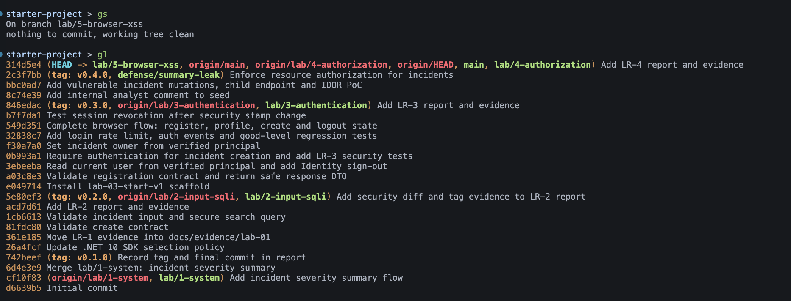 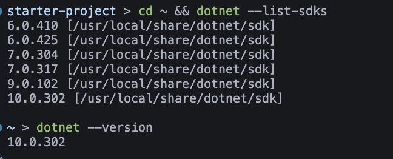                                                                                                                       |
| Installer       | dry run показав 5 файлів, `--write` створив квитанцію: release `lab-05-start-v1`, inherits `v0.4.0`, base_commit `2c3f7bb`, entry_parent `314d5e4`         | 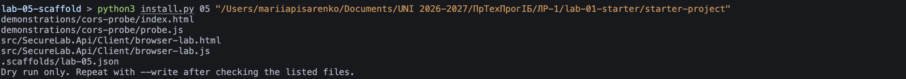 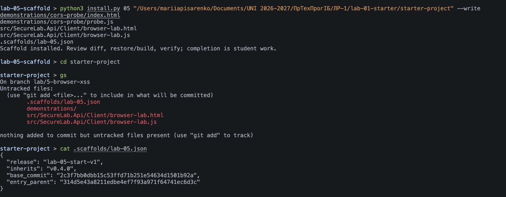                                                                                             |
| Стенд           | PostgreSQL healthy, reset, тести 54/54 як на `v0.4.0`, API на 5080 у Development                                                                           | 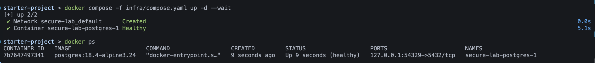 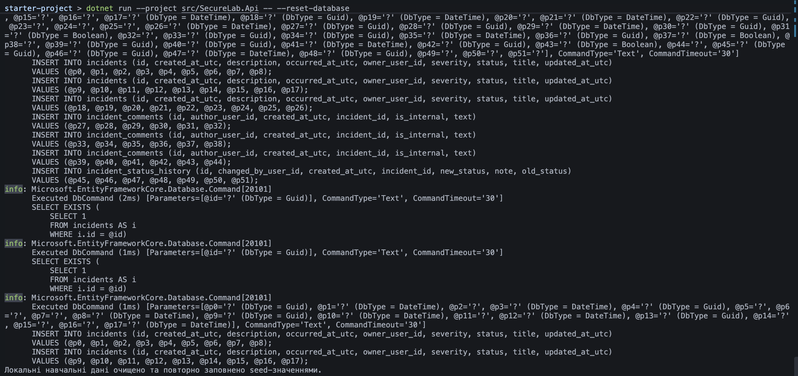 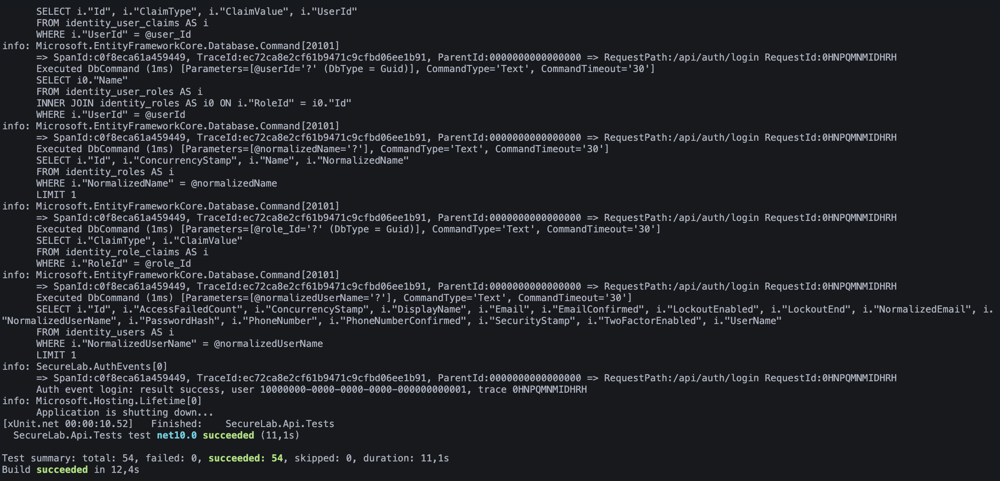 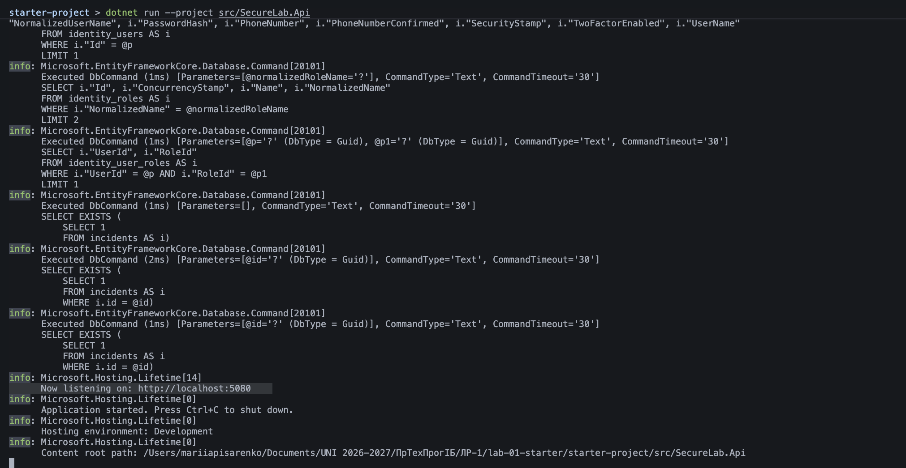 |
| Перший прохід   | вхід Alice 204, `/browser-lab.html` читає seed `20000000-...0001` - GET 200, назва, опис і коментар                                                        | 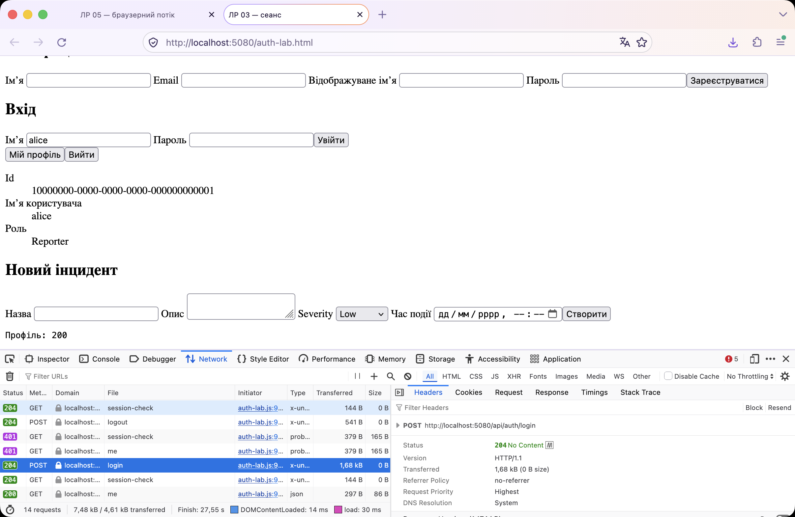 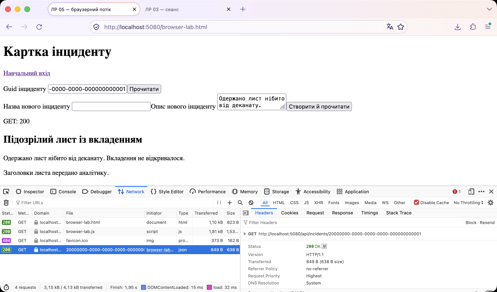                                                                                             |
| Механізм сеансу | cookie `.AspNetCore.Identity.Application`, Domain `localhost`, Path `/`, Session, HttpOnly, SameSite `Lax`, Secure немає (локальний http), Value приховано | 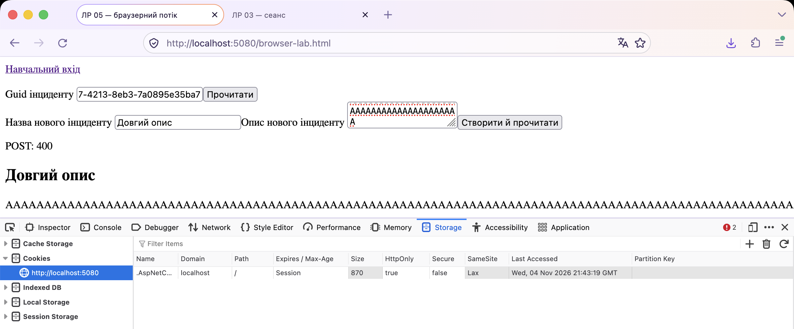 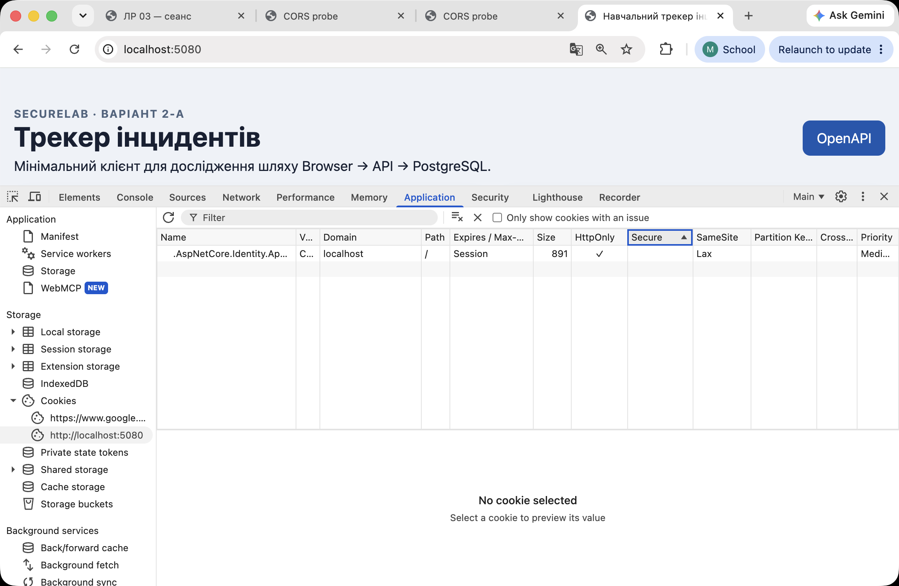                                                                                           |

**Таблиця 2.** Commits гілки `lab/5-browser-xss`

| Commit    | Зміст                                                   | Стан                                                                                |
| --------- | ------------------------------------------------------- | ----------------------------------------------------------------------------------- |
| `523eaf4` | Install lab-05-start-v1 scaffold (vulnerable state)     | **vulnerable**, обидва sinks через `innerHTML`                                      |
| `af95db7` | Add LR-5 marker comment to seed and DOM regression test | seed-коментар `30...0005` і `tests/browser/description-dom.js`, sinks ще небезпечні |
| `cce6f69` | Render description and comments as text via safe helper | **XSS fixed**                                                                       |
| `f386d45` | Add development CORS policy for probe origin 4173       | CORS лише для 4173                                                                  |
| `e330186` | Allow credentials for development probe origin 4173     | cookie-профіль                                                                      |
| `9bd6c5c` | Enforce content security policy for client pages        | **кінцевий fixed state** для `v0.5.0`                                               |

## Карта source-to-sink

Повна карта обох потоків і інвентаризація всіх значень сторінки - `docs/source-to-sink.md`.

**Таблиця 3.** Потік `Incident.Description` (vulnerable `523eaf4`)

| Крок                 | Файл і функція                                                                                        | Поле / значення                                                     | Довіра                                                    | Доказ                                                                           |
| -------------------- | ----------------------------------------------------------------------------------------------------- | ------------------------------------------------------------------- | --------------------------------------------------------- | ------------------------------------------------------------------------------- |
| Source               | `Client/browser-lab.html`, `<textarea name="description">` форми `#edit`                              | текст автора інциденту                                              | контрольоване користувачем                                | 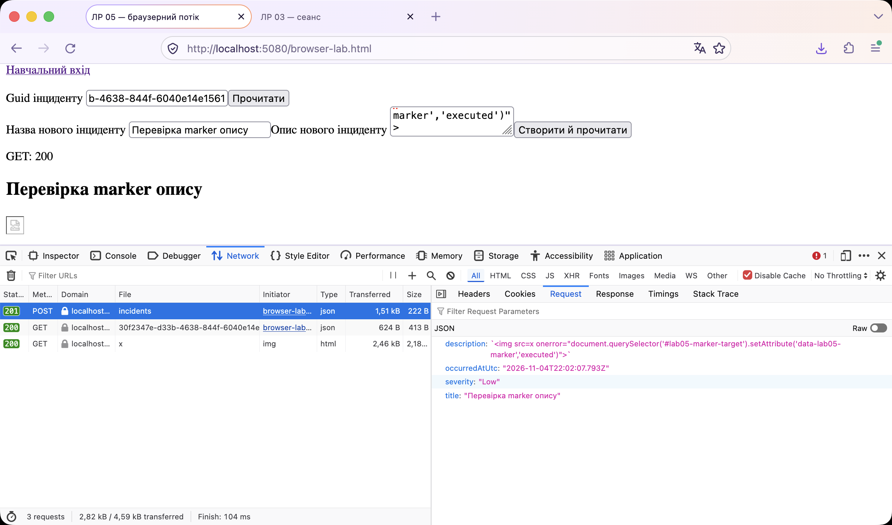       |
| Request              | `browser-lab.js`, обробник `submit`, `fetch("/api/incidents", { method: "POST" })`                    | JSON field `description`                                            | контрольоване користувачем                                |        |
| Validation / mapping | `Scaffolding/Lab02Endpoints.cs`, `MapPost("/api/incidents")`, DTO `CreateIncidentRequest`             | required, до 4000 символів, `Trim()`, для High/Critical не менше 40 | business validation, значення не стає trusted             | 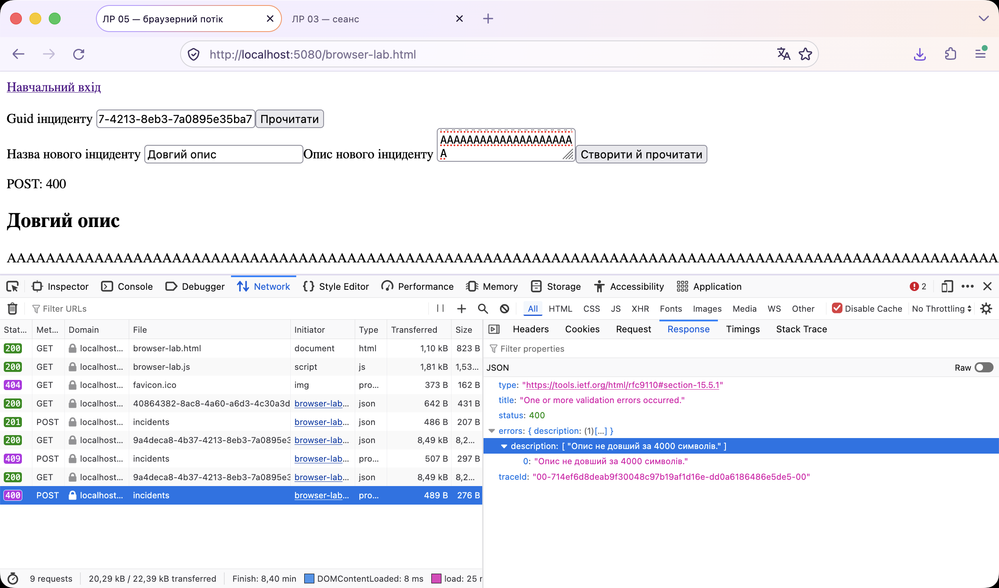                           |
| Storage              | `Incident.Description`, колонка `incidents.description` varchar(4000)                                 | те саме значення                                                    | збережене значення користувача                            | 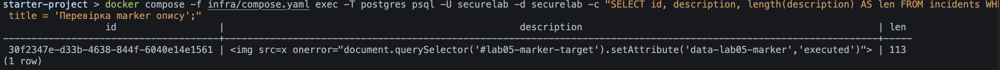                           |
| Response             | `IncidentQueries.GetDetailsAsync` -> `IncidentDetailsResponse.Description`, `GET /api/incidents/{id}` | response field `description`                                        | недовірене для браузера, JSON escape не захищає HTML sink | 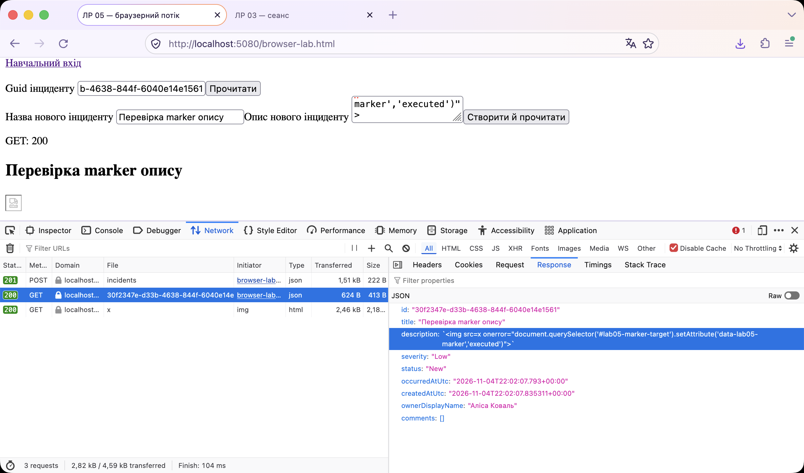     |
| Client transform     | `browser-lab.js`, `load()`, `current = await response.json()`                                         | `current.description` без змін                                      | передається як є                                          |      |
| Sink                 | `load()`, `document.querySelector("#description").innerHTML = current.description`                    | `<div id="description">`                                            | **HTML context**, рядок розбирає HTML parser              | 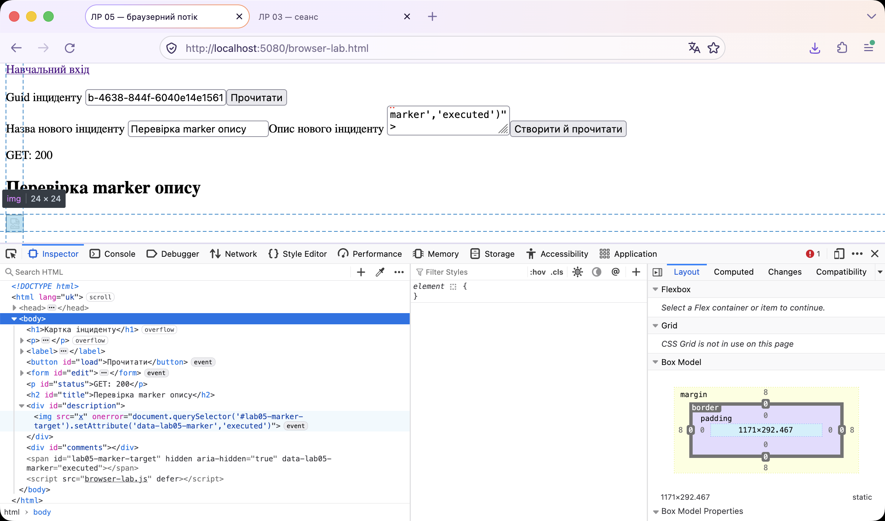 |
| Sink після fix       | `load()`, `renderText(document.querySelector("#description"), current.description)`                   | той самий `<div>`                                                   | text context, один текстовий вузол                        | 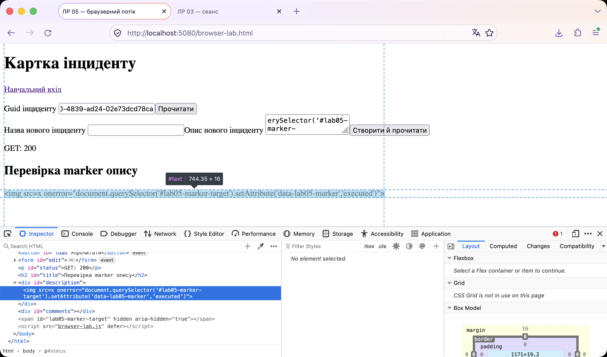   |

Другий потік `IncidentComment.Text`: source - seed `DbSeeder.SeedAsync` (у продукті будь-який автор коментаря), response field `comments[].text`, client transform - цикл `for (const comment of current.comments ?? [])`, sink - `paragraph.innerHTML = comment.text` у кожному `<p>` контейнера `#comments`.

Інвентаризація інших значень сторінки: `#status` (server-generated, `textContent`), `#title` (збережене значення користувача, `textContent`), поле `textarea.value` (властивість `value` не розбирає HTML), `#incident-id` (Guid від сервера), шлях `fetch` з `encodeURIComponent` і маршрутом `{id:guid}` - усі безпечні. Небезпечні лише два `innerHTML`. Штатний клієнт `app.js` показує ті самі поля через `createTextElement` і `createTextNode`, тому той самий JSON безпечний чи небезпечний лише залежно від sink.

## Звичайний текст до PoC

Гіпотеза: значення з поля «Опис нового інциденту» зберігається в `incidents.description`, повертається через `description` у `GET /api/incidents/{id}` і передається у `#description.innerHTML` як HTML context, тому текст із розміткою та inline event handler браузер інтерпретує як елементи й код, а не як звичайний текст. Те саме для `comments[].text`.

**Таблиця 4.** Легітимні значення на vulnerable `523eaf4`

| Значення                                                                          | API / БД                                   | DOM на browser-lab                                                                | Доказ                                                                                                                                                     |
| --------------------------------------------------------------------------------- | ------------------------------------------ | --------------------------------------------------------------------------------- | --------------------------------------------------------------------------------------------------------------------------------------------------------- |
| seed `...0001`, звичайні слова                                                    | те саме                                    | той самий текст, вигляд не відрізняє sink                                         | 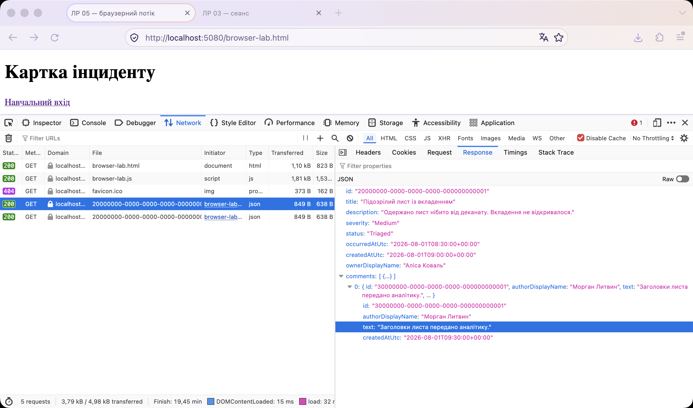                                                                                     |
| seed `...0003`, `Текст <script> має відображатися як текст...`                    | те саме                                    | видно лише «Текст», решта речення всередині створеного й не виконаного `<script>` | 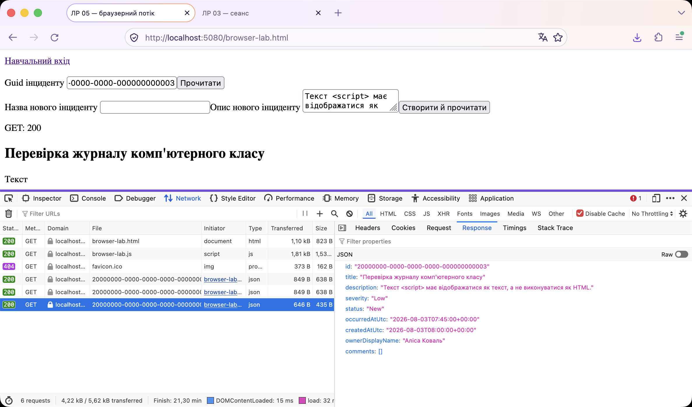 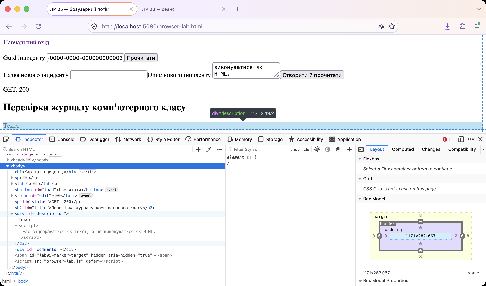         |
| `O'Brien написав "терміново", 5 < 7 і 9 > 3, Київ - Ω ї є ґ, <b>жирний</b> текст` | те саме Unicode-значення, len 90           | лапки, `<`, `>` і Unicode без змін, але `<b>` став елементом                      | 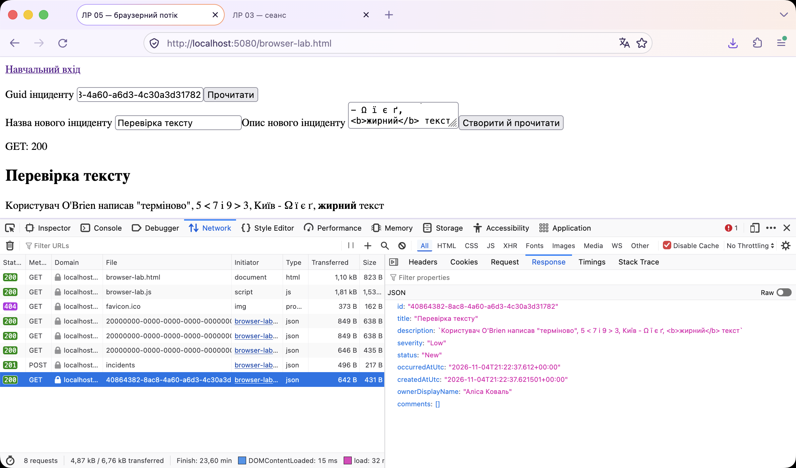 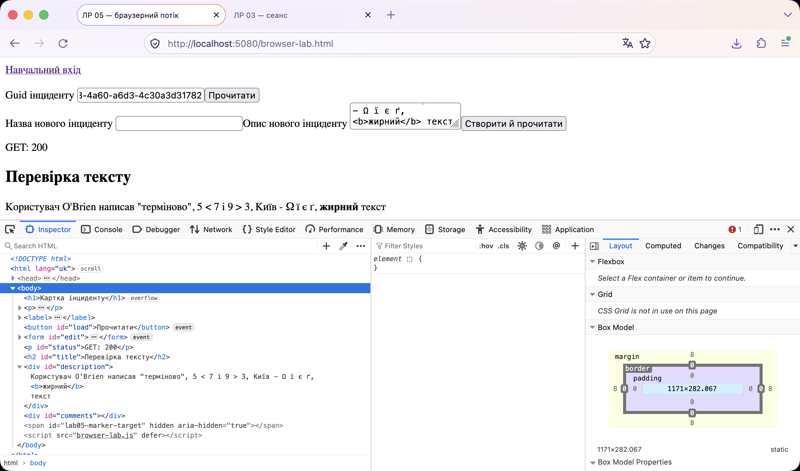 |
| 4000 символів                                                                     | POST 201, GET 200                          | відображено без client error                                                      | 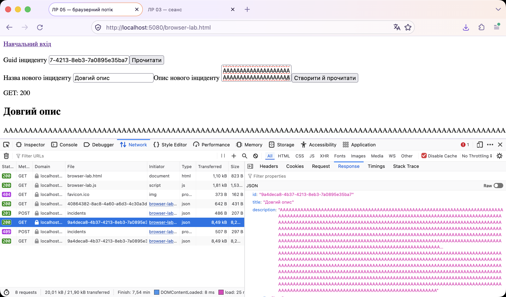                                                                                                     |
| 4001 символ                                                                       | POST 400 «Опис не довший за 4000 символів» | запис не створено                                                                 |                                                                                                      |
| БД до виправлення                                                                 | довжини 61, 64, 69, 70, 70, 90, 4000       | -                                                                                 | 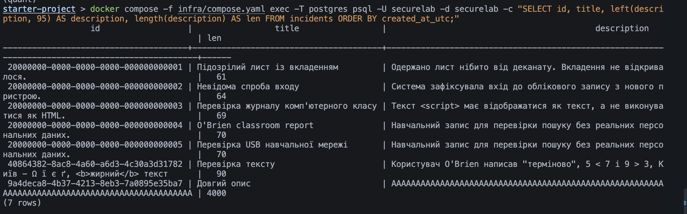                                                                                                     |

Звичайні слова, лапки й Unicode не розрізняють безпечне й небезпечне відображення. Різницю показують лише рядки, схожі на теги. Власна валідація ЛР-2 не відкидає `<` і `>`, тому окреме виправлення надмірного правила не знадобилось.

## Вразливий стан і PoC

Marker - єдиний рядок `resources/lab05-marker.txt`, скопійований без кінцевого переносу командою `tr -d '\n' < lab05-marker.txt | pbcopy`. Команда перевірки в Console: `document.querySelector("#lab05-marker-target").getAttribute("data-lab05-marker")` - до досліду `null`, після виконання `"executed"`.

**Таблиця 5.** Stored XSS на vulnerable `523eaf4`

| №   | Вікно                            | Дія                                                    | Фактично                                                                                                                  | Доказ                                                                                                                                                                                                                     |
| --- | -------------------------------- | ------------------------------------------------------ | ------------------------------------------------------------------------------------------------------------------------- | ------------------------------------------------------------------------------------------------------------------------------------------------------------------------------------------------------------------------- |
| 1   | Alice                            | перевірка до досліду                                   | `null`                                                                                                                    | 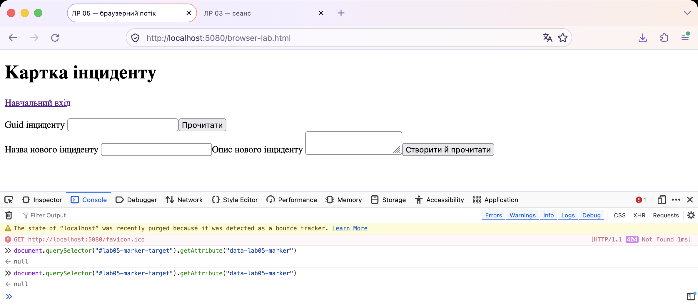                                                                                                                                                       |
| 2   | Alice                            | створити «Перевірка marker опису» з marker в описі     | POST 201, у payload `description` = marker                                                                                |                                                                                                                                                  |
| 3   | Alice                            | render запису `30f2347e-...`                           | GET 200, у `#description` створено ``, браузер надіслав запит `x`, значок зламаного зображення |                                                                 |
| 4   | Alice                            | перевірка після                                        | `"executed"`, на span з'явився `data-lab05-marker="executed"`                                                             | 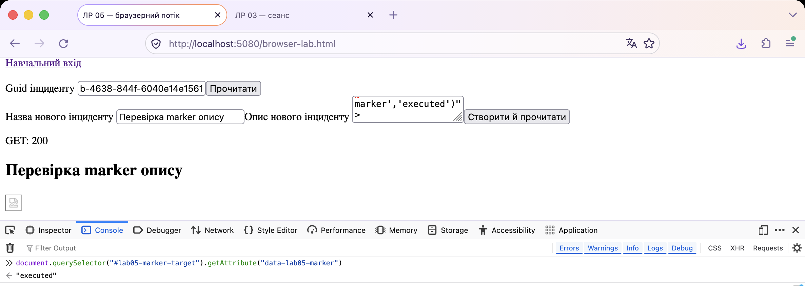                                                                                                                                               |
| 5   | Morgan (Analyst), приватне вікно | вхід, перевірка, «Прочитати» той самий Guid            | `null`, потім GET 200 і `"executed"` - код, збережений Alice, виконався в сеансі Analyst                                  | 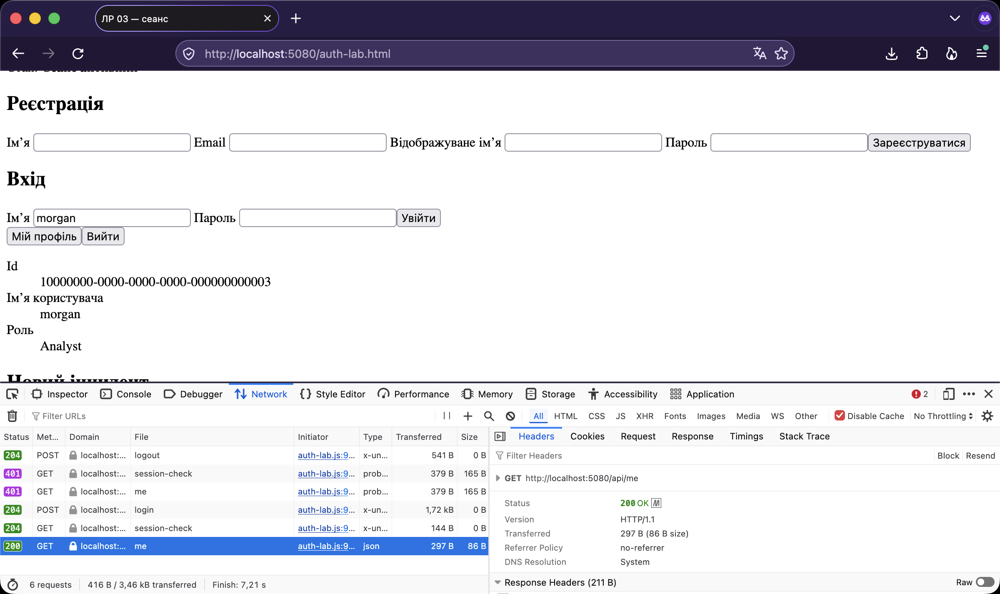 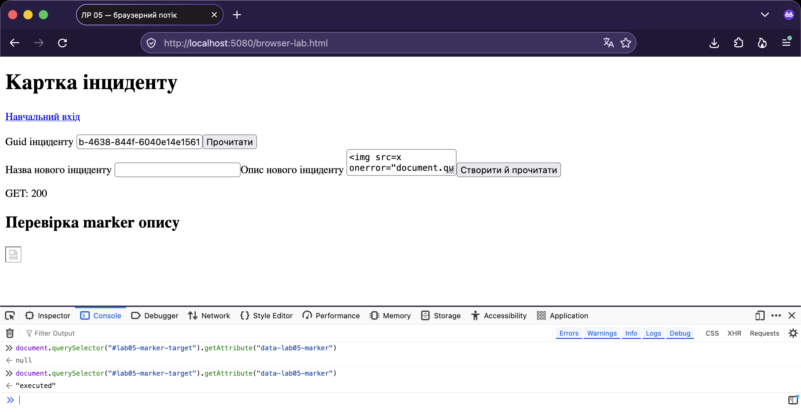                                                                                             |
| 6   | Bob (Reporter), контроль         | той самий Guid                                         | GET 404 за матрицею ЛР-4, DOM запису не будується, `null`                                                                 | 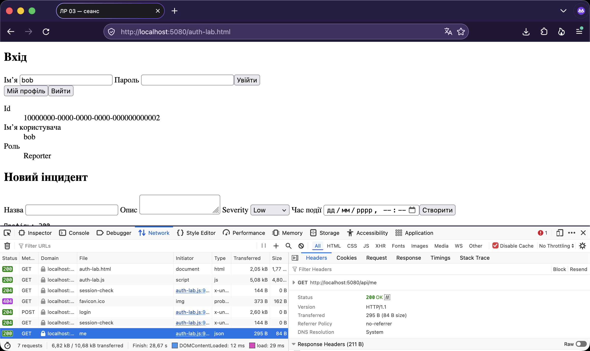 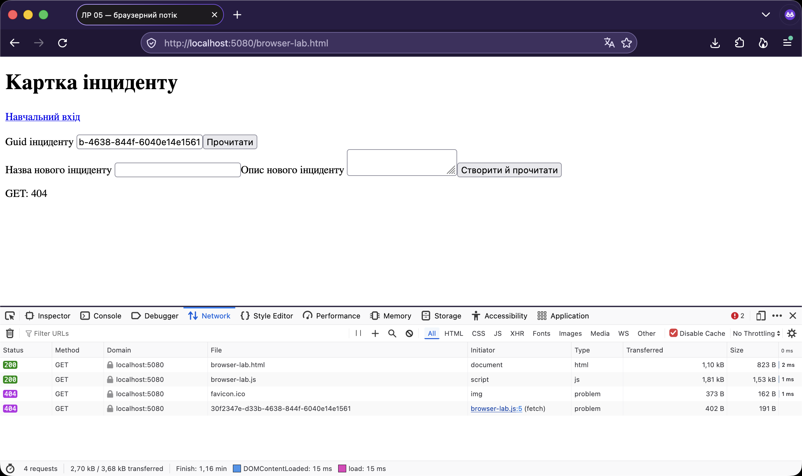                                                                                                             |
| 7   | БД                               | значення                                               | `description` дорівнює marker, len 113                                                                                    |                                                                                                                                                                      |
| 8   | Alice, після seed `af95db7`      | коментар `30...0005` у `...0001`                       | у `#comments` другим `<p>` створено ``, `"executed"`, тести 54/54                                            | 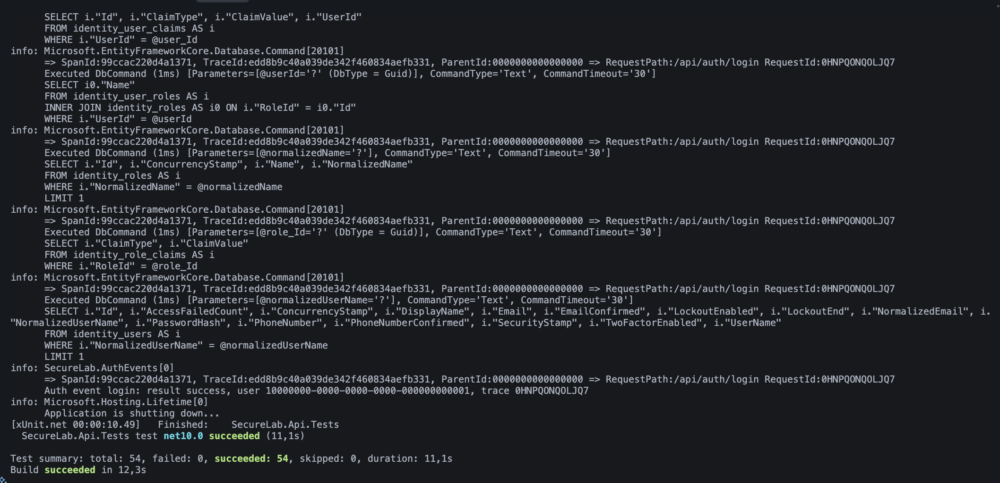 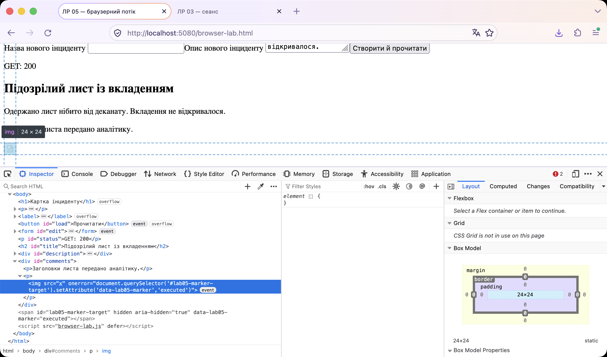 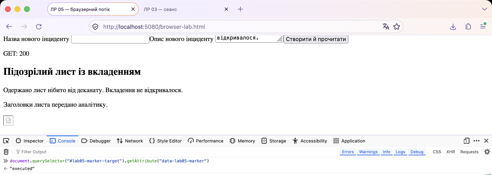 |
| 9   | Alice                            | запис відтворено після reset, `61808765-...`, DOM-тест | `FAIL: 8 of 11 checks`                                                                                                    | 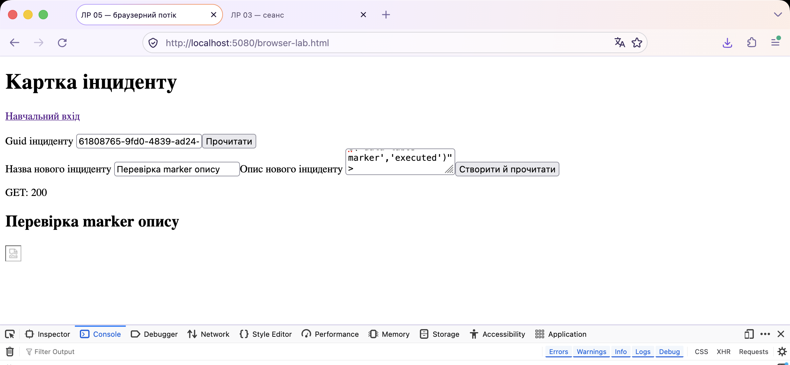 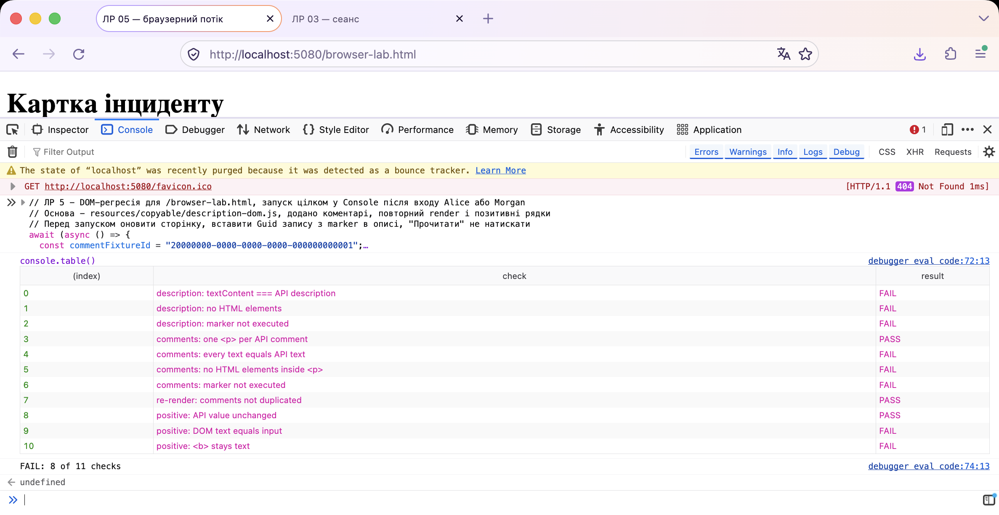                                                                                         |

Класифікація: stored XSS, бо значення зберігається в PostgreSQL і виконується під час пізнішого перегляду іншим користувачем, з DOM-based останнім кроком, бо небезпечне перетворення виконує клієнтський `innerHTML` у `browser-lab.js`. Reflected XSS у спільному scope немає - значення не повертається одразу з того самого request.

## Основний finding і залишковий ризик

| Частина          | Зміст                                                                                                                                                   |
| ---------------- | ------------------------------------------------------------------------------------------------------------------------------------------------------- |
| Актив            | browser session Morgan (Analyst) і Alice та дані, доступні від їхнього імені                                                                            |
| Передумови       | локальний тестовий обліковий запис Reporter, контроль над полем опису або текстом коментаря                                                             |
| Першопричина     | `browser-lab.js`, функція `load()`, передавала збережений текст користувача (`current.description`, `comment.text`) у `innerHTML`, тобто в HTML context |
| Вплив на стенді  | marker виконав лише безпечну дію над `#lab05-marker-target` у сеансі Alice і Morgan                                                                     |
| Виправлення      | safe DOM rendering - єдиний helper `renderText(element, text)` з `element.textContent = text` для обох полів, без фільтрів payload і без sanitizer      |
| Retest           | той самий marker на тому самому записі показано як текст, атрибута немає, запиту `x` немає, DOM-тест PASS 11 з 11                                       |
| Залишковий ризик | інші майбутні sinks у клієнті, сторонній UI Scalar з винятком із CSP у Development, CSRF для cookie mutation до ЛР-6                                    |

## Виправлення і retest

```js
// ЛР 5 - єдиний safe helper для опису й коментарів, значення з API стає лише текстовим вузлом
function renderText(element, text) {
  element.textContent = text;
  return element;
}
...
renderText(document.querySelector("#description"), current.description);
...
const paragraph = document.createElement("p");
renderText(paragraph, comment.text);
```

Структуру (`<p>`) задає код через `createElement`, дані потрапляють лише в текстовий вузол. Контейнер коментарів очищує `replaceChildren()`, тому повторний render не дублює вузли. Значення на вході й у БД не змінюються.

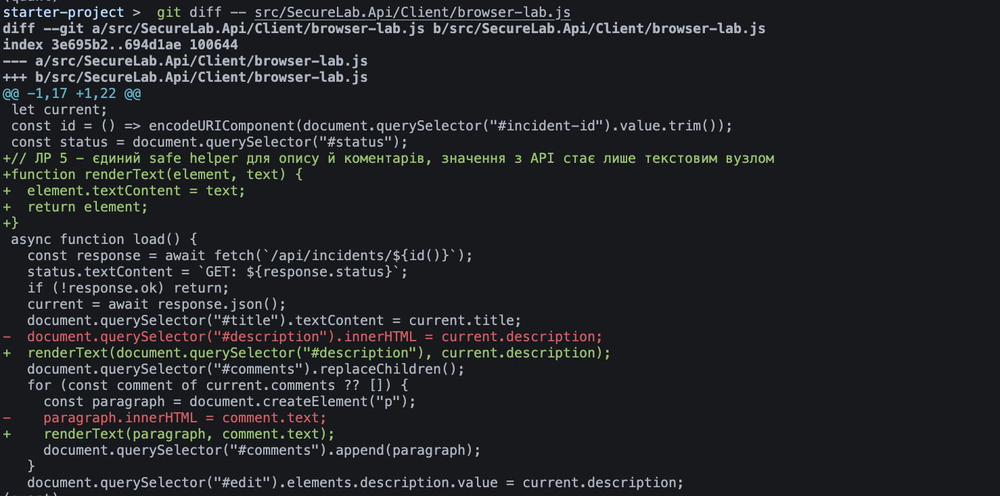

**Рисунок 1.** Safe DOM diff `cce6f69`

**Таблиця 6.** Ті самі перевірки до і після виправлення

| Перевірка            | До fix (`523eaf4`, `af95db7`)                                                                                          | Після fix (`cce6f69`)                                                                                                                                                                                                                                                                                  |
| -------------------- | ---------------------------------------------------------------------------------------------------------------------- | ------------------------------------------------------------------------------------------------------------------------------------------------------------------------------------------------------------------------------------------------------------------------------------------------------ |
| БД, запис з marker   | len 113                                                           | те саме значення, len 113 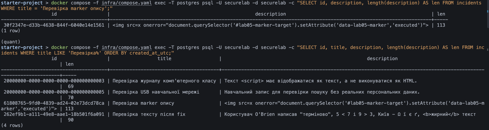                                                                                                                                                                                                                          |
| API `description`    | marker                                      | той самий marker 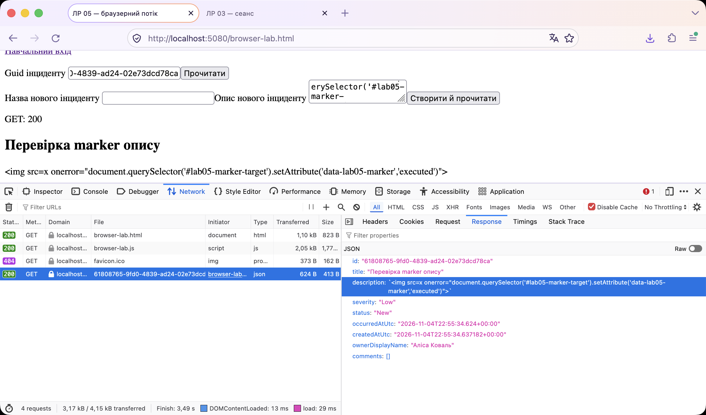                                                                                                                                                                                                           |
| DOM `#description`   | елемент ``                 | один `#text`, marker видно символ у символ                                                                                                                                                                                |
| Запит `x`            | є                                           | немає 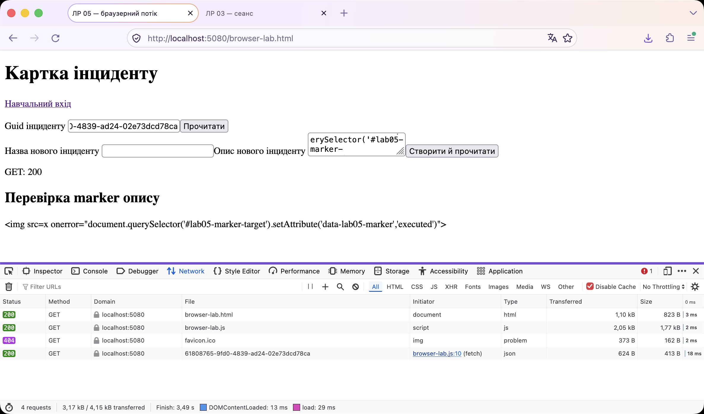                                                                                                                                                                                                                        |
| Перевірка, Alice     | `"executed"`                                | `null` 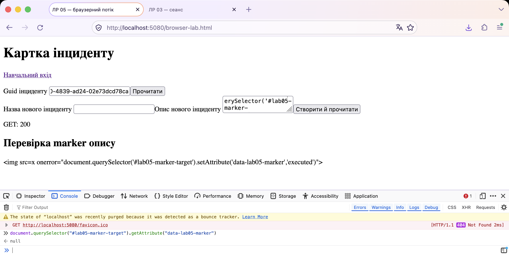                                                                                                                                                                                                                       |
| Перевірка, Morgan    | `"executed"`                                          | `null`, marker як текст 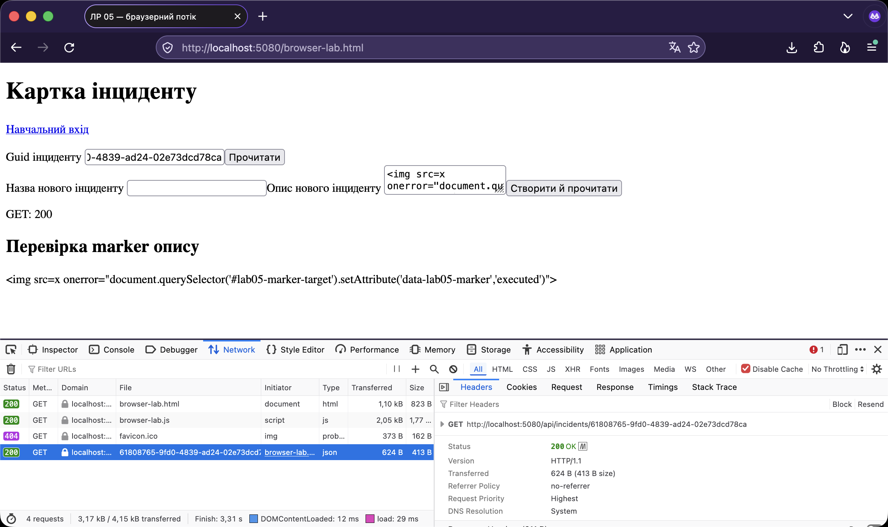 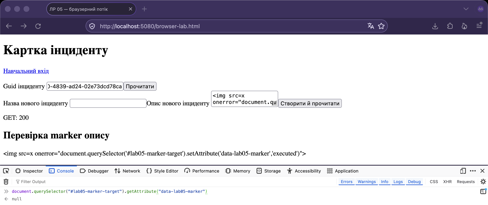                                                                                                                                    |
| Коментар `30...0005` | `<p></p>`, `"executed"`  | `<p>` з текстом, у JSON той самий `text`, `null` 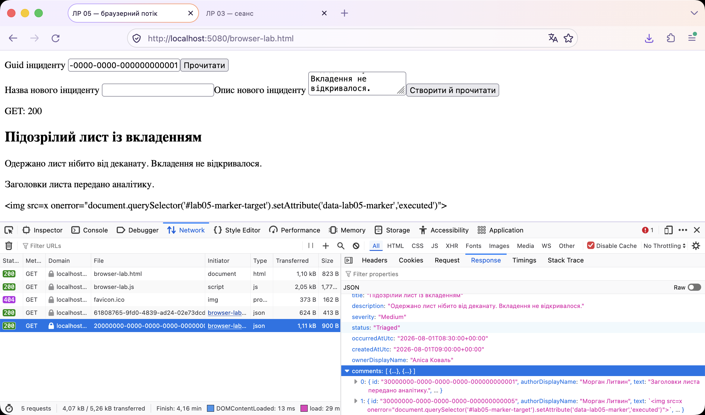 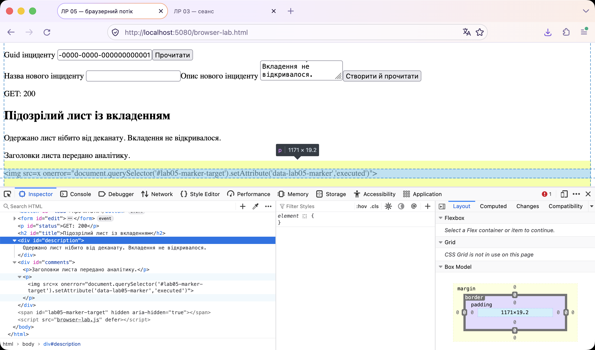 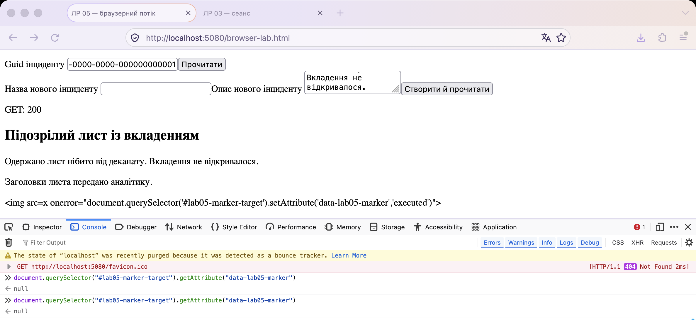 |
| Позитивний рядок     | `<b>` став елементом                      | `<b>жирний</b>` з дужками, текстовий вузол, len 90 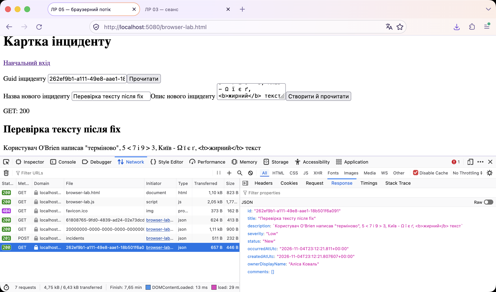 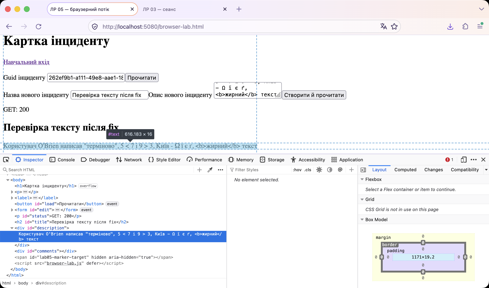                                                                                   |
| 4000 символів        | 201, відображено                                                  | 201, відображено 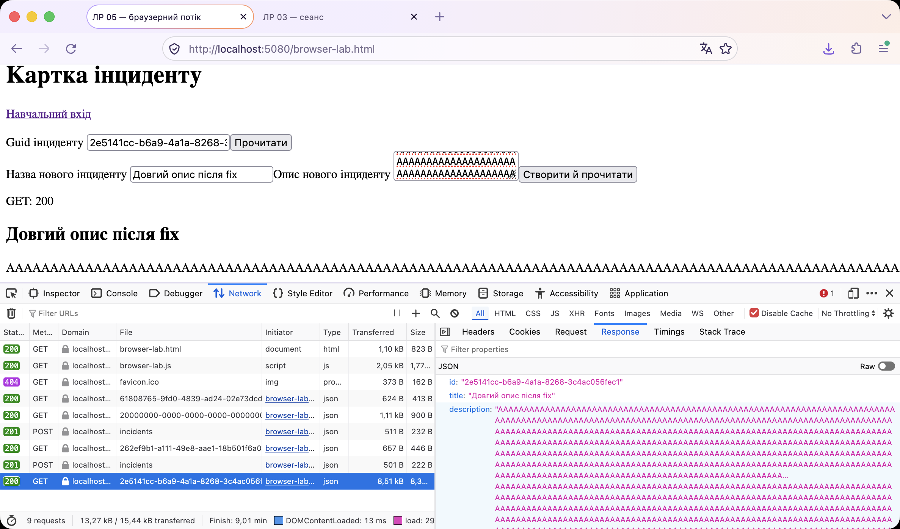                                                                                                                                                                                                                             |
| DOM-тест             | FAIL 8 з 11                                               | PASS 11 з 11 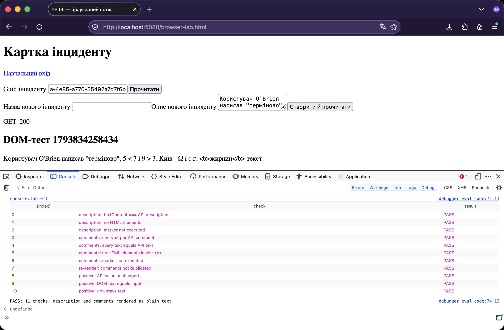                                                                                                                                                                                                                             |

## Добрий рівень: коментар, helper, CORS, cookie, CSP, review

### IncidentComment.Text і helper

Публічний коментар `30000000-0000-0000-0000-000000000005` (автор Morgan, інцидент Alice, `IsInternal = false`, текст - константа `Lab05Marker`) додано останнім аргументом `IncidentComments.AddRange` у `DbSeeder.SeedAsync`, наявні initializer не змінено. Тести ЛР-4 не мають точного лічильника коментарів, тому жодне assertion не змінювалось (54/54). Обидва поля відображає один helper `renderText`, докази в таблиці 6.

### CORS

LibreWolf 157 читав відповіді API зі сторінок 4173 і 4174 без `Access-Control-Allow-Origin` і не надсилав preflight, хоча curl підтверджував відсутність CORS headers на сервері, а перевірка в Chromium дала очікуваний `TypeError`. Тому CORS-дослід виконано в Google Chrome 152, а кадри LibreWolf до доказів не включено.

Probes: `python3 -m http.server 4173 --bind localhost --directory demonstrations/cors-probe` і та сама команда з `4174` в окремих терміналах.

Policy в `Program.cs`, лише в Development:

```csharp
// ЛР 5 - навчальна CORS policy лише в Development, точний origin probe 4173, 4174 - контроль
if (builder.Environment.IsDevelopment())
{
    builder.Services.AddCors(options =>
    {
        options.AddPolicy("Lab05BrowserProbe", policy =>
        {
            policy.WithOrigins("http://localhost:4173")
                .WithMethods("GET")
                .WithHeaders("X-Lab-Cors-Probe")
                // Cookie-дослід - лише разом із точним origin, без wildcard
                .AllowCredentials();
        });
    });
}
...
// ЛР 5 - CORS після routing і до authentication, щоб дозвіл був і на 401/403
app.UseRouting();
if (app.Environment.IsDevelopment())
{
    app.UseCors("Lab05BrowserProbe");
}
app.UseAuthentication();
app.UseAuthorization();
```

**Таблиця 7.** Прогноз до зміни policy

| Сценарій         | Чи доходить request до API                         | Чи може JS прочитати response | Чому                               |
| ---------------- | -------------------------------------------------- | ----------------------------- | ---------------------------------- |
| same-origin 5080 | так                                                | так                           | той самий origin, CORS не потрібен |
| simple GET 4173  | так                                                | ні до policy, так після       | SOP браузера                       |
| simple GET 4174  | так                                                | ні                            | 4174 не в allowlist                |
| preflighted 4173 | спершу лише OPTIONS, GET після успішного preflight | ні до policy, так після       | `X-Lab-Cors-Probe` не safelisted   |
| preflighted 4174 | лише OPTIONS                                       | ні                            | preflight відхилено                |
| curl             | так                                                | не застосовується             | curl не виконує SOP                |

Прогноз підтвердився повністю.

**Таблиця 8.** CORS до policy і в fixed state

| Клієнт / запит     | До policy (`cce6f69`)                                                                                                                                                                                                                                                                                       | Fixed state (`f386d45` і далі)                                                                                                                                                                                                                                                                                                                                        |
| ------------------ | ----------------------------------------------------------------------------------------------------------------------------------------------------------------------------------------------------------------------------------------------------------------------------------------------------------- | --------------------------------------------------------------------------------------------------------------------------------------------------------------------------------------------------------------------------------------------------------------------------------------------------------------------------------------------------------------------- |
| Probes             |                                                                                                                                                                                                                                              | -                                                                                                                                                                                                                                                                                                                                                                     |
| Same-origin 5080   | 200, без `Access-Control-*`, CORS не потрібен                                                                                                 | без змін                                                                                                                                                                                                                                                                                                                                                              |
| 4173, simple       | `GET ... net::ERR_FAILED 200 (OK)` - запит дійшов, JS отримав `TypeError`    | `{status: 200}`, `Access-Control-Allow-Origin: http://localhost:4173`, `Origin: http://localhost:4173`           |
| 4173, preflight    | preflight відхилено, GET не надіслано                                                                                                                                                                                              | OPTIONS **204** з `Allow-Origin`, `Allow-Methods: GET`, `Allow-Headers: X-Lab-Cors-Probe`, далі GET 200    |
| 4174, simple       | `TypeError`                                                                                                                                               | без змін - API повернув 200 без ACAO, JS отримав `TypeError`                                                     |
| 4174, preflight    | OPTIONS **405**, GET не надіслано                                                                                                                                                                                      | OPTIONS **204 без жодного** `Access-Control-*`, GET не надіслано                                                                                                                        |
| Порядок middleware | -                                                                                                                                                                                                                                                                                                           | з 4173 без cookie `fetch("/api/incidents")` повертає саме число `401`, без CORS-помилки                                                                                                                                                                                                              |
| curl / direct HTTP | -                                                                                                                                                                                                                                                                                                           | Origin 4173 - 200 з ACAO, Origin 4174 - 200 без `Access-Control-*`, обидва запити виконано                                                                                                                                                                                                                     |

Статус preflight (204) однаковий для дозволеного й недозволеного origin, рішення визначають лише заголовки. `Sec-Fetch-Site: same-site` у запитах з 4173 і 4174 показує, що різні порти localhost - різні origins, але той самий site.

**Таблиця 9.** Cookie-дослід

| Сценарій                                    | Результат                                                                                               | Доказ                                                                                                                                                                               |
| ------------------------------------------- | ------------------------------------------------------------------------------------------------------- | ----------------------------------------------------------------------------------------------------------------------------------------------------------------------------------- |
| Вхід Alice у Chrome                         | `/api/me` 200, Reporter                                                                                 |                                                                                                              |
| 4173, кнопка GET (`credentials: "include"`) | 200 і список Alice, `Allow-Origin: http://localhost:4173`, `Allow-Credentials: true`                    |                                 |
| 4174, кнопка GET                            | API виконав запит з cookie і повернув 200 без ACAO, сторінка нічого не отримала                         |                                   |
| 4173 без `AllowCredentials` (тимчасово)     | `The value of the 'Access-Control-Allow-Credentials' header in the response is '' which must be 'true'` |                       |
| Без входу, без `AllowCredentials`           | 401 на сервері, але JS не отримує навіть відмову                                                        |   |
| Без входу, `AllowCredentials` повернуто     | JS прочитав `401: {"title":"Unauthorized"...}` з ACAO і ACAC                                            |                                               |

`credentials: "include"` у fetch і `AllowCredentials()` на сервері працюють лише разом. Cookie з `SameSite=Lax` надсилається з 4173 і 4174 на 5080, бо порт не входить до site. Кінцевий стан - `AllowCredentials()` лише в Development policy для одного origin 4173. `AllowAnyOrigin()` разом із credentials ASP.NET Core відхиляє ще під час запуску, а відбиття будь-якого `Origin` фактично дорівнювало б дозволу всім.

### CSP і browser headers

Клієнт завантажує лише власні `app.js`, `auth-lab.js`, `browser-lab.js`, `styles.css`, системні шрифти і відносні `fetch`, inline-скриптів, inline-стилів і `on*`-атрибутів немає. CSP додано в наявну middleware заголовків, а не другою middleware:

```csharp
// ЛР 5 - CSP за фактичними ресурсами клієнта, усе з власного origin, inline-коду немає
const string csp = "default-src 'self'; script-src 'self'; style-src 'self'; img-src 'self'; "
    + "connect-src 'self'; object-src 'none'; base-uri 'self'; form-action 'self'; frame-ancestors 'none'";
...
    // Development-довідник Scalar має власні inline-ресурси, виняток лише для нього
    var isDevelopmentApiReference = app.Environment.IsDevelopment()
        && context.Request.Path.StartsWithSegments("/scalar");
    if (!isDevelopmentApiReference)
    {
        context.Response.Headers["Content-Security-Policy"] = csp;
    }
```

**Таблиця 10.** Директиви CSP

| Директива                         | Фактична потреба                             | Джерело / причина                                        |
| --------------------------------- | -------------------------------------------- | -------------------------------------------------------- |
| default-src                       | fallback для неявних типів                   | `'self'`                                                 |
| script-src                        | три власні JS-файли                          | `'self'`, без `unsafe-inline`                            |
| style-src                         | `styles.css`                                 | `'self'`                                                 |
| connect-src                       | відносні `/api/...` і `/health`              | `'self'`, probes не додано, бо це тимчасовий стенд       |
| img-src                           | зображень з даних немає                      | `'self'`                                                 |
| object-src, base-uri, form-action | плагінів і `<base>` немає, форми обробляє JS | `'none'`, `'self'`, `'self'`                             |
| frame-ancestors                   | вбудовування не потрібне                     | `'none'`, вказано явно, бо fallback до default-src немає |

**Таблиця 11.** Report-only, потім enforcement

| Перевірка                                         | Report-only                                                                                                                                                                                        | Enforcement (`9bd6c5c`)                                                                                                                                                                                                                                                                                       |
| ------------------------------------------------- | -------------------------------------------------------------------------------------------------------------------------------------------------------------------------------------------------- | ------------------------------------------------------------------------------------------------------------------------------------------------------------------------------------------------------------------------------------------------------------------------------------------------------------- |
| Header                                            | `Content-Security-Policy-Report-Only`, документ 200                      | `Content-Security-Policy`, один header                                                                                                                                                                                                     |
| Легітимний flow                                   | `browser-lab.html` читає запис, порушень немає   | `/` список, `/auth-lab.html` профіль, `/browser-lab.html` запис - усе 200    |
| `new Image().src = "http://localhost:4173/x.png"` | `The policy is report-only, so the violation has been logged but no further action has been taken.`                             | `The action has been blocked.`, запит без відповіді                                                                 |
| CSP не замінює fix                                | -                                                                                                                                                                                                  | проба `example-03.js`: inline handler заблоковано, але `innerHTML: undefined 1` - `` створено, `textContent: undefined 0`                                                                                                                 |
| Виняток Scalar                                    | -                                                                                                                                                                                                  | `/scalar/v1` без CSP, `nosniff` і `no-referrer` є                                                                                                                                                                                          |

**Таблиця 12.** Headers і обґрунтування policy

| Header                 | Значення                 | Ризик, який зменшує                                                                                                                                        | Чого не замінює                               |
| ---------------------- | ------------------------ | ---------------------------------------------------------------------------------------------------------------------------------------------------------- | --------------------------------------------- |
| X-Content-Type-Options | `nosniff` (baseline)     | браузер не «вгадує» тип, JSON чи текст не стане скриптом                                                                                                   | правильний server `Content-Type` і validation |
| Referrer-Policy        | `no-referrer` (baseline) | адреса сторінки не передається в переходах і запитах. Клієнт не потребує referrer, посилання на Scalar має `rel="noreferrer"`, тому залишено `no-referrer` | заборону зберігати секрети в URL              |
| frame-ancestors        | `'none'` у CSP           | сторінку не можна вбудувати в чужий `<iframe>`, clickjacking неможливий                                                                                    | authorization і XSS fix                       |

`X-Frame-Options` не додано, бо сучасні браузери застосовують `frame-ancestors`, і два механізми довелося б узгоджувати. Докази значень - рис. у таблиці 11 (90, 91).

### Review: XSS, CORS, CSRF і authorization на власному flow

- XSS - браузер виконав збережений текст як код через `innerHTML`. Захист у місці відображення: `textContent`. Ні авторизація, ні CORS цього не зупиняють - Morgan мав право читати запис, і саме тому marker виконався в його сеансі.
- CORS - вирішує лише, чи віддасть браузер cross-origin response коду сторінки. Запит з 4174 з cookie дійшов до API й виконався (таблиця 9), а curl читає відповідь узагалі без CORS. CORS не автентифікує, не перевіряє власника і не обмежує direct client.
- CSRF - сторінка з іншого origin може змусити браузер надіслати запит з cookie (simple request з 4174 дійшов до API). Для state-changing endpoint-ів потрібен окремий antiforgery-контроль, CORS його не замінює. Це навчальний борг до ЛР-6.
- Authorization - рішення сервера за principal + дія + ресурс з ЛР-4. Без входу API повертає 401 і з дозволеного origin (рис. 64, 83), Bob отримує 404 на чужий запис (рис. 28) незалежно від CORS і CSP.

## Відмінний рівень

- **DOM-тест** `tests/browser/description-dom.js` (основа - `resources/copyable/description-dom.js`) запускається цілком у Console на `/browser-lab.html` і перевіряє реальний DOM: опис (textContent дорівнює API, немає HTML-елементів, marker не виконався), кожен `comments[].text`, повторний render без дублювання і позитивний рядок, який тест сам створює з унікальною назвою. Результати: vulnerable `af95db7` - `FAIL: 8 of 11 checks` (LibreWolf, рис. 34), fixed `cce6f69` - `PASS: 11 checks` (LibreWolf, рис. 47), кінцевий `9bd6c5c` під enforcement CSP - `PASS: 11 checks` (Chrome, рис. 104). Тест падає на unsafe sink незалежно від CSP, бо перевіряє відсутність елементів, а не лише виконання marker.
- **CSP report-only, потім enforcement** - таблиця 11, обидва режими на тому самому керованому порушенні.
- **Коментарі й повторний render** - перевірки 3-7 DOM-тесту і таблиця 6. `replaceChildren()` очищує контейнер, кількість `<p>` дорівнює кількості коментарів і після другого render.
- **Контекст URL і атрибута** - `resources/copyable/safe-url.js`, рис. 49.

**Таблиця 13.** `safe-url.js`

| Вхід                             | Результат                           | Висновок                                                            |
| -------------------------------- | ----------------------------------- | ------------------------------------------------------------------- |
| `https://example.com/a`          | `https://example.com/a`             | дозволена схема                                                     |
| `/incidents/1`                   | `http://localhost:5080/incidents/1` | відносний шлях від base                                             |
| `javascript:alert(1)`            | `null`                              | небезпечну схему відхилено                                          |
| `JaVaScRiPt:alert(1)`            | `null`                              | регістр і пробіл не обходять перевірку, бо рядок розбирає `new URL` |
| `http://[bad`                    | `null`                              | некоректний URL                                                     |
| `anchor.getAttribute("href")`    | `http://localhost:5080/incidents/1` | атрибут встановлено лише після перевірки                            |
| `anchor.getAttribute("onclick")` | `null`                              | inline handler з даних не створюється                               |


**Рисунок 2.** Вивід `safe-url.js` у Console

**Різні правила для різних контекстів:**

- текстовий вузол - `textContent` або `createTextNode`, рядок не розбирається взагалі, будь-які `<`, `>` і лапки лишаються символами.
- значення атрибута - лише заздалегідь обраний безпечний атрибут через DOM property або `setAttribute`, ніколи `on*`, `srcdoc`, `style` з даних. `textContent` тут не допомагає.
- URL (`href`, `src`) - розібрати через `new URL`, дозволити лише потрібні схеми (`https:`, `http:`) і, для продукту, allowlist hosts. Без цього `javascript:` у `href` стає кодом навіть без HTML-ін'єкції.
- JavaScript - дані ніколи не стають кодом: без `eval`, `new Function`, рядкових обробників і вставлення в `<script>`. Дані передаються аргументом заздалегідь визначеній функції.

У `browser-lab.js` посилань і атрибутів з даних немає, тому URL і attribute sinks у дослідженому flow відсутні.

**Залишковий ризик third-party scripts.** Основний клієнт не підключає жодного стороннього скрипта, CDN чи аналітики, `script-src 'self'` це закріплює. Єдиний сторонній код - Development-довідник Scalar (`/scalar/v1`, пакет `Scalar.AspNetCore`), який завантажує власні `scalar.js`, шрифти й має inline-ресурси. Для нього зроблено точковий виняток із CSP лише в Development (рис. 97). Ризик: компрометація або вразливість пакета виконується з origin 5080 і має доступ до тих самих cookie-запитів, що й клієнт. Зменшують його лише Development-реєстрація, фіксовані версії в `packages.lock.json` і перевірка залежностей у ЛР-6. У production Scalar не реєструється.

## Підсумкова регресія на кінцевому стані `9bd6c5c`

**Таблиця 14.** REG-XSS-01 і REG-CORS-01

| ID                   | Передумови                                         | Кроки                                                                                      | Очікувано                                                          | Фактично                             | Доказ                                                                                                                                                                                                                           |
| -------------------- | -------------------------------------------------- | ------------------------------------------------------------------------------------------ | ------------------------------------------------------------------ | ------------------------------------ | ------------------------------------------------------------------------------------------------------------------------------------------------------------------------------------------------------------------------------- |
| Стан                 | `9bd6c5c`, reset, пароль seed лише через `read -s` | `dotnet test`                                                                              | 54/54                                                              | 54/54                                |                                                                                                                                                                        |
| REG-XSS-01           | Alice у Chrome, marker з `lab05-marker.txt`        | створити «REG-XSS-01» `146d475c-7a4e-44fc-bc40-bf00b3772772`, прочитати, команда перевірки | marker як текст, `#text`, `null`, CSP на відповіді                 | так                                  |          |
| REG-XSS-01, коментар | seed `30...0005`                                   | прочитати `20000000-...0001`                                                               | коментар з marker як текст                                         | так                                  |                                                                                                                                                              |
| REG-XSS-01, DOM-тест | Guid `146d475c-...` у полі, сторінку оновлено      | `pbcopy < tests/browser/description-dom.js`, вставити в Console                            | PASS 11 з 11                                                       | PASS 11 з 11                         |                                                                                                                                                                |
| Негативний контроль  | vulnerable `523eaf4`                               | ті самі кроки                                                                              | marker виконувався                                                 | `"executed"`, FAIL 8 з 11            |                                                                                         |
| REG-CORS-01, HTTP    | API у Development                                  | `curl -sS -D - -o /dev/null -H "Origin: ..." http://localhost:5080/health` для 4173 і 4174 | 4173 - ACAO і ACAC, 4174 - без `Access-Control-*`, обидва 200      | так, плюс nosniff, no-referrer і CSP |                                                                                                                                                                    |
| REG-CORS-01, browser | probes 4173 і 4174                                 | простий запит / кнопка GET                                                                 | 4173 читає, 4174 `blocked by CORS policy` при `200 (OK)` у Network | так                                  |    |

Виправлено sink, а не дані: значення marker у БД і API однакове до й після fix (len 113, таблиця 6), змінилось лише відображення в DOM.

## Відповіді на контрольні питання

1. **Чому value з БД може лишатися недовіреним?** Сховище не змінює походження. Опис колись ввела Alice, і після запису в PostgreSQL та повернення через API це той самий контрольований нею текст. DTO, JSON і перевірка довжини не перетворюють його на безпечну розмітку.
2. **Source, transformation і sink у моєму flow.** Source - поле «Опис нового інциденту», transformations - POST JSON `description`, `CreateIncidentRequest`, `Trim()`, колонка `description`, `IncidentDetailsResponse.Description`, `response.json()`, sink - `#description.innerHTML` у `load()` (після fix `renderText` з `textContent`).
3. **Stored, reflected і DOM-based XSS.** Stored - значення зберігається і виконується пізніше в іншому перегляді (Alice зберегла, Morgan виконав). Reflected - значення поточного request одразу повертається у відповідь. DOM-based - небезпечне перетворення робить клієнтський JavaScript. Ознаки перетинаються: мій потік stored за походженням і DOM-based за місцем sink.
4. **Чому блокування `<script>` не усуває XSS?** `<script>`, вставлений через `innerHTML`, браузер навіть не виконує, а marker працює через ``. Обробники подій, інші теги, атрибути й схеми URL лишаються, тому фільтр слова захищає лише від одного запису payload.
5. **Коли textContent, а коли sanitizer?** Для звичайного тексту (опис і коментар у 2-A) - `textContent`, бо HTML не потрібен. Sanitizer потрібен лише за явної продуктової вимоги приймати обмежене форматування з allowlist тегів, атрибутів і схем.
6. **Чому sanitizer не пишуть regular expression?** Regex не відтворює правил HTML parser: регістр, кодування, незакриті теги, атрибути без лапок і різні контексти. Потрібна підтримувана бібліотека на кшталт DOMPurify з тестами.
7. **Компоненти origin.** Scheme, host і port. `http://localhost:4173` і `http://localhost:5080` - різні origins через port, але той самий site.
8. **Що в preflight і хто його ініціює?** Браузер сам надсилає OPTIONS з `Origin`, `Access-Control-Request-Method` і `Access-Control-Request-Headers` (у мене `x-lab-cors-probe`, рис. 70). Код сторінки його не пише.
9. **Хто оголошує і хто застосовує CORS?** API оголошує дозволи заголовками `Access-Control-Allow-*`, браузер вирішує, чи віддати відповідь коду сторінки. API запит виконує в будь-якому разі (рис. 66).
10. **Чому curl читає відповідь, коли браузер дає CORS error?** SOP - правило браузера для web content. curl не виконує його й отримує ту саму HTTP-відповідь (рис. 60, 99), але все одно проходить authentication і authorization API.
11. **Чому CORS не є authorization і не замінює CSRF-захист?** CORS не перевіряє principal і власника ресурсу, лише доступ JS до відповіді. Simple request з cookie з 4174 дійшов до API й виконався (рис. 76), тож для змін стану потрібен antiforgery.
12. **Чому wildcard origin не поєднують із credentials?** Тоді будь-який сайт читав би відповіді з cookie користувача. Браузер не віддає credentialed response при `*`, а ASP.NET Core відхиляє таку policy ще на старті.
13. **Межа CSP і чому вона не замінює safe DOM?** CSP обмежує джерела й inline-виконання, але DOM уже змінено: під enforcement `` усе одно створено через `innerHTML` (рис. 96). Інший payload без inline-коду чи послаблена policy знову відкриють sink. Виправлення - саме `textContent`.
14. **Ризик nosniff, Referrer-Policy і frame-ancestors.** nosniff - MIME sniffing, Referrer-Policy - витік адреси сторінки через `Referer`, frame-ancestors - clickjacking через вбудовування в чужий `<iframe>` (таблиця 12).

## Декларація використання ШІ

| Інструмент              | Для чого                                                                                                                                                          | Що використано                                                                                                                                                                       | Що перевірено самостійно                                                                                                                                                                                                           |
| ----------------------- | ----------------------------------------------------------------------------------------------------------------------------------------------------------------- | ------------------------------------------------------------------------------------------------------------------------------------------------------------------------------------ | ---------------------------------------------------------------------------------------------------------------------------------------------------------------------------------------------------------------------------------- |
| Claude Code (Anthropic) | покроковий план за методичкою, пояснення source-to-sink, підказки для safe helper, CORS policy, CSP, розширеного DOM-тесту, обрізання скріншотів і чернетка звіту | код створено за підказками ШІ й перевірено власноруч, рішення про рівень, браузер для CORS-досліду, директиви CSP, виняток Scalar і `no-referrer` прийнято й обґрунтовано самостійно | PoC, retest, CORS, cookie-дослід і CSP виконано вручну в LibreWolf і Chrome DevTools з фотофіксацією, DOM-тест FAIL/PASS і 54 автотести запущено самостійно на відповідних commits, пароль і значення cookie до ШІ не передавались |

## Межі перевірки

- Фактично перевірено все наведене в таблицях на локальному стенді з штучними даними.
- Не перевірялось: cross-site поведінка `SameSite` (два порти localhost - той самий site), CSP і CORS у Production-профілі, стороння бібліотека Scalar окремо від винятку, автоматичний headless-запуск DOM-тесту (тест запускається вручну в реальному браузері).
- LibreWolf 157 не застосовував CORS до запитів probe, причину в налаштуваннях збірки не встановлено, тому CORS-висновки зроблено лише за Chrome.
