# Звіт ЛР-06

## Контекст і межа виконання

- Рівень: відмінний («Відмінно»). Виконано весь достатній і добрий рівень і додатково третю знахідку поза checklist, автоматизований REG-CSRF-01, пріоритизацію, доказ безпечності журналів, CSP без руйнування клієнта і погоджений advanced variant.
- Baseline 2-A, ресурс Incident. Гілка `lab/6-hardening-review` від `main` `220b9b3` (звіт ЛР-5 поверх `v0.5.0` = `9bd6c5c`), тег `v0.5.0` не змінювався.
- Стенд: API і клієнт `http://localhost:5080`, PostgreSQL у Docker на `127.0.0.1:54329`, probes `http://localhost:4173` і `4174` (ЛР 5), сторінка іншого origin `http://localhost:4175` (ЛР 6), лише локальні навчальні дані.
- Клієнти: Google Chrome в окремому вікні з DevTools, curl з cookie jar поза репозиторієм, xUnit test host. Пароль seed і ключі аудиту читались з `~/.securelab-seed` (права 600) і в команди й кадри не потрапляли.
- Advanced variant: tamper-evident журнал security-подій. Redis-сценарій викладач відхилив як типовий, нову тему погоджено 2026-11-11 до реалізації.

Окремі доказові файли: `docs/security-review.md` (підсумковий огляд), `docs/threat-model.md` (модель загроз), `docs/findings/F-01...F-03` (картки знахідок). Звіт містить ті самі докази в стислому вигляді з кадрами.

## Стенд і Git-стан

**Таблиця 1.** Стартова перевірка

| Крок        | Результат                                                                            | Доказ                                                                         |
| ----------- | ------------------------------------------------------------------------------------ | ----------------------------------------------------------------------------- |
| Git і SDK   | гілка `lab/6-hardening-review`, чисте дерево, теги `v0.1.0`...`v0.5.0`, SDK 10.0.302 | 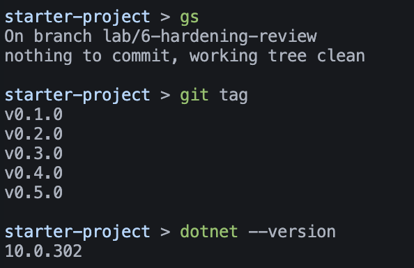   |
| Development | `Now listening on: http://localhost:5080`, `Hosting environment: Development`        | 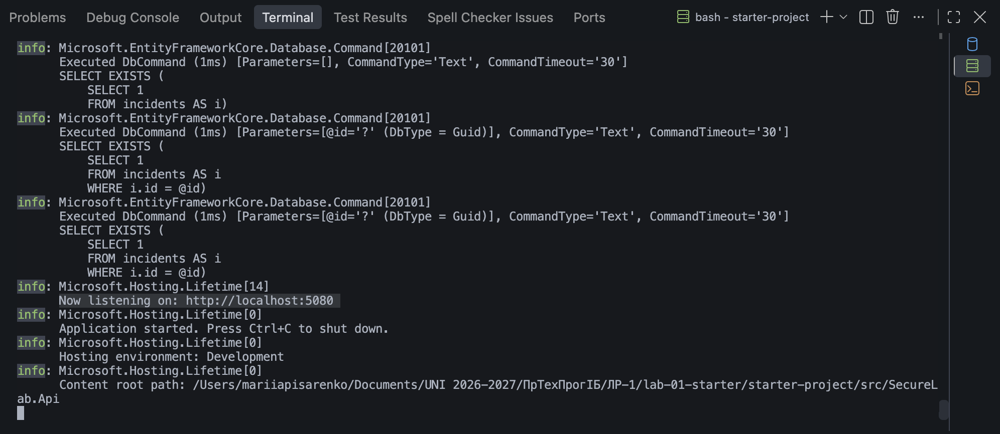 |
| Health      | `GET /health` 200 `{"status":"ready"}`                                               | 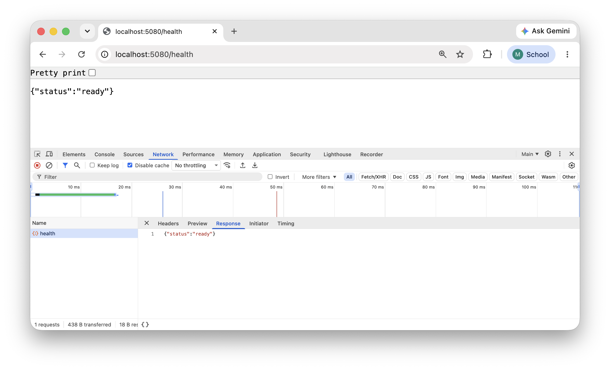               |
| Тести       | після першої зміни ЛР 6 `Passed: 56, Failed: 0`                                      | 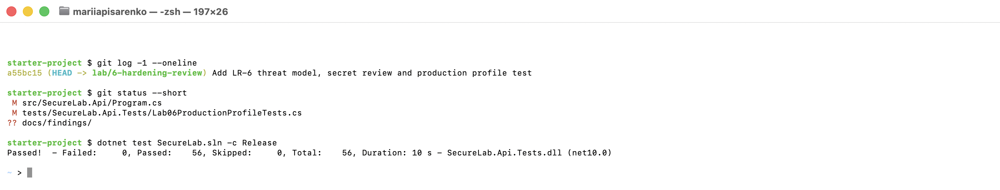       |

**Таблиця 2.** Commits гілки `lab/6-hardening-review`

| Commit                          | Зміст                                                                            |
| ------------------------------- | -------------------------------------------------------------------------------- |
| `a55bc15`                       | модель загроз, огляд секретів, Production-тест                                   |
| `fde58a5`                       | F-01, security headers на відповіді помилки                                      |
| `fc4c7d6`                       | REG-CORS-01                                                                      |
| `27b5674`                       | F-02, antiforgery на всіх змінювальних маршрутах cookie-сеансу                   |
| `1ba23a3`                       | search rate limit на користувача, огляд транспорту                               |
| `aebd7a1`, `995cd60`, `ae19cb2` | залежності, пошук секретів, журнали, regression pack, відновлення DOM-тесту ЛР 5 |
| `c75995d`                       | F-03, 405 і 415 замість 404 у API-fallback                                       |
| `7fdf92f`                       | пріоритизація, asset -> threat -> control -> verification                        |
| `24505ae`, `6f4efdc`            | advanced variant, журнал аудиту з HMAC-ланцюжком і CLI                           |
| `91984d7`                       | документація advanced variant, залишкові ризики                                  |

## Етап 1. Межі огляду, секрети й безпечні помилки

Межі огляду, активи, суб’єкти, entry points і схему меж довіри записано в `docs/threat-model.md`. До меж входять API, клієнт, PostgreSQL, конфігурація, залежності й журнали, виключено production host і TLS, зовнішній pentest, повну історію Git і мініпроєкти методички.

**Таблиця 3.** Секрети й конфігурація

| Перевірка             | Результат                                                                                                                                                                        | Доказ                                                                           |
| --------------------- | -------------------------------------------------------------------------------------------------------------------------------------------------------------------------------- | ------------------------------------------------------------------------------- |
| tracked configuration | 4 файли, `.gitignore` ігнорує `infra/.env` і `appsettings.Local.json`, `.env.example` містить лише порт                                                                          | 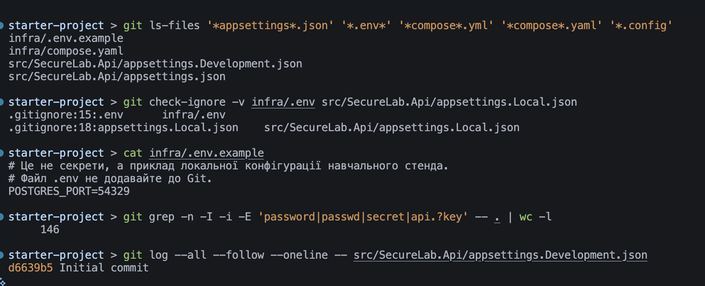 |
| широкий пошук         | 146 збігів на початку огляду, усі класифіковано: назви полів, змінна `SeedUsers__Password`, тести, документація, три study-only входи `local-study-password` для БД на 127.0.0.1 | там само                                                                        |
| історія конфігурації  | один commit `d6639b5`, інших паролів не було                                                                                                                                     | там само                                                                        |

Якби в Git потрапив реальний пароль, видалити його з поточного файла недостатньо. Значення лишається в історії, клонах, форках і кешах, тому credential треба відкликати або змінити в системі, що його видала.

**Таблиця 4.** Production-like профіль і контрольована помилка

| Властивість                | Результат                                                                                                       | Доказ                                                                                                                                                                     |
| -------------------------- | --------------------------------------------------------------------------------------------------------------- | ------------------------------------------------------------------------------------------------------------------------------------------------------------------------- |
| профіль активний           | `Hosting environment: Production` на 5080                                                                       | 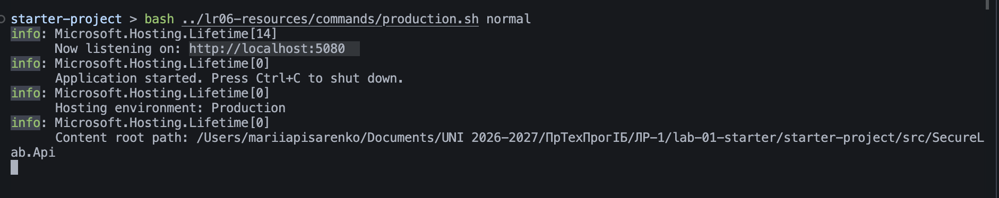                                                                                     |
| OpenAPI і fallback         | `/openapi/v1.json` 404 Problem Details, `/scalar/v1` 200 `text/html` клієнта, тобто fallback, а не документація | 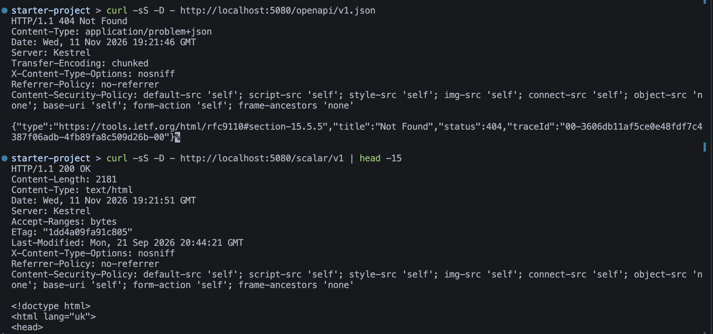                                                                                           |
| reset заборонено           | «Reset даних дозволено лише в явно налаштованому Development environment»                                       | 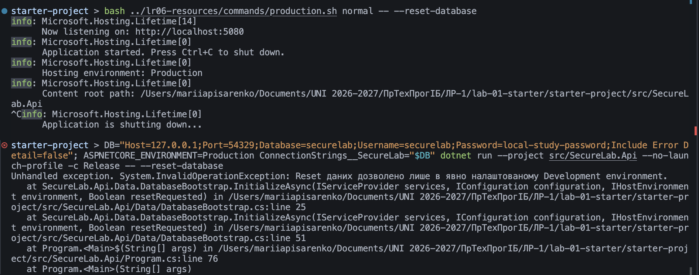                                                                                             |
| очікувані 4xx у Production | тест `Production_ExpectedErrors_StayProblemDetails4xx` пройшов                                                  | 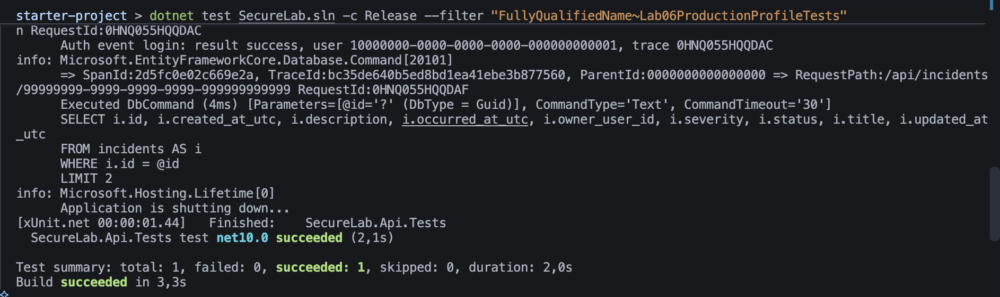                                                                                 |
| безпечна 500               | недосяжна БД 54399, login дає 500 `application/problem+json` з `traceId` без stack trace і connection string    | 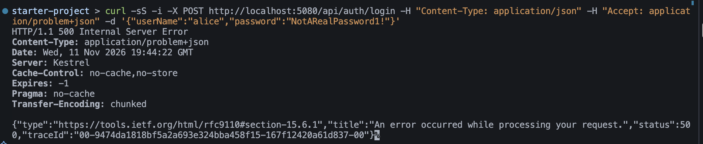                                                                                               |
| зв’язок з журналом         | запис `ExceptionHandlerMiddleware[1]` з тим самим `TraceId` і `RequestPath:/api/auth/login`                     | 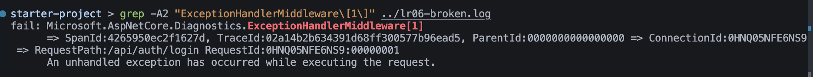                                                                             |
| відновлення                | Development, вхід Alice, `/api/me` 200, список із трьох власних інцидентів                                      | 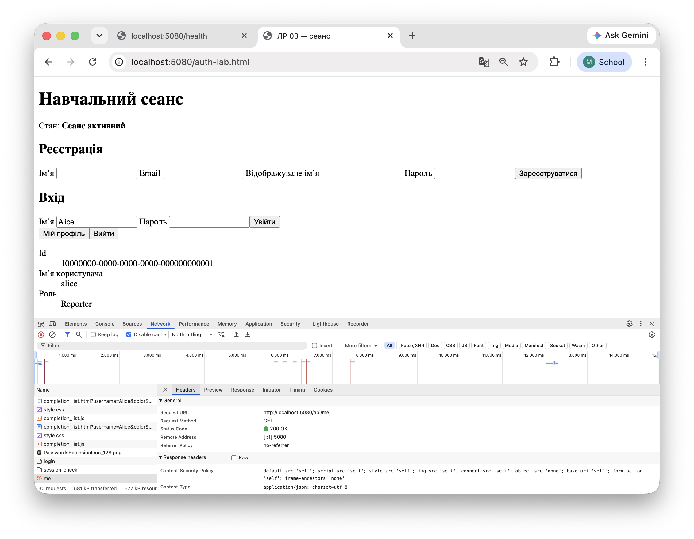 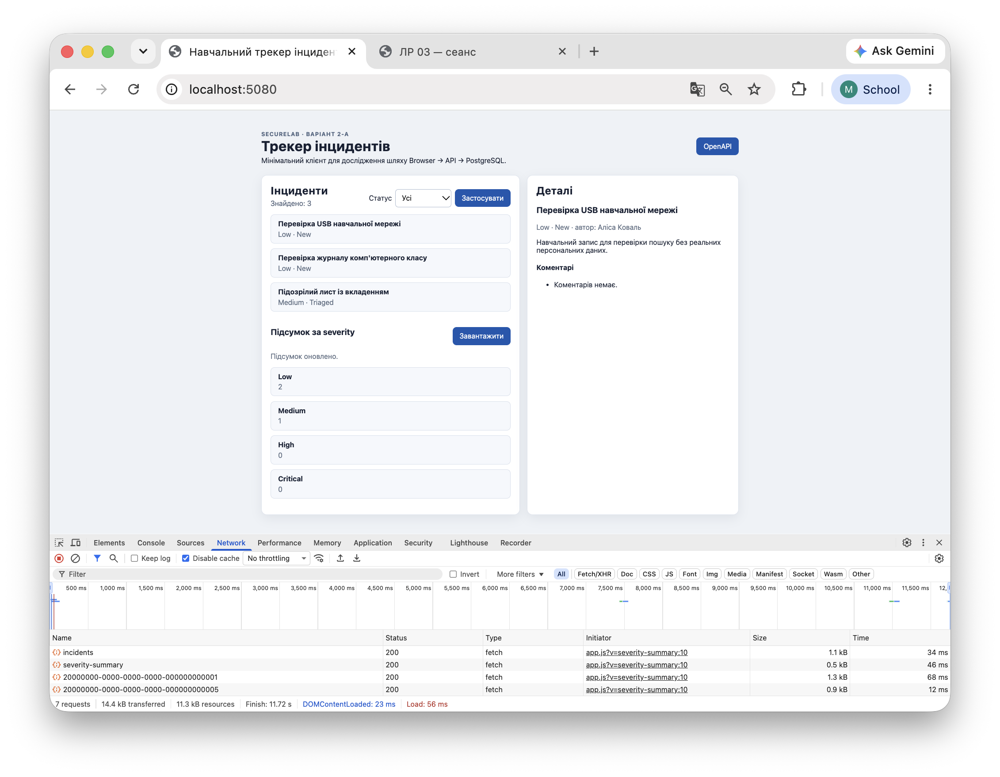 |

Збережена відповідь і запис журналу взяті з двох однакових запусків, тому ідентифікатори на цих кадрах різні. Пару з одного запиту зафіксовано під час retest F-01 (Таблиця 5).

## Етап 2. Захисти браузера, CSRF і rate limiting

### Browser headers і F-01

Відповідь 500 не мала `X-Content-Type-Options`, `Referrer-Policy` і `Content-Security-Policy`, хоча 404 того самого запуску їх мала. Причина: middleware ставив заголовки до `next`, а `UseExceptionHandler` очищує відповідь. Заголовки перенесено в `Response.OnStarting`.

**Таблиця 5.** Заголовки на п’яти класах відповідей

| Клас                             | Результат                                                                                                                     | Доказ                                                                                           |
| -------------------------------- | ----------------------------------------------------------------------------------------------------------------------------- | ----------------------------------------------------------------------------------------------- |
| 500 до виправлення               | лише `Cache-Control`, `Expires`, `Pragma`                                                                                     | 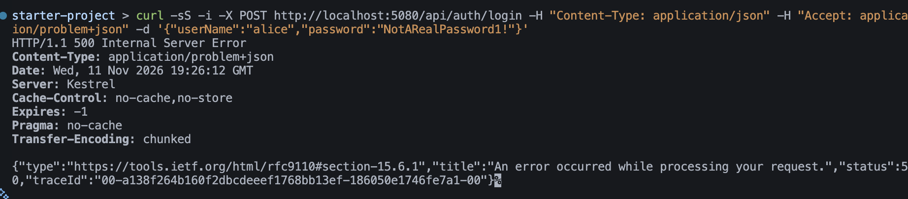       |
| 500 після виправлення            | є `nosniff`, `no-referrer`, CSP з `frame-ancestors 'none'`, `traceId` відповіді дорівнює `TraceId` журналу того самого запиту | 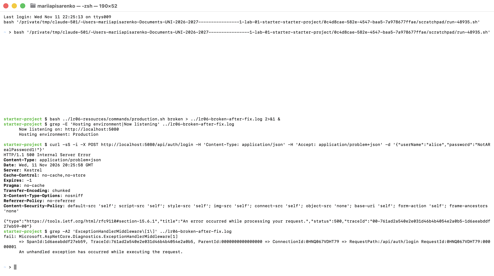   |
| статична сторінка і успішний API | `GET /` 200 `text/html`, details Alice 200 JSON, обидва з трьома заголовками                                                  | 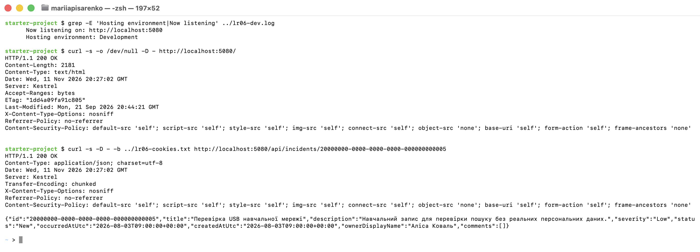 |
| validation і unknown resource    | `?status=Unknown` 400 і неіснуючий id 404 з тими самими заголовками                                                           | 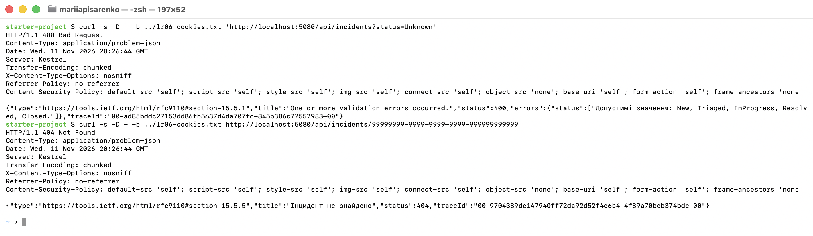               |

CSP з ЛР 5 працює в режимі enforcement і клієнт з нею не зламаний: список, details, створення й severity-summary у Chrome відповідають 200.

### CORS, REG-CORS-01

**Таблиця 6.** CORS у Chrome і прямим HTTP

| Сценарій                 | Результат                                                                                           | Доказ                                                                                                                                                                       |
| ------------------------ | --------------------------------------------------------------------------------------------------- | --------------------------------------------------------------------------------------------------------------------------------------------------------------------------- |
| дозволений origin 4173   | 200 і список Alice, `Access-Control-Allow-Origin: http://localhost:4173`, `Allow-Credentials: true` | 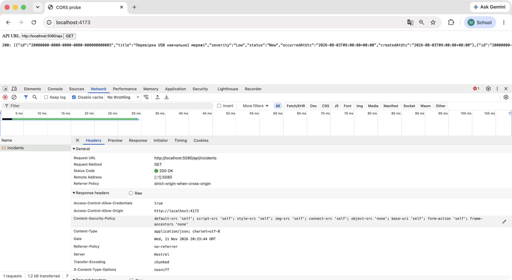                                                                                       |
| недозволений origin 4174 | у Network `CORS error`, сторінка не отримала відповідь                                              | 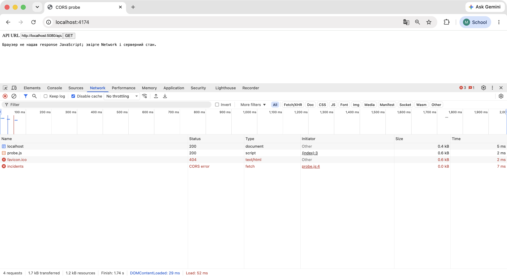                                                                                       |
| той самий запит 4174     | сервер відповів 200 без жодного `Access-Control-*`, тобто запит із cookie виконався                 | 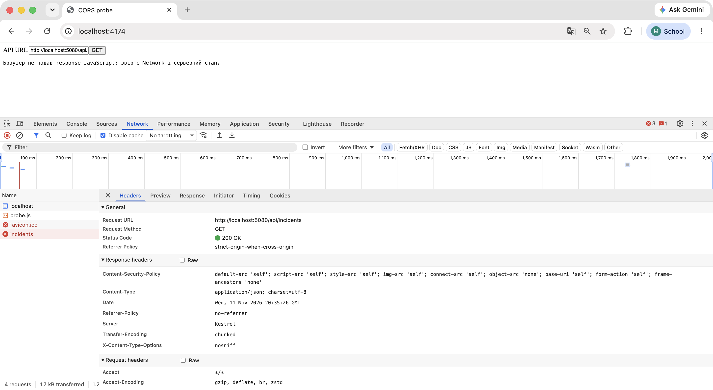 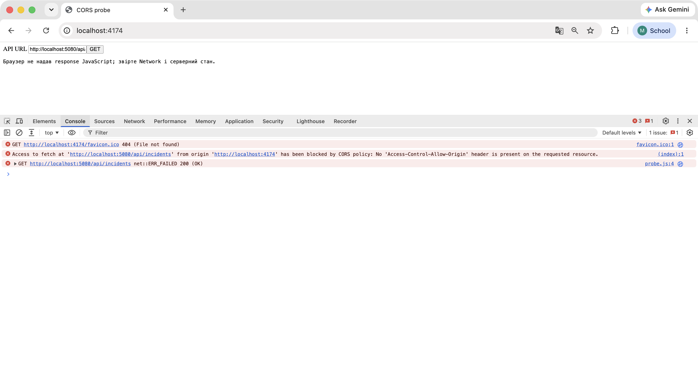 |
| прямий HTTP і preflight  | 4173 отримує ACAO навіть на 401, 4174 ні, preflight POST з 4173 дає лише `Allow-Methods: GET`       | 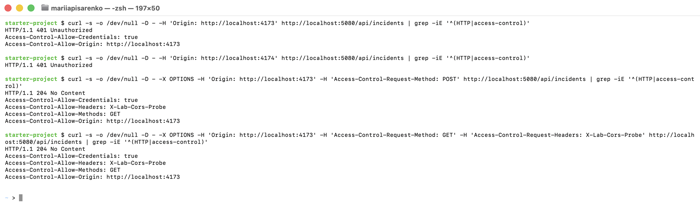                                                                                                       |

CORS вирішує лише, чи віддасть браузер відповідь коду сторінки, і не зупиняє сам запит. Тому для змінювальних маршрутів потрібна окрема antiforgery-перевірка.

### F-02. CSRF і antiforgery

Маршрут `POST /api/incidents/{id}/triage` не має тіла, тож сторінка іншого origin може надіслати його звичайною HTML-формою, а браузер сам додає cookie. Так само відкритими були create, update, delete і logout.

**Таблиця 7.** Атака з `http://localhost:4175` до і після виправлення

| Крок                           | Результат                                                                                                                                   | Доказ                                                                                                                                                                       |
| ------------------------------ | ------------------------------------------------------------------------------------------------------------------------------------------- | --------------------------------------------------------------------------------------------------------------------------------------------------------------------------- |
| стан до атаки                  | Morgan (Analyst), інцидент `...0005` має `New`                                                                                              | 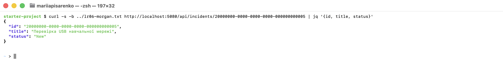                                                                                     |
| атака                          | Network `triage 204 No Content` з 4175                                                                                                      | 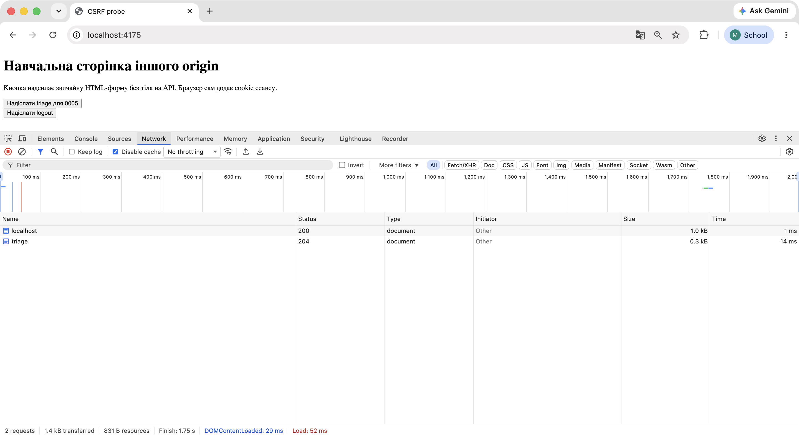 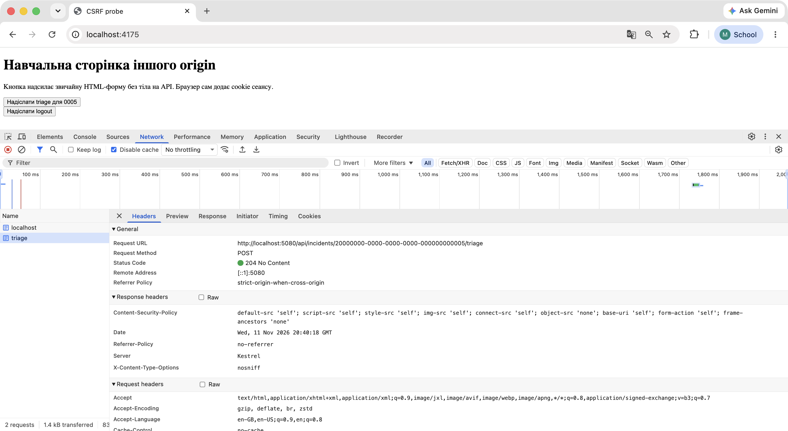 |
| стан після атаки               | `Triaged`                                                                                                                                   | 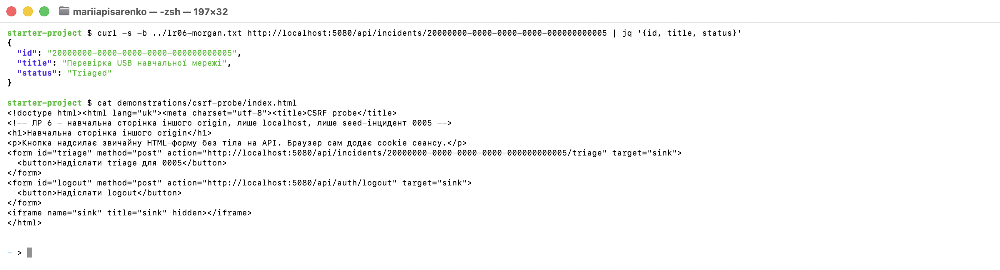                                                                               |
| ручна перевірка control        | без header 400 і стан `New`, token видано з `Set-Cookie: securelab-af=<redacted>; samesite=strict; httponly`, з header 204 і стан `Triaged` | 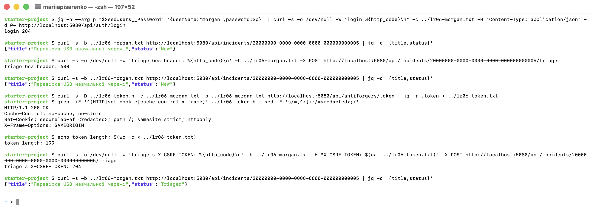                                                                                     |
| повтор атаки після виправлення | Network `triage 400`                                                                                                                        | 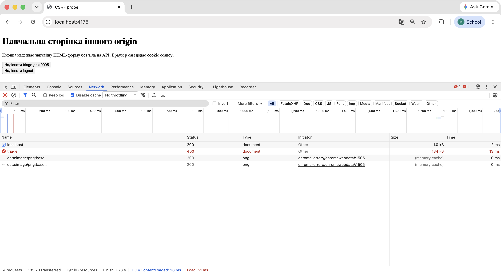                                                                                     |
| стан і тести                   | статус лишився `New`, 6 тестів Lab06 пройшли                                                                                                | 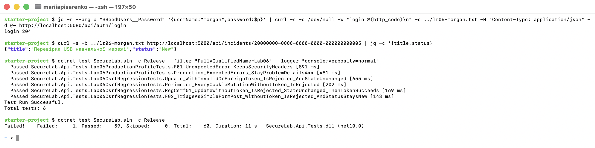                                                                           |

Реалізовано стандартний ASP.NET Core antiforgery: header `X-CSRF-TOKEN`, cookie `securelab-af`, маршрут видачі `GET /api/antiforgery/token`, один `AntiforgeryValidationFilter` з точним 400 Problem Details на всіх п’яти змінювальних маршрутах cookie-сеансу. Для logout перевірка стоїть до `SignOutAsync`. Клієнтський `Client/csrf.js` одержує token перед першою дією сторінки, тримає його лише в пам’яті і скидає після login і logout. Login і register токена не мають, бо не довіряють cookie, приймають лише JSON, а JSON з іншого origin вимагає preflight, який CORS не дозволяє.

**Таблиця 8.** Змінювальні дії клієнта після впровадження

| Дія                             | Результат                                                                 | Доказ                                                                                                   |
| ------------------------------- | ------------------------------------------------------------------------- | ------------------------------------------------------------------------------------------------------- |
| створення на `auth-lab.html`    | `token 200` з `csrf.js:22`, далі `incidents 201` з `csrf.js:42`           | 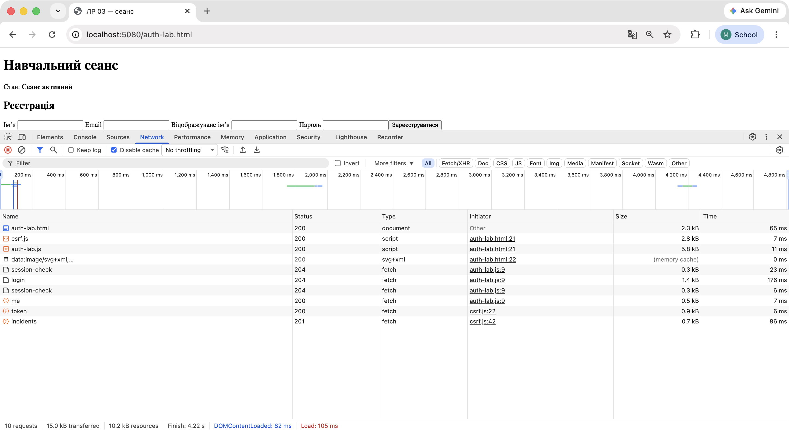             |
| header без значення             | фільтр Network `has-request-header:x-csrf-token` показує лише mutation    | 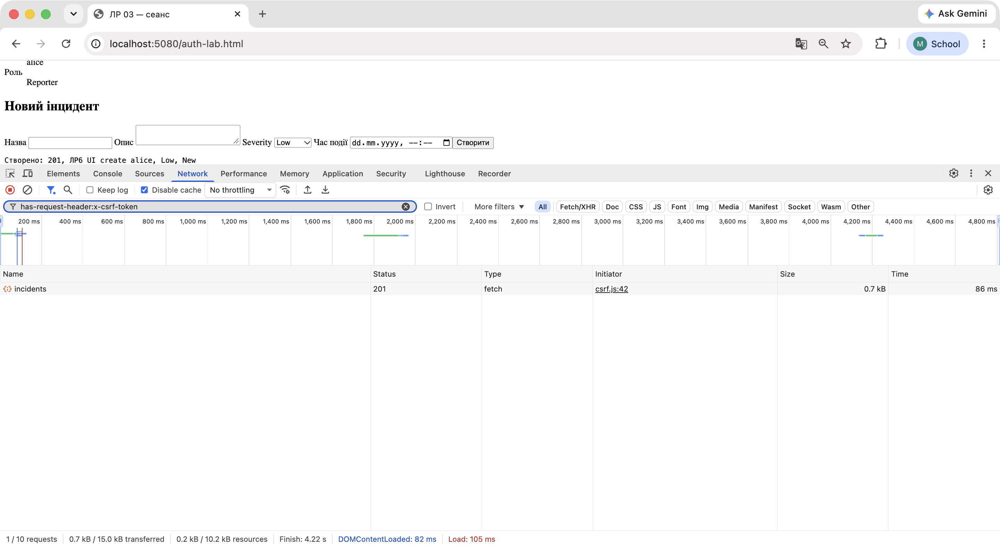             |
| F5, logout, новий login Bob     | створення 201 після F5, logout 204 і `/api/me` 401, створення від Bob 201 | 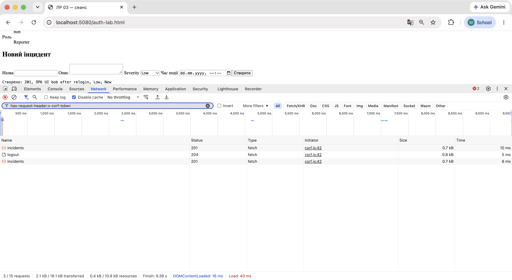             |
| `browser-lab.html`              | `POST incidents 201`, далі `GET: 200`                                     | 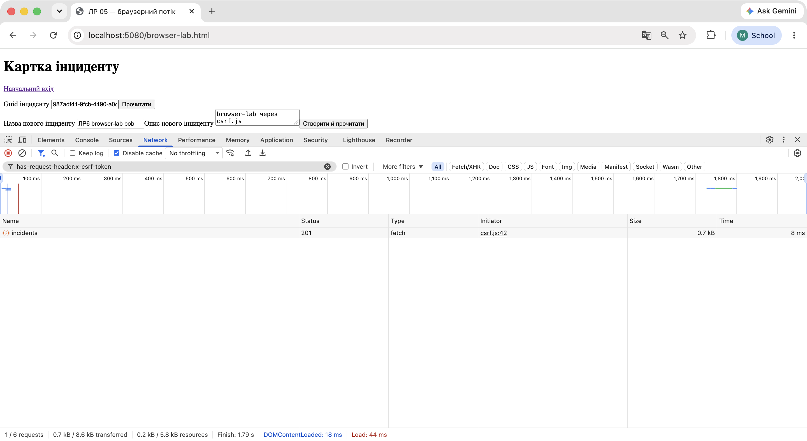           |
| повний набір                    | після reset `Passed: 60, Failed: 0`                                       | 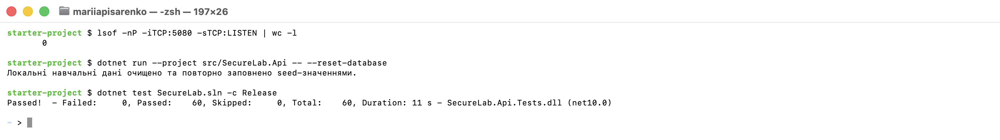           |
| login і register простою формою | до F-03 404, після виправлення 415                                        | 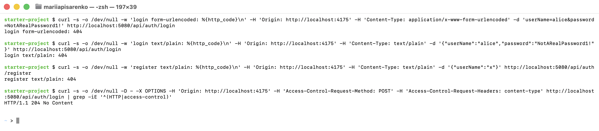 |

REG-CSRF-01 автоматизовано тестом `RegCsrf01_UpdateWithoutToken_IsRejected_StateUnchanged_ThenTokenSucceeds`: вхід Alice і cookie-сеанс, PUT без токена 400, читання незмінного опису, видача токена, PUT 204, читання зміненого опису. Окремі тести перевіряють невалідний і чужий токен та відмову без токена на всьому периметрі.

### HTTPS і rate limiting

Профіль `http` має лише `http://localhost:5080`, у `Program.cs` немає `UseHttpsRedirection` і `UseHsts`. Локальний HTTP не доводить безпеки транспорту, а відсутність HSTS на loopback не є дефектом, бо `ExcludedHosts` за замовчуванням виключає `localhost`.

**Таблиця 9.** Rate limiting

| Перевірка                      | Результат                                                                                                             | Доказ                                                                                 |
| ------------------------------ | --------------------------------------------------------------------------------------------------------------------- | ------------------------------------------------------------------------------------- |
| search, нова policy на user id | `200, 200, 200, 429` Problem Details без даних, Bob 200 з 0 записів Alice, маршрут без policy 200, після вікна 200    | 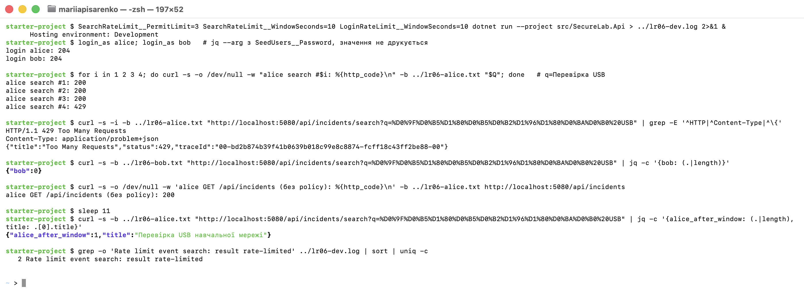 |
| login з ЛР 3                   | `401` п’ять разів, далі `429` однаковий для існуючого й неіснуючого акаунта, після вікна 204, чужий інцидент далі 404 | 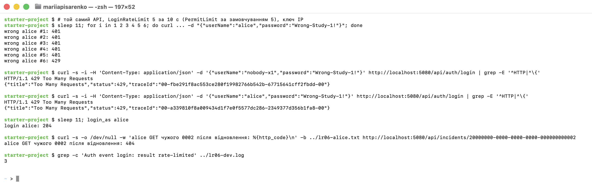   |

Тимчасові квоти для кадрів задавались лише змінними процесу, tracked конфігурація не змінювалась.

## Етап 3. Залежності, журнали й regression pack

**Таблиця 10.** Залежності, секрети й журнали

| Перевірка                 | Результат                                                                                                                                                                                    | Доказ                                                                                       |
| ------------------------- | -------------------------------------------------------------------------------------------------------------------------------------------------------------------------------------------- | ------------------------------------------------------------------------------------------- |
| аудит залежностей         | restore і `dotnet package list --vulnerable --include-transitive` з кодом 0, відомих advisories немає для обох проєктів. Доступні лише major-оновлення до .NET 11, оновлення не виконувалось | 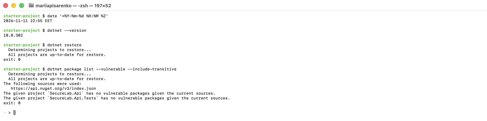         |
| пошук у 434 tracked files | три шаблони, 185, 184 і 59 збігів, кожну категорію класифіковано, реальних credential немає                                                                                                  | 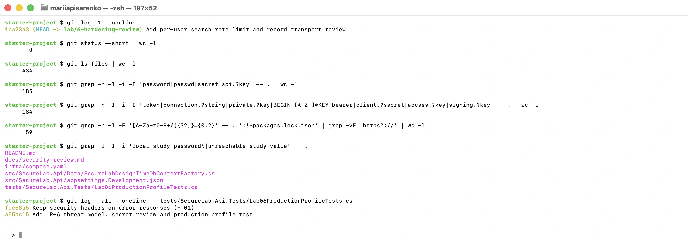 |
| шість сценаріїв журналу   | у `../lr06-logs/api.log` 0 збігів пароля seed, хибного пароля, cookie, назви header, фактичних токенів і connection string, audit trail переходу в `incident_status_history`                 | 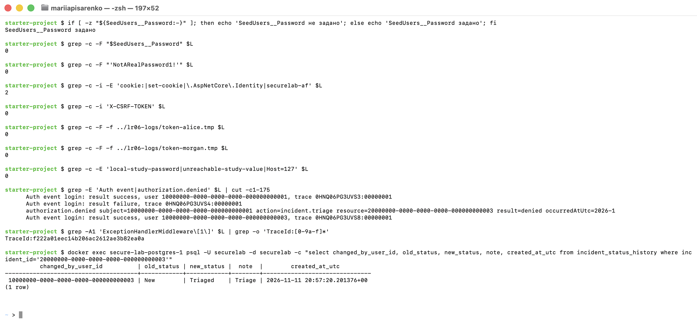   |
| уточнення шаблону cookie  | два збіги ширшого шаблону - назва простору імен `Microsoft.AspNetCore.Identity` у stack trace, а не cookie                                                                                   | 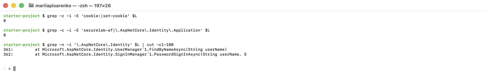     |
| REG-XSS-01 у Chrome       | DOM-тест ЛР 5 у Console: `PASS: 11 checks`, marker не виконався                                                                                                                              | 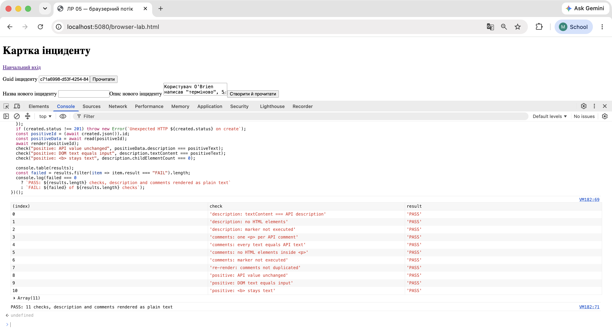   |

DOM-тест ЛР 5 створював запис через `fetch` без токена і після ЛР 6 отримав би 400. Його створення переведено на `SecureLabCsrf.mutate`, перевірки не змінювались.

**Таблиця 11.** Regression pack

| ID                          | Property                 | Тест або процедура                                   | Result |
| --------------------------- | ------------------------ | ---------------------------------------------------- | ------ |
| ЛР 2 T-02, T-01, T-03       | server validation        | `Lab02ContractTests` з токеном, `errors.title` і 409 | pass   |
| ЛР 2 S-02, T-04, T-05       | SQL не змінюється        | `SearchMechanicsTests`                               | pass   |
| ЛР 3 A-01, A-02, A-06, A-07 | identity lifecycle       | `Lab03SecurityTests`                                 | pass   |
| ЛР 4 A-01...A-12            | ownership і role         | `Lab04AuthorizationTests`                            | pass   |
| REG-XSS-01                  | текст не виконується     | DOM-тест у Chrome, 11 з 11                           | pass   |
| REG-CORS-01                 | точний origin            | Таблиця 6                                            | pass   |
| REG-CSRF-01                 | пара токенів обов’язкова | `Lab06CsrfRegressionTests`                           | pass   |
| ЛР 3 Rate limit, REG-RL-01  | abuse flow limited       | `Lab03RateLimitTests`, `Lab06SearchRateLimitTests`   | pass   |

## Етап 4. Знахідки й підсумок

### F-03. API fallback маскує 405 і 415 під 404

Під час рішення щодо login і register запит `text/plain` на наявний JSON-маршрут дав 404 «Ресурс API не знайдено» замість 415. Неправильний метод (`PATCH` інциденту, `GET` login) теж давав 404 замість 405. Fallback `/api/{**path}` не має обмежень на метод чи Content-Type, тому лишався валідним кандидатом для routing і перехоплював ці випадки. Новий `ApiFallback.Handle` перевіряє, чи існує маршрут, і повертає 405 з `Allow` або 415, а 404 лишає лише для невідомого шляху. Методика цієї перевірки не називає.

**Таблиця 12.** F-03 до і після

| Перевірка        | Результат                                                                                                              | Доказ                                                                                     |
| ---------------- | ---------------------------------------------------------------------------------------------------------------------- | ----------------------------------------------------------------------------------------- |
| тести до і після | worktree на `ae19cb2` з новим тестом `Failed: 6, Passed: 5`, після виправлення `Passed: 11`                            | 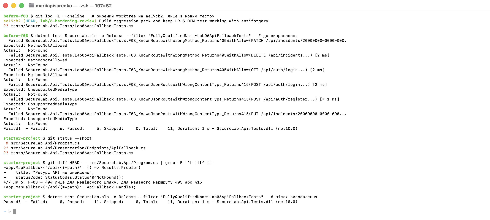 |
| ручна перевірка  | PATCH 405 `Allow: DELETE, GET, PUT`, GET login 405 `Allow: POST`, `text/plain` 415, невідомий шлях 404, JSON-login 401 | 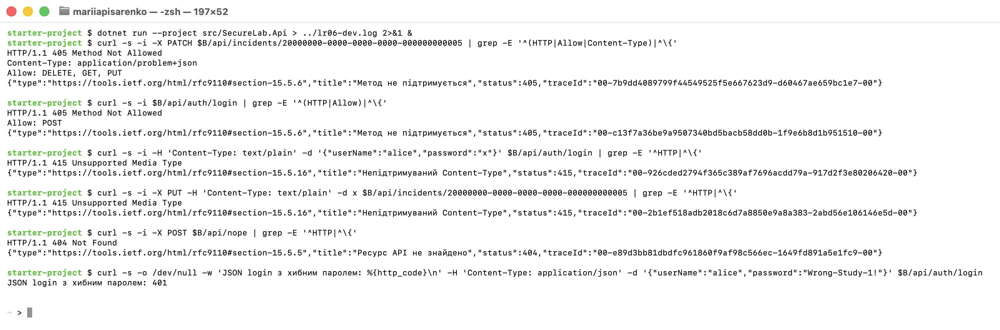             |

**Таблиця 13.** Пріоритизація знахідок

| ID   | Вплив                                           | Ймовірність і передумови                          | Пріоритет |
| ---- | ----------------------------------------------- | ------------------------------------------------- | --------- |
| F-02 | зміна чужих даних і примусовий logout           | висока, досить відкрити сторінку того самого site | P1        |
| F-01 | низький, 500 без browser headers, даних немає   | середня, потрібна необроблена помилка             | P3        |
| F-03 | низький, хибний error contract без витоку даних | висока, будь-який запит з іншим методом чи типом  | P3        |

F-02 виправлено першою, бо лише вона дає змінити дані іншої людини без жодної автентифікації зловмисника. F-01 і F-03 мають низький вплив. F-01 пріоритетніша за класом control, бо вимикає вже налаштовані браузерні захисти на відповіді, яку зловмисник може спровокувати.

**Таблиця 14.** Development і Production

| Властивість                  | Development                                           | Production                                           | Доказ                                                                                 |
| ---------------------------- | ----------------------------------------------------- | ---------------------------------------------------- | ------------------------------------------------------------------------------------- |
| OpenAPI, CORS, cookie, reset | 200, ACAO для 4173, cookie без `secure`, reset працює | 404, ACAO немає, cookie з `secure`, reset заборонено | 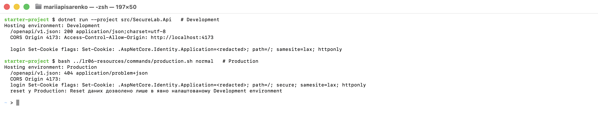 |

## Advanced variant. Tamper-evident журнал security-подій

Події login (успіх, невдача, перевищення ліміту), logout, відмови CSRF, 403, 404 на чужий ресурс і успішний triage пишуться в таблицю `security_audit_events`. Кожен запис має `sequence`, `key_id`, HMAC попереднього запису і власний HMAC-SHA256 від канонічної серіалізації з фіксованим порядком полів, UTF-8 і часом UTC з мікросекундами. Перший запис має `sequence` 1 і фіксоване початкове значення. Запис іде під session-level `pg_advisory_lock`: спершу commit у БД, потім файл-якір з номером і HMAC останнього запису поза БД, і лише потім unlock. Ключі задаються змінними середовища поза Git, ротацію ключа винесено за межі. Для невдалого входу замість логіна зберігається keyed-хеш нормалізованого логіна. Перевірка й експорт виконуються з командного рядка `--verify-audit` і `--export-audit`, нового публічного endpoint немає.

Дозволені зміни (login success, logout, triage) працюють fail-closed: без запису аудиту повертається 503 і стан не змінюється. Відмови лишаються відмовами з тим самим кодом, бо 503 замість 404 розкрив би існування чужого ресурсу.

**Таблиця 15.** Перевірка журналу аудиту

| Перевірка                      | Результат                                                                                                                                                             | Доказ                                                                                 |
| ------------------------------ | --------------------------------------------------------------------------------------------------------------------------------------------------------------------- | ------------------------------------------------------------------------------------- |
| погодження викладача           | тему погоджено як advanced variant ЛР 6 з п’ятьма умовами щодо якоря, lock, поведінки при збої, початку ланцюжка й keyed-хешу логіна                                  | 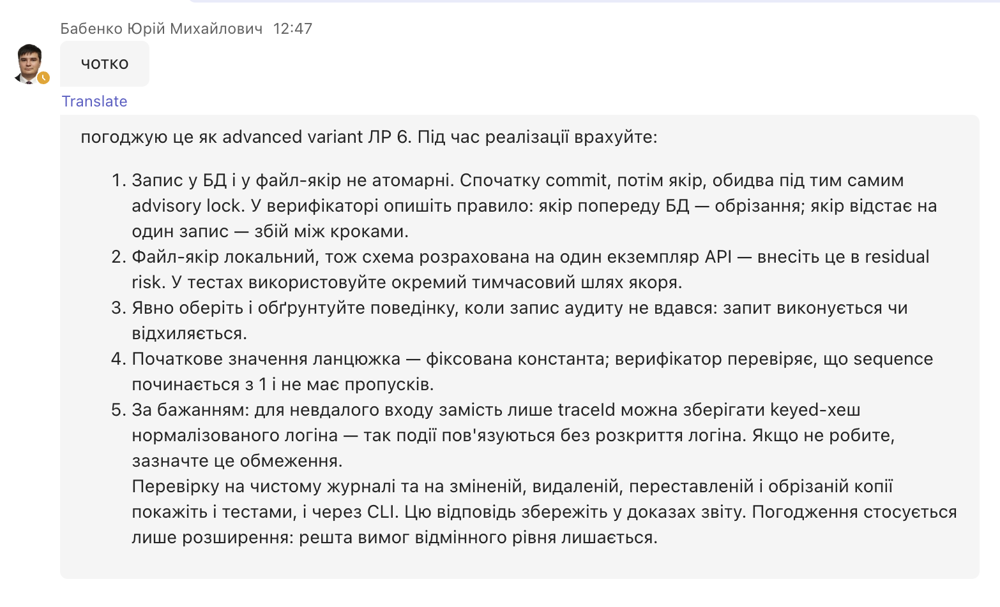 |
| сім сценаріїв і перевірка БД   | 8 записів, `PASS: ланцюжок цілий, якір збігається`, exit 0. У таблиці лише id, keyed-хеш логіна і HMAC                                                                | 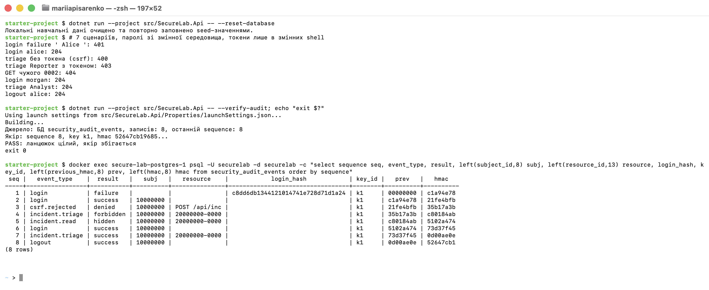 |
| копії журналу                  | clean PASS, modified `sequence 3: HMAC не збігається`, deleted `очікувався 3`, reordered `очікувався 2`, truncated `обрізання: якір має sequence 8, останній запис 7` | 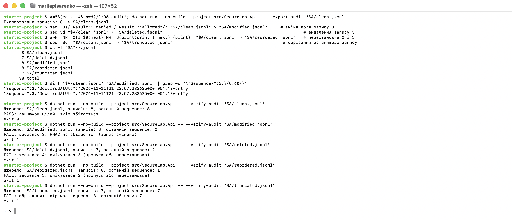       |
| підробка в БД, якір, видалення | UPDATE роллю застосунку FAIL, після повернення PASS, якір позаду на один WARNING з exit 2, видалення останнього запису і всього журналу FAIL обрізання                | 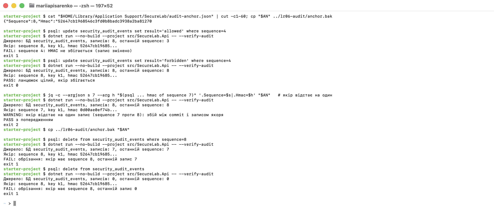 |
| fail-closed                    | без ключа правильний пароль 503 без `Set-Cookie`, хибний пароль 401, 0 подій                                                                                          | 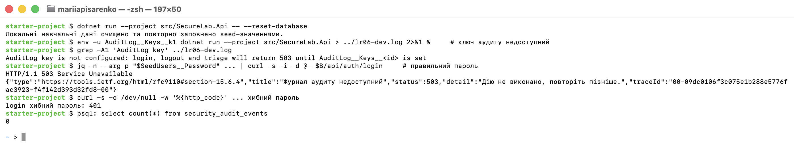           |
| тести журналу аудиту           | `Lab06AuditLogTests` 16 з 16 після reset: усі види підробки, реальні події без секретів, паралельний запис, fail-closed                                               |            |

Тести `Lab06AuditLogTests` (16) перевіряють ті самі види підробки на рівні верифікатора, реальні події без секретів, паралельний запис 30 подій без пропусків і fail-closed.

Ланцюжок захищає від того, хто може писати в таблицю журналу без ключа, зокрема від ролі застосунку, яка як власник схеми має UPDATE і DELETE. Від компрометації самого застосунку з ключем і від одночасної зміни БД і якоря він не захищає. Якір локальний, тому схема розрахована на один екземпляр API.

## Відповіді на контрольні питання

1. До меж огляду входять API, браузерний клієнт, PostgreSQL у Compose, конфігурація, NuGet-залежності й журнали консолі. Явно не перевірялись production host і TLS, повна історія Git, зовнішній pentest і мініпроєкти методички.
2. Назва файла нічого не гарантує: `appsettings.json` під Git читає кожен, хто має доступ до репозиторію, а значення лишається в історії. Безпечним його робить лише відсутність реального секрету, а реальні значення мають приходити зі змінних середовища чи сховища секретів.
3. CSRF-регресія має довести відмову без валідного токена разом з незмінним станом ресурсу і успіх легітимного запиту з валідною парою токенів разом із саме очікуваною зміною.
4. SameSite не зупиняє запити з іншого origin того самого site (інші порти localhost, піддомени), а CORS вирішує лише читання відповіді й не блокує простий POST форми. Запит з cookie однаково доходить до сервера, тому намір користувача доводить лише токен, якого чужа сторінка не має.
5. Advisory описує вразливу версію пакета, але вразливість експлуатується лише тоді, коли застосунок досяжно викликає вразливу функцію в потрібних умовах. Для транзитивного пакета треба перевірити, хто його притягує, і чи використовується відповідний API.
6. Діагностичний журнал допомагає розробнику знайти причину збою і містить технічні деталі, наприклад stack trace. Подія аудиту фіксує, хто що зробив з яким ресурсом і з яким результатом, має бути мінімальною й захищеною від зміни, як журнал advanced variant.

## Декларація використання ШІ

| Інструмент              | Для чого                                                                                                                                                                       | Що використано                                                                                              | Що перевірено самостійно                         |
| ----------------------- | ------------------------------------------------------------------------------------------------------------------------------------------------------------------------------ | ----------------------------------------------------------------------------------------------------------- | ------------------------------------------------ |
| Claude Code (Anthropic) | покроковий план за методичкою, код antiforgery, search limiter, F-01, F-03 і журналу аудиту, команди перевірки, обрізання скріншотів, чернетки review, карток знахідок і звіту | тему advanced variant, межі огляду, рівень, рішення щодо login і register та fail-closed для журналу аудиту | пароль seed і ключі аудиту до ШІ не передавались |

## Межі перевірки

Транспорт HTTPS і HSTS перевірено лише як конфігурацію, бо production host немає. Rate limiting і якір журналу аудиту розраховані на один екземпляр API. Історію Git перевірено лише для файлів конфігурації. Фінальний прогін на прийнятому merge commit і хеш тегу `v1.0.0` додаються до експортованого PDF.
