# Звіт до лабораторної роботи № 3

## 1. Ідентифікація і відтворення

- ПІБ і група: Пісаренко Марія, група КБ-42.
- Спільний baseline 2-A «Трекер інцидентів», індивідуального номера немає.
- Заявлений рівень: відмінний («Відмінно»).
- Base tag: `v0.2.0` (`5e80ef3`).
- Гілка: `lab/3-authentication`.
- Release і base_commit із квитанції `.scaffolds/lab-03.json`: `lab-03-start-v1`, `5e80ef3ff4617f080f5d7d00ec100569554e62ad`, `5e80ef3ff4617f080f5d7d00ec100569554e62ad`.
- Commit встановленого scaffold: `e049714`, власна робота йде окремими commits після нього. Перевірений commit коду: `b7f7da1`. Тег `v0.3.0` стоїть на commit із завершеним звітом, між `b7f7da1` і тегом змінювались лише `docs/`.
- ОС і SDK: macOS 26.6.2, .NET SDK 10.0.302.
- Команди build/tests: `dotnet build SecureLab.sln -c Release`, `dotnet test tests/SecureLab.Api.Tests -c Release`. Фактичний результат після встановлення scaffold: 21 з 21 тестів пройдено, фінальний результат після reset: 35 з 35.
- Migration і reset: міграцію `Lab03Identity` застосовано через `--reset-database`, два послідовні reset із тестами після кожного завершилися кодом 0.
- DEL-01: приватний remote `https://github.com/pisarenkom-knu/PrTechPIB-pisarenko.git`, гілка `lab/3-authentication` і тег `v0.3.0`.

Перевірка вхідного стану, SDK і створення гілки:

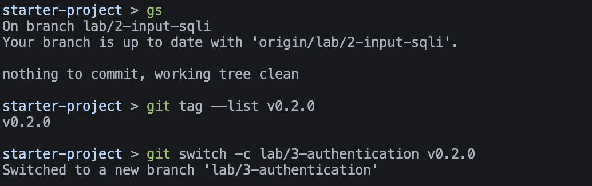
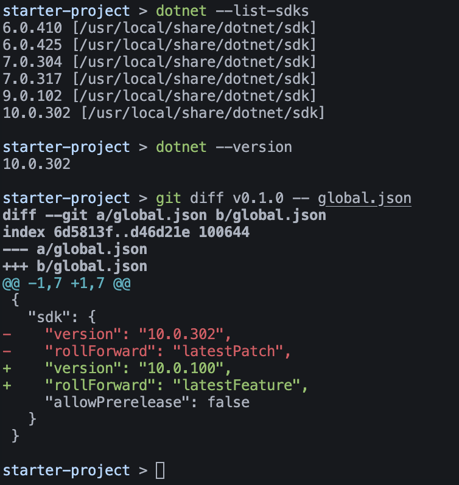

`git diff v0.1.0 -- global.json` не порожній, бо `global.json` ще в межах ЛР-2 (commit `26a4fcf`) приведено до рекомендованого вигляду: `version` 10.0.100, `rollForward` latestFeature, `allowPrerelease` false. Повторно змінювати його не потрібно.

## 2. Встановлення scaffold і початковий стан

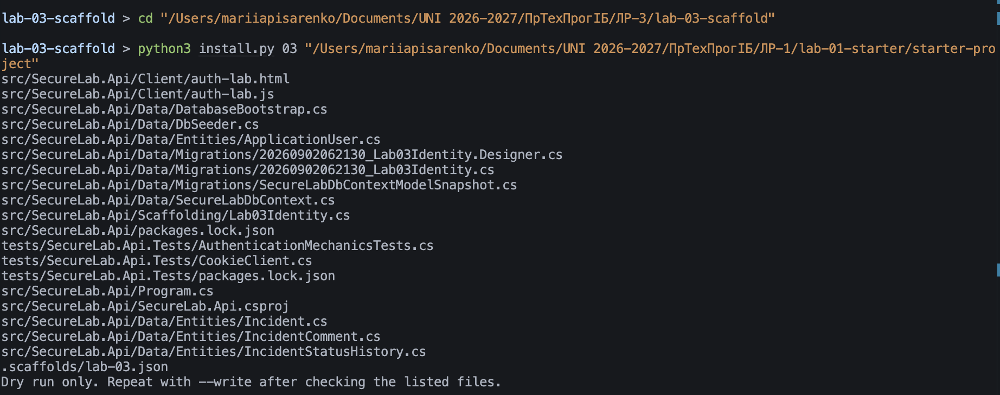
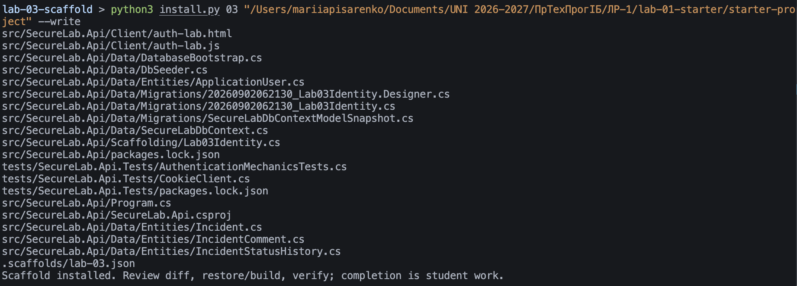
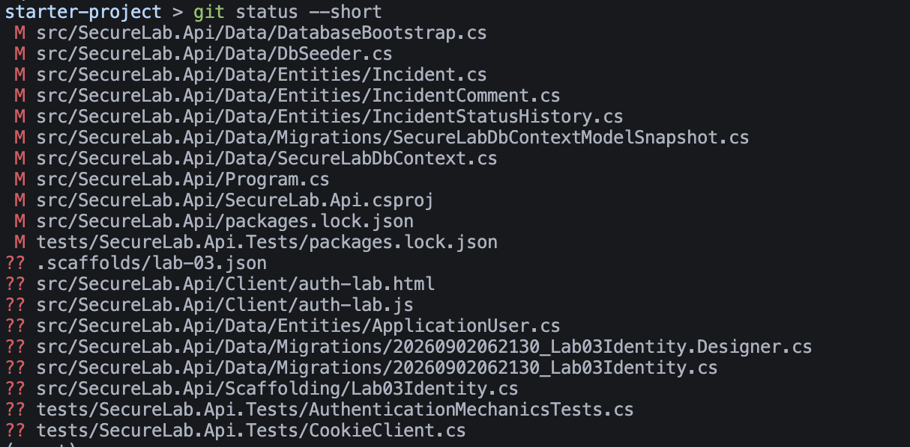
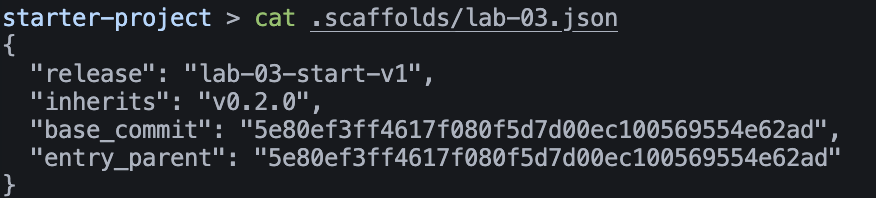

Встановлений scaffold збережено окремим commit-ом `e049714`:

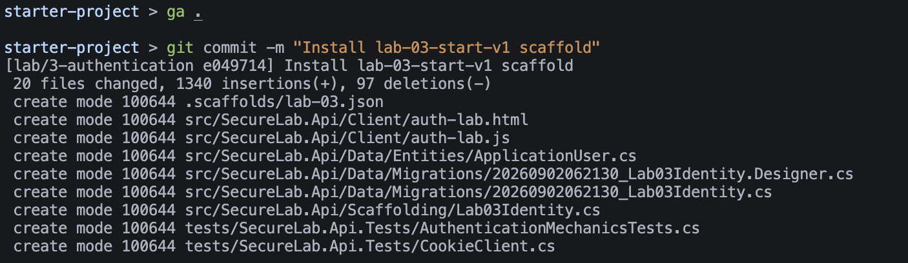
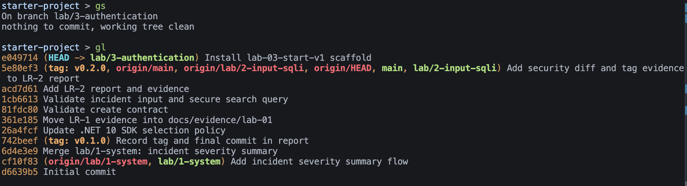

Навчальний пароль акаунтів задано лише змінною середовища `SeedUsers__Password` поточного термінала через `read -rs`, значення не відображається і не потрапляє у файли чи Git. Перевірено лише довжину (10 символів):

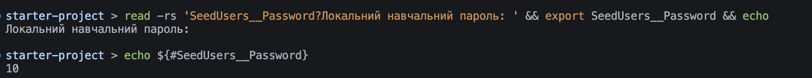

Контейнер PostgreSQL, reset із міграцією `Lab03Identity` і seed чотирьох акаунтів, тести (21 з 21, серед них `RealCookie_ReachesSessionCheck`):

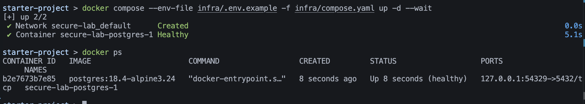
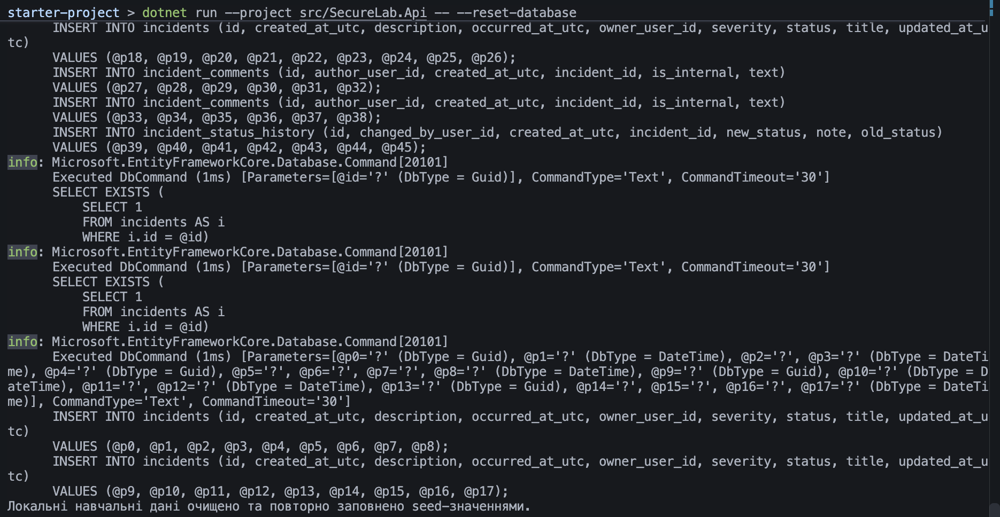
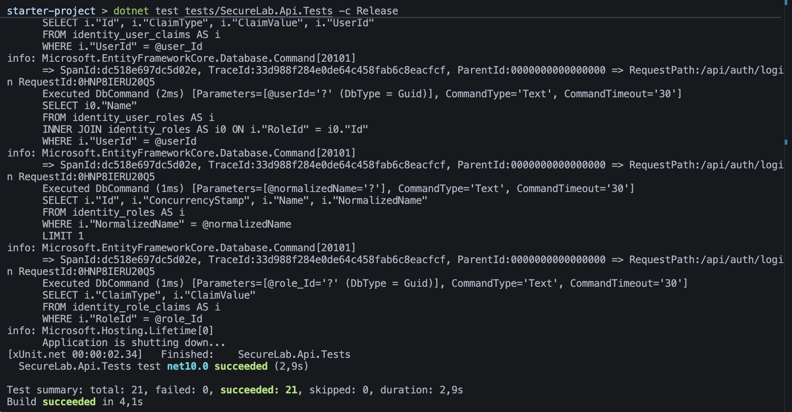

Два послідовні reset із тестами після кожного, код завершення 0:

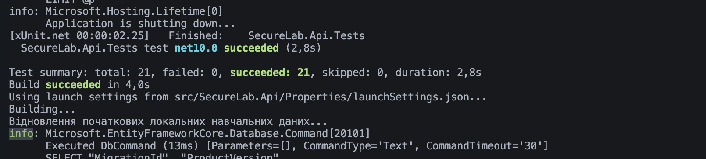
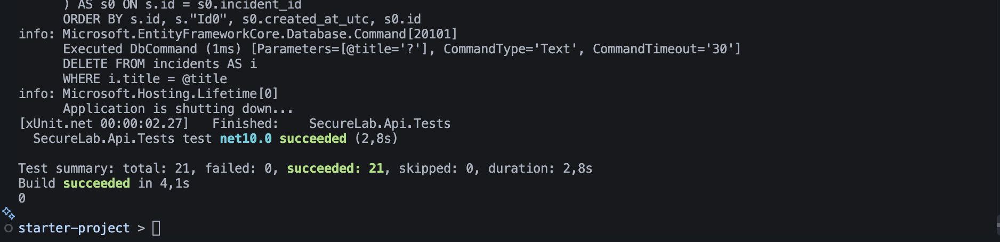

Початковий стан `auth-lab.html`: login дає 204, «Мій профіль» і «Вийти» дають 501:

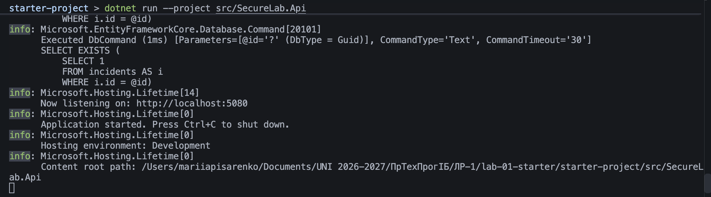
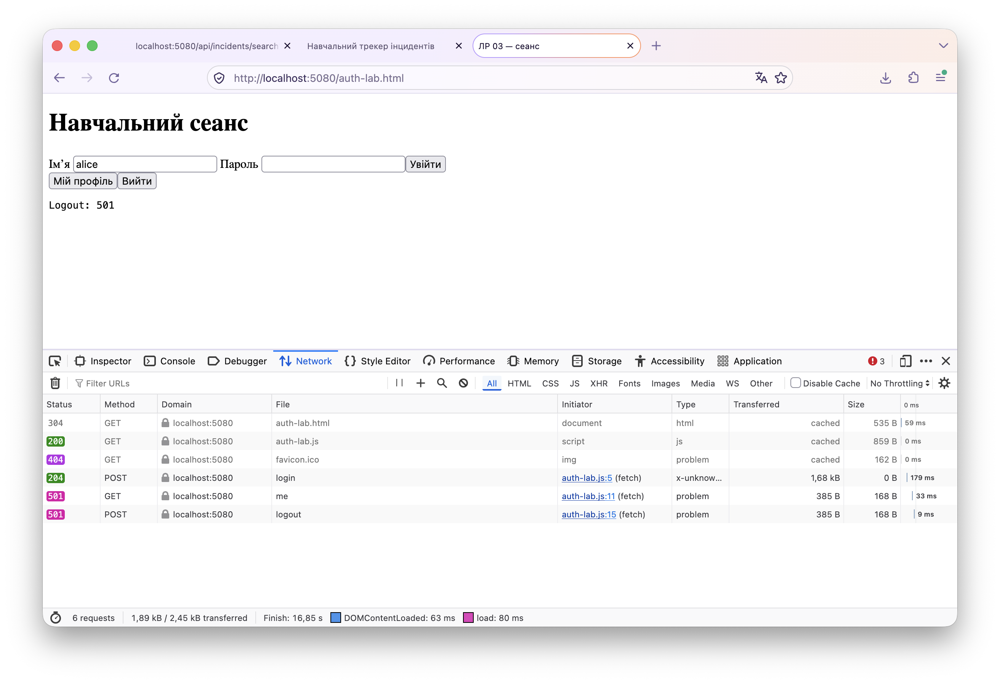

`GET /api/me` без cookie і без header повертає заглушку 501:

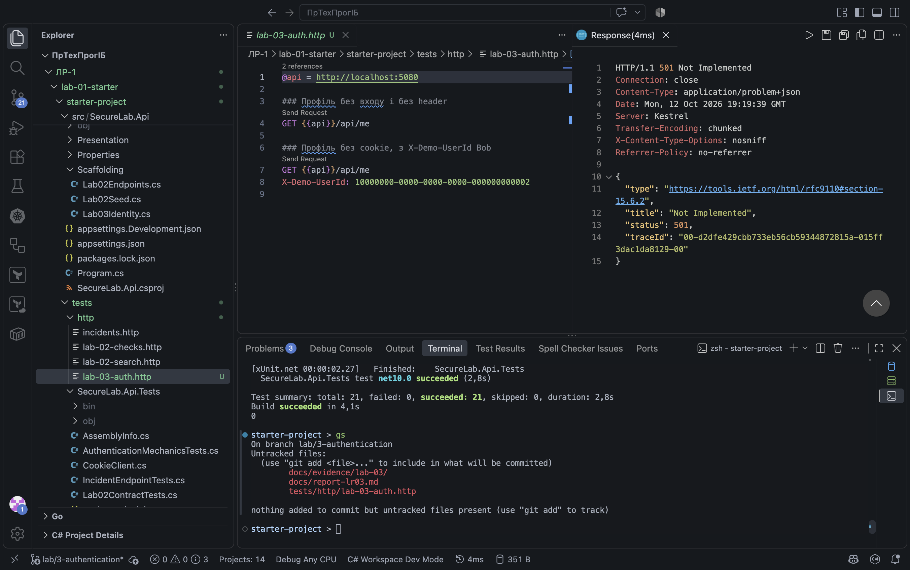

Зафіксований початковий дефект: той самий запит без cookie, але з `X-Demo-UserId` Bob повертає 200 і профіль Bob. Сервер довіряє ідентифікатору, який надіслав клієнт:

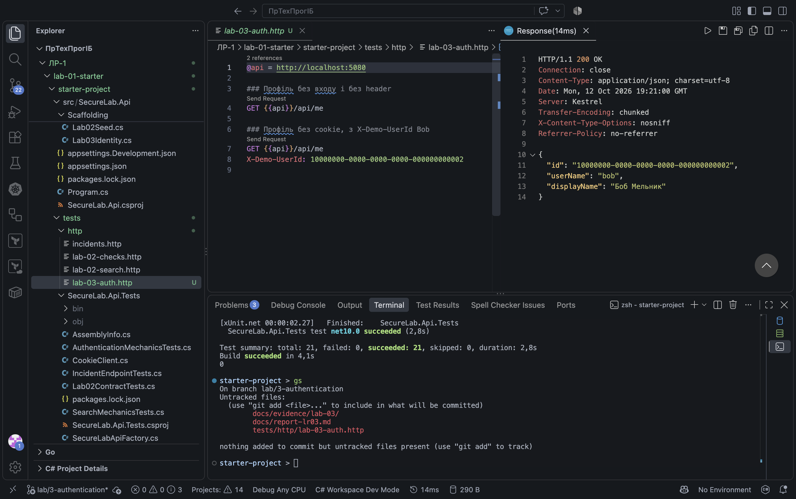

## 3. Реєстрація і CP-01

Наданий endpoint уже створював `ApplicationUser` без `PasswordHash` і викликав `UserManager.CreateAsync(user, password)`, але перевіряв лише наявність полів і повертав анонімний об'єкт. Довжину `displayName` не перевіряв ніхто, крім БД: значення з 121 символу дійшло до `SaveChanges` і завершилося `500 Internal Server Error`, тоді як 120 символів давали `201`. Це додатковий дефект межі DTO.

Доповнення в `src/SecureLab.Api/Scaffolding/Lab03Identity.cs` (endpoint `POST /api/auth/register`):

- request DTO `RegistrationInput(UserName, Email, DisplayName, Password)` не містить `Id`, ролі чи `PasswordHash`. Невідомі поля JSON ігноруються стандартним model binding, роль `Reporter` і `Id` призначає сервер.
- Перевірки до звернення до Identity: усі поля обов'язкові, довжина до `Trim()` не більша за межі моделі БД (`userName` і `email` 256, `displayName` 120), `password` не довший за 128 символів, щоб обмежити вартість хешування. Результат - `400 ValidationProblem` з ключами полів.
- Нормалізація лише `Trim()` для `userName`, `email`, `displayName`. Пароль не нормалізується і не логується.
- Відмови `IdentityResult` перетворюються за `error.Code`: `DuplicateUserName` або `DuplicateEmail` дають `409` з однаковим текстом «Реєстрація неможлива» без уточнення, яке поле зайняте. Коди `Password*`, `InvalidUserName`, `InvalidEmail` дають `400` з ключем відповідного поля. Значення із запиту у відповідь не повертаються.
- Відповідь `201` містить лише `RegistrationResponse(Id, UserName, DisplayName)` замість анонімного об'єкта.

Duplicate-контракт: `409` залишає канал перебору облікових записів (account enumeration), бо підтверджує існування імені або email. Це усвідомлений компроміс заради зрозумілої відповіді користувачеві. Його пом'якшують однакова відповідь для імені та email і обмеження частоти запитів.

| Ситуація                              | До змін                   | Після змін                  | Доказ                                                                                                                                                                                |
| ------------------------------------- | ------------------------- | --------------------------- | ------------------------------------------------------------------------------------------------------------------------------------------------------------------------------------ |
| коректна реєстрація (T-01)            | 201, анонімний об'єкт     | 201, `RegistrationResponse` | 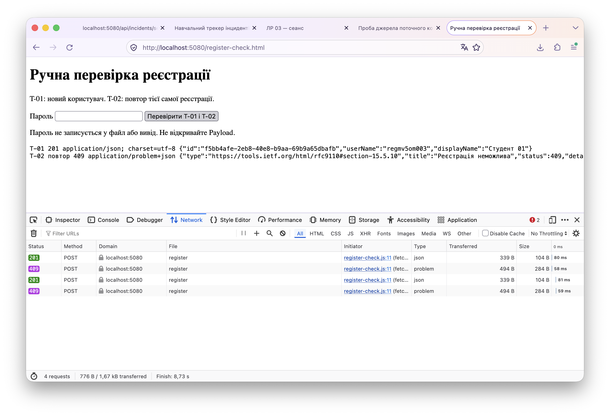                                                                                                                      |
| повторна реєстрація (T-02, duplicate) | 400 `Registration failed` | 409 «Реєстрація неможлива»  |                                                                                                                       |
| `displayName` довжиною 121            | 500                       | 400, ключ `displayName`     | 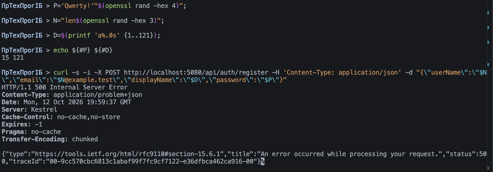, 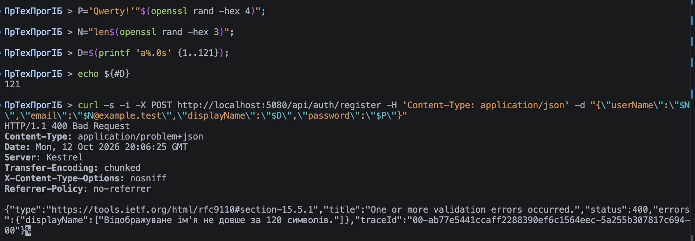 |
| `displayName` довжиною 120            | 201                       | 201                         | 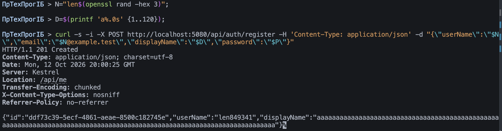                                                                                              |

T-03. Структура `identity_users` без даних: відкритого пароля немає, є лише `PasswordHash` типу `text`. Перевірку пароля виконує стандартний `PasswordHasher` Identity (PBKDF2 з HMAC-SHA512, 100 000 повторень, окрема 16-байтова сіль для кожного акаунта), власного хешування в коді немає.

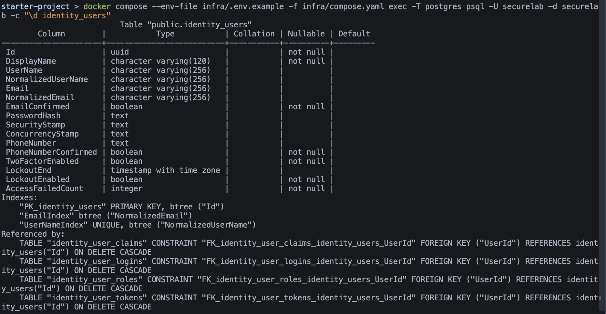

## 4. Login, cookie, /api/me, logout і CP-02

Cookie options (`AddLab03Identity`): `HttpOnly = true`, `SameSite = Lax`, `SecurePolicy = SameAsRequest` у Development і `Always` поза ним. Строк дії не змінювався, діє стандартний для Identity. Локальний HTTP-запуск не доводить Secure, атрибут `secure` перевірено тестом через HTTPS base address.

DevTools Firefox після login alice через `http://localhost:5080`. У `Set-Cookie` відповіді `204` є атрибути `path=/; samesite=lax; httponly`, атрибута `secure` немає, бо запит ішов через HTTP. У Storage -> Cookies рядок `.AspNetCore.Identity.Application` має HttpOnly `true`, Secure `false`, SameSite `Lax`, Expires/Max-Age `Session` (стовпець Value приховано). `document.cookie` повертає порожній рядок, отже JavaScript сторінки не бачить cookie сеансу. Значення cookie на кадрах закрито:

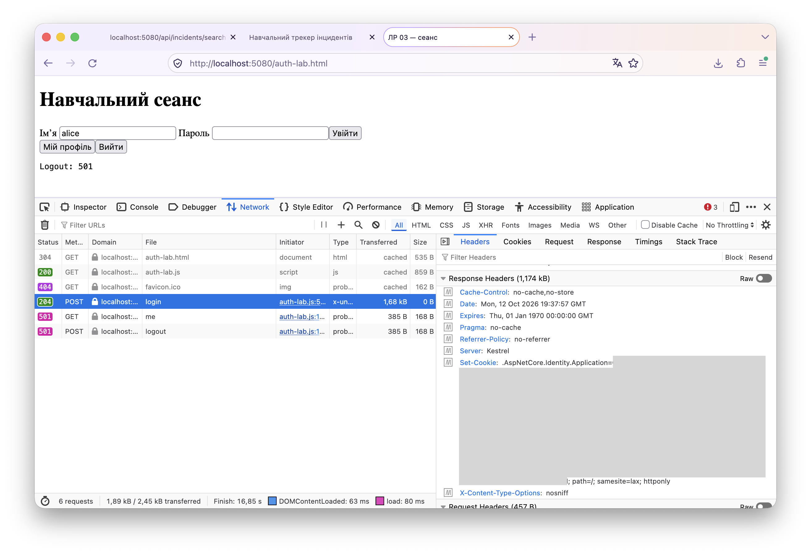
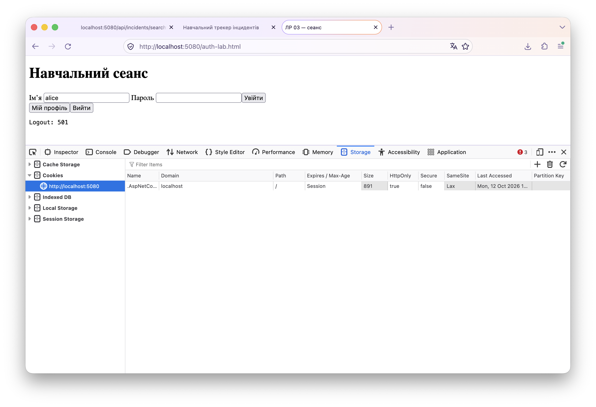
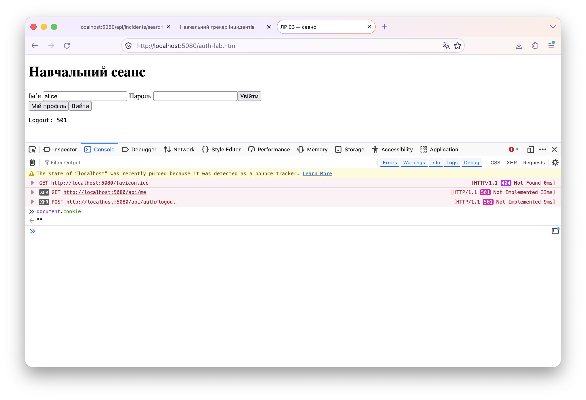

Наданий `GET /api/me` без заголовка повертав `501`, а із заголовком `X-Demo-UserId` довіряв заявленому id навіть без cookie ([12-2-me-header-defect.png](evidence/lab-03/12-2-me-header-defect.png) і [22-probe-before.png](evidence/lab-03/22-probe-before.png)). Зміни в `Lab03Identity.cs`:

- `/api/me` зареєстровано як `app.MapGet("/api/me", GetCurrentUser).RequireAuthorization()`. Анонімний запит зупиняє `UseAuthorization()` з відповіддю `401` ще до коду endpoint.
- Метод `GetCurrentUser(HttpContext)` читає лише `HttpContext.User`: `ClaimTypes.NameIdentifier` (перетворюється на `Guid`), `ClaimTypes.Name` і `ClaimTypes.Role`. Заголовки, query і body не читаються. Якщо в authenticated principal немає коректного identifier, повертається `500`, а не підстановка клієнтського id. Відповідь - `CurrentUserResponse(UserId, UserName, Role)`.
- Logout викликає `SignInManager.SignOutAsync()` і повертає `204`. Сервер надсилає `Set-Cookie` з порожнім значенням і `expires=Thu, 01 Jan 1970` для основної cookie та службових `Identity.External`, `Identity.TwoFactorUserId`.

Login наданого scaffold не змінювався: невідомий користувач і хибний пароль отримують однаковий `401` з однаковим Problem Details, різниться лише `traceId`.

Перевірки після змін:

| Крок | Дія                                | До змін          | Після змін                               | Доказ                                                                                                                                              |
| ---- | ---------------------------------- | ---------------- | ---------------------------------------- | -------------------------------------------------------------------------------------------------------------------------------------------------- |
| 1    | `GET /api/me` без входу            | 501              | 401                                      | , 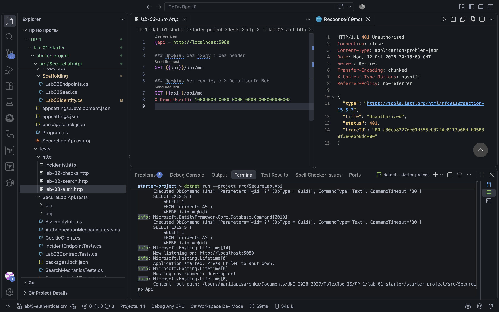                                     |
| 3    | `GET /api/me` після login alice    | 501              | 200, `userId` …0001, `alice`, `Reporter` | , 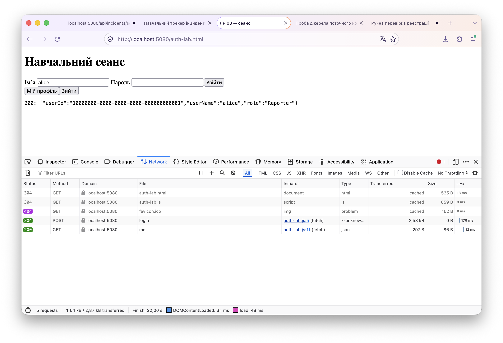                 |
| 4    | без cookie, `X-Demo-UserId` Bob    | 200, профіль Bob | 401                                      | , 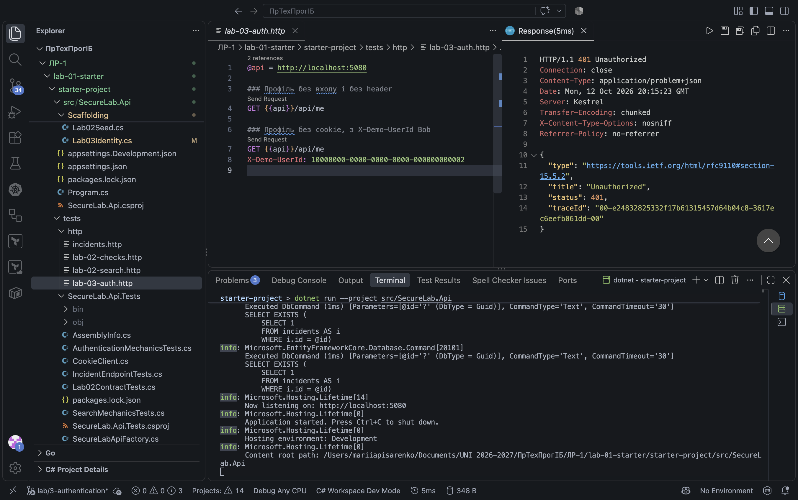 |
| 5    | cookie Alice і `X-Demo-UserId` Bob | `isBob: true`    | `isAlice: true`                          | 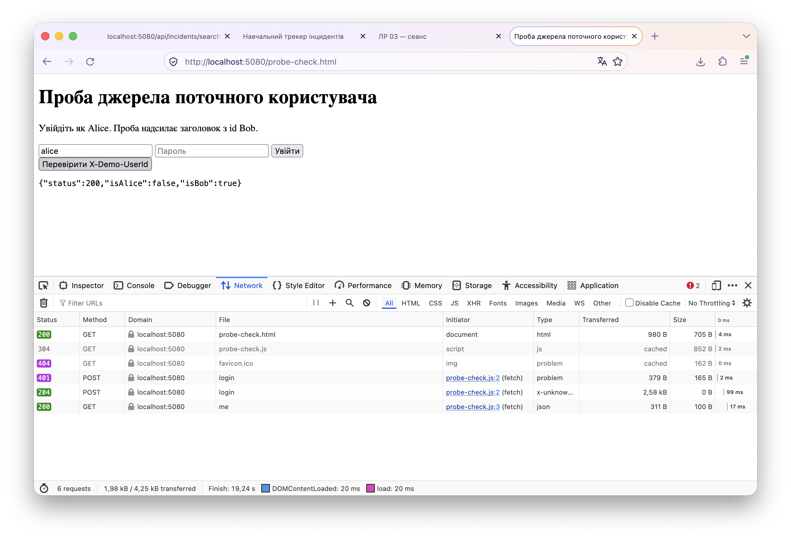,                              |
| 6    | `POST /api/auth/logout`            | 501              | 204, основна cookie видаляється          | , 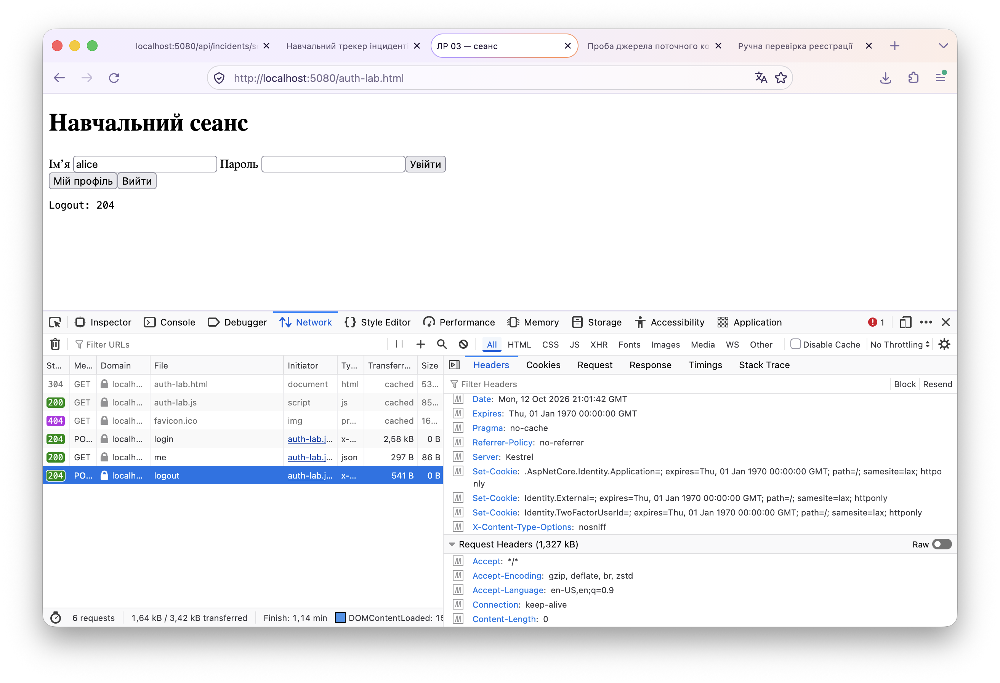           |
| 7    | `GET /api/me` після logout         | -                | 401                                      | 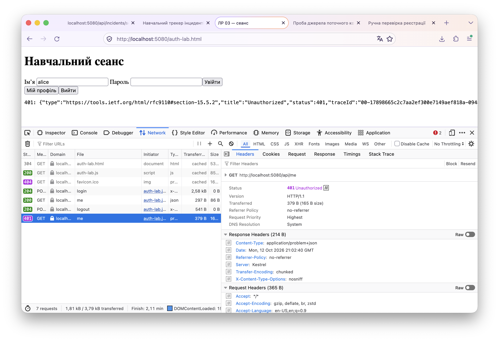                                                                          |

Однакова відмова login для невідомого користувача і хибного пароля:

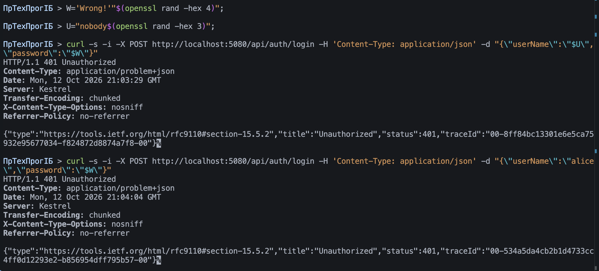

## 5. Захищене створення і CP-03

Наданий `POST /api/incidents` був доступний без входу і записував сталого власника `OwnerUserId = DbSeeder.AliceId`. Зміни в `src/SecureLab.Api/Scaffolding/Lab02Endpoints.cs`:

- до реєстрації endpoint додано `.RequireAuthorization()`. Захист саме цього `MapPost` потрібен окремо, бо група GET-маршрутів у `IncidentEndpoints.cs` створення не покриває.
- endpoint отримує `HttpContext httpContext`, читає `ClaimTypes.NameIdentifier` і перетворює його на `Guid`. Створена entity отримує `OwnerUserId = ownerId` з principal.
- `CreateIncidentRequest(Title, Description, Severity, OccurredAtUtc)` не містить `OwnerUserId`, `Id`, `Status` чи ролі, тому `ownerUserId` у JSON ігнорується model binding і не відновлюється з raw JSON.

Тести ЛР-2 на `201`, `400` і `409` для створення тепер виконуються клієнтом Alice після login, перевірки контракту не змінювались.

Анонімний `POST /api/incidents` дає `401`:

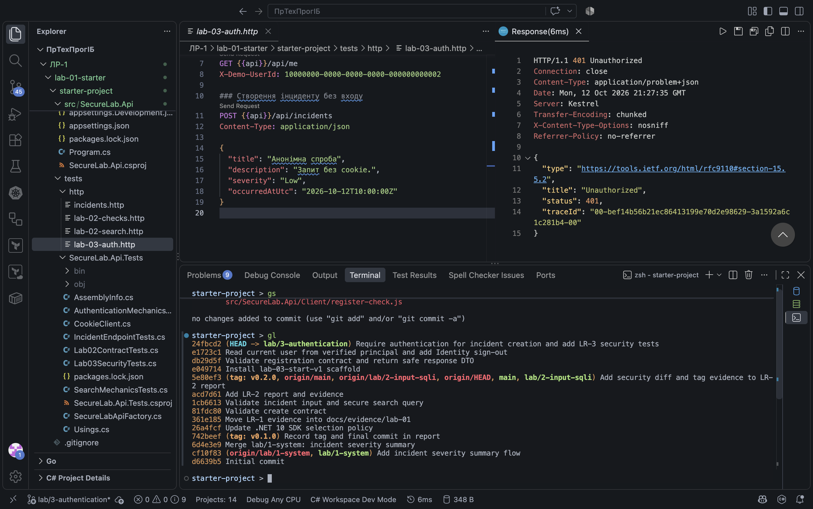

Bob після login передає `ownerUserId` Alice (`…0001`). Запис створено (`201`), а `GET /api/incidents/{id}` показує власника `Боб Мельник`:

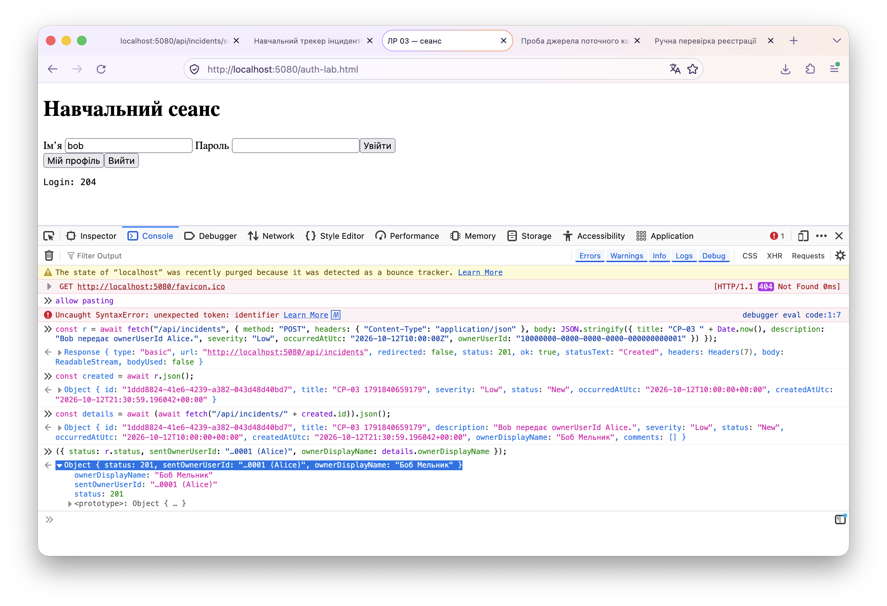

Контроль чутливості тестів. Тести A-01…A-07 написано раніше за виправлення власника і запущено на commit `0b993a1`, де вже є `.RequireAuthorization()`, але власником ще записується стала Alice. Кадр нижче показує цей прогін: A-04 і A-05 падають з `Expected …0002` (Bob) і `Actual …0001` (Alice), решта п'ять сценаріїв проходять. Отже, тести справді виявляють дефект, а не проходять за будь-якого коду:

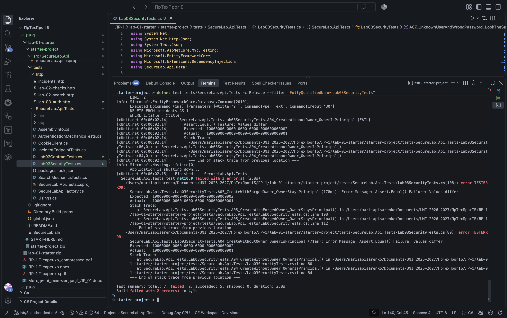

Після заміни джерела власника на principal (commit `f30a7a0`) ті самі сім тестів проходять, це видно на [30-tests-required.png](evidence/lab-03/30-tests-required.png).

Server бере owner лише з verified principal. Hidden form field, `X-Demo-UserId` чи поле JSON - це дані, які клієнт пише довільно, тому вони не є доказом особи і не можуть бути контролем доступу.

## 6. Регресійні перевірки

| ID            | Рівень    | Передумова/дія                          | Очікувано                                              | Фактично                                                                              | Безпечний доказ                                                                                                                                                                                                                                                                                                                                                                                                                                                                                                                                                                                                                                                                                       |
| ------------- | --------- | --------------------------------------- | ------------------------------------------------------ | ------------------------------------------------------------------------------------- | ----------------------------------------------------------------------------------------------------------------------------------------------------------------------------------------------------------------------------------------------------------------------------------------------------------------------------------------------------------------------------------------------------------------------------------------------------------------------------------------------------------------------------------------------------------------------------------------------------------------------------------------------------------------------------------------------------- |
| T-01          | достатній | register                                | safe 201                                               | 201, `{id, userName, displayName}` без чутливих полів                                 | ручний HTTP,                                                                                                                                                                                                                                                                                                                                                                                                                                                                                                                                                                                                                           |
| T-02          | достатній | invalid/duplicate                       | safe rejection                                         | duplicate 409 «Реєстрація неможлива», 121 символ 400                                  | ручний HTTP, ,                                                                                                                                                                                                                                                                                                                                                                                                                                                                                                                              |
| T-03          | достатній | модель/схема і Identity verifier        | password не відкрито                                   | лише `PasswordHash text`, дані не виводились                                          | `\d identity_users`,                                                                                                                                                                                                                                                                                                                                                                                                                                                                                                                                                                                                                           |
| A-01          | достатній | anonymous protected request             | 401, no redirect                                       | 401, без Location і WWW-Authenticate, problem+json                                    | `A01_AnonymousCreate_Returns401_NotRedirect`, , 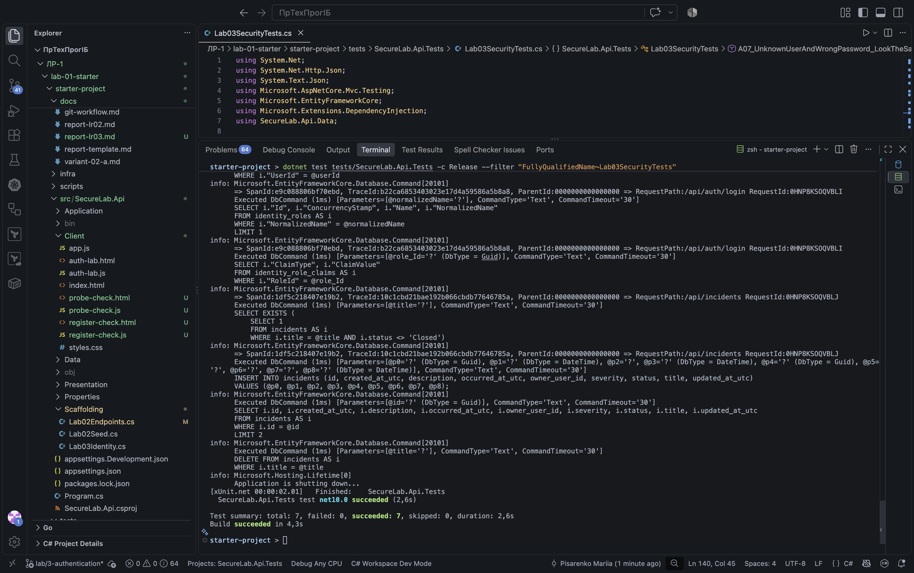                                                                                                                                                                                                                                                                                                                                                                                                                                                                                                                      |
| A-02          | достатній | login -> me                             | principal user                                         | 200, `userId` Alice, чутливих полів немає                                             | `A02_LoginThenMe_ReturnsVerifiedUser`, ,                                                                                                                                                                                                                                                                                                                                                                                                                                                                                                                                |
| A-03          | добрий    | cookie Alice і `X-Demo-UserId` Bob      | профіль Alice                                          | 200, `userId` Alice                                                                   | `A03_MeWithForeignHeader_StaysCurrentUser`, ,                                                                                                                                                                                                                                                                                                                                                                                                                                                                                                                                 |
| A-04          | добрий    | Bob створює запис без owner             | owner = Bob                                            | owner у БД = Bob                                                                      | `A04_CreateWithoutOwner_OwnerIsPrincipal`, ,                                                                                                                                                                                                                                                                                                                                                                                                                                                                                                      |
| A-05          | достатній | Bob створює запис із forged owner Alice | owner = Bob                                            | 201, owner у БД = Bob                                                                 | `A05_CreateWithForgedOwner_OwnerStaysPrincipal`, , ,                                                                                                                                                                                                                                                                                                                                                                                                                     |
| A-06          | добрий    | login -> logout -> me                   | 401                                                    | 200 -> 204 -> 401 тим самим клієнтом                                                  | `A06_Logout_ThenMe_Returns401`, , ,                                                                                                                                                                                                                                                                                                                                                                                                                                                      |
| A-07          | добрий    | unknown user і хибний пароль            | однаковий результат                                    | 401, однакові type/title/status/detail                                                | `A07_UnknownUserAndWrongPassword_LookTheSame`, ,                                                                                                                                                                                                                                                                                                                                                                                                                                                                                                                        |
| S-01          | достатній | аналіз credentials boundary             | без витоків                                            | пароля немає в робочому дереві й історії Git, response DTO і події без чутливих полів | 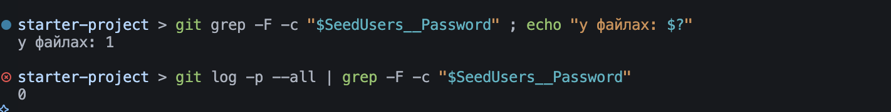, A-02, `AuthEvents_AreLogged_WithoutCredentials`                                                                                                                                                                                                                                                                                                                                                                                                                                                                                                                                                                                              |
| Duplicate     | добрий    | обраний контракт і регресія             | послідовний 409                                        | 409 однаковий для імені та email                                                      | `Register_Duplicate_Returns409_SameForNameAndEmail`, 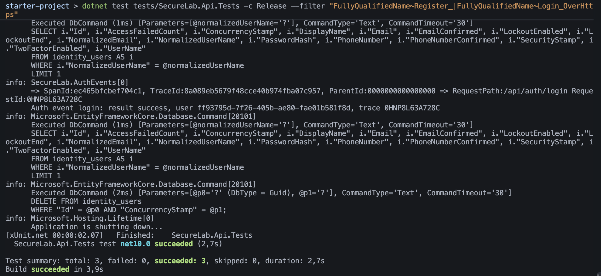                                                                                                                                                                                                                                                                                                                                                                                                                                                                                                                                                                            |
| Cookie flags  | добрий    | тест фактичних flags через HTTPS        | secure, httponly, samesite=lax                         | є всі три, немає expires/max-age                                                      | `Login_OverHttps_SetsExpectedCookieFlags`,                                                                                                                                                                                                                                                                                                                                                                                                                                                                                                                                                                                       |
| Rate limit    | добрий    | перевищення ліміту і відновлення        | 429, відновлення після вікна                           | 401×3, 429, після вікна 401, події без credentials                                    | `Login_TooManyAttempts_Returns429_ThenRecovers`, `AuthEvents_AreLogged_WithoutCredentials`, 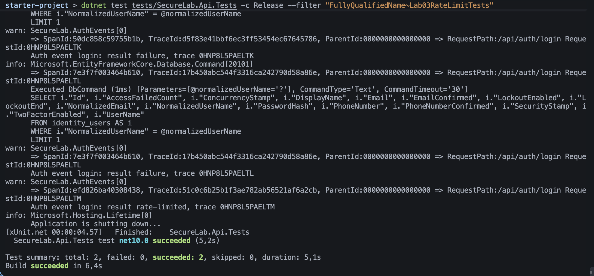, 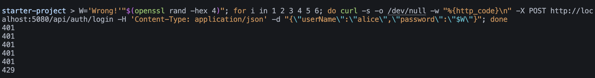                                                                                                                                                                                                                                                                                                                                                                                                                                                                  |
| Browser flow  | добрий    | п’ять спостережень етапу 4              | state/profile/create/logout                            | усі п'ять підтверджено                                                                | 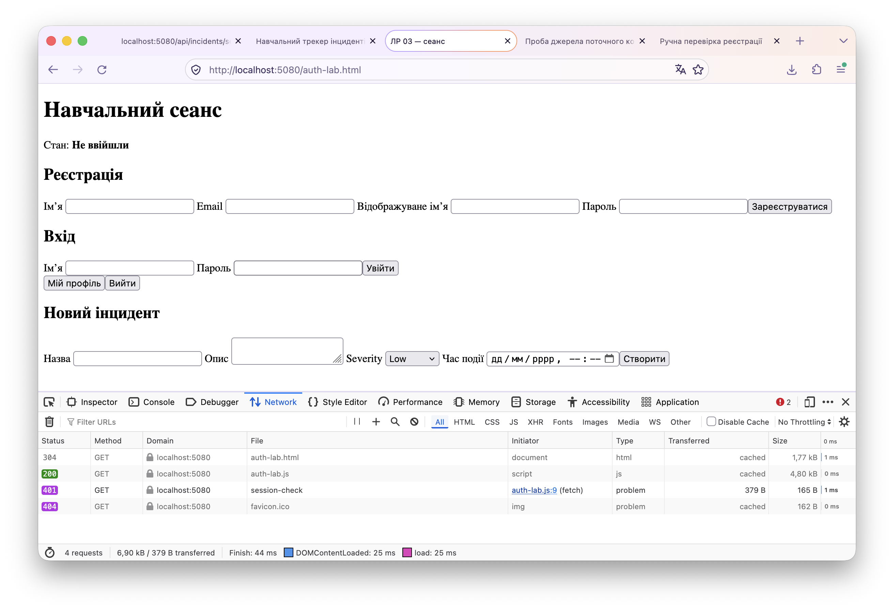, 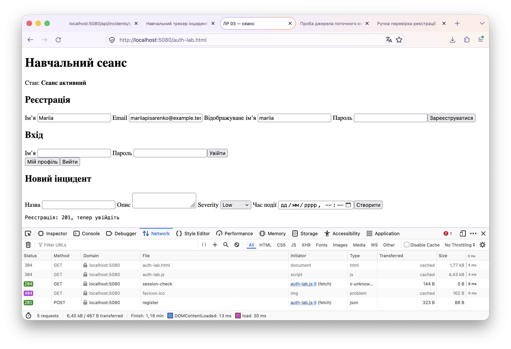, 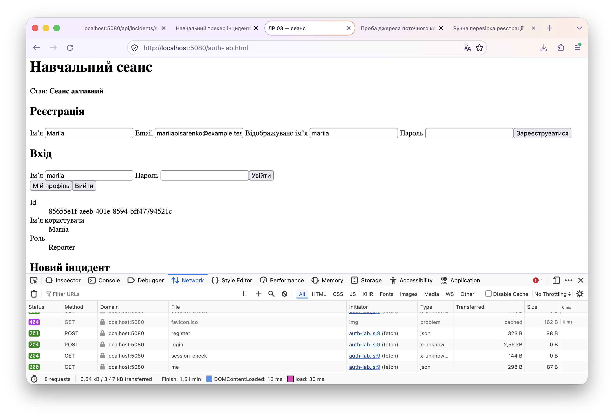, 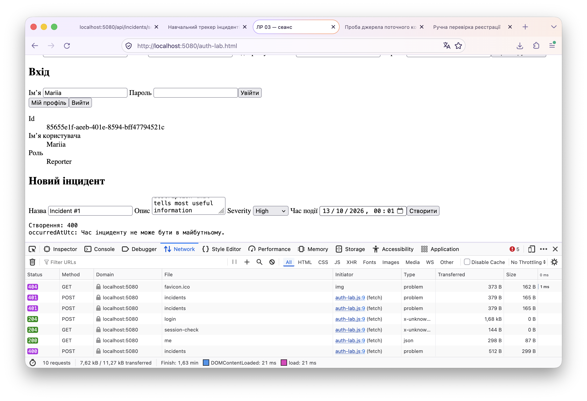, 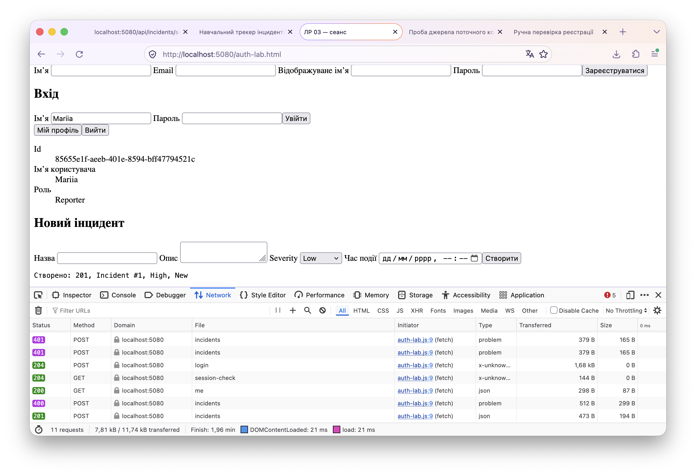, 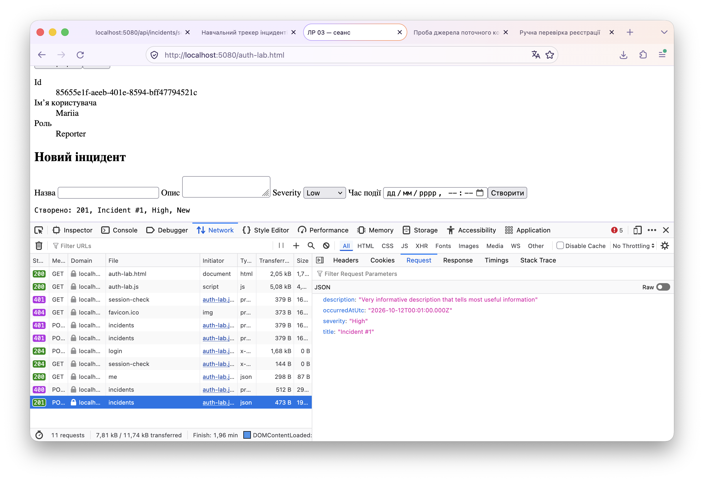, 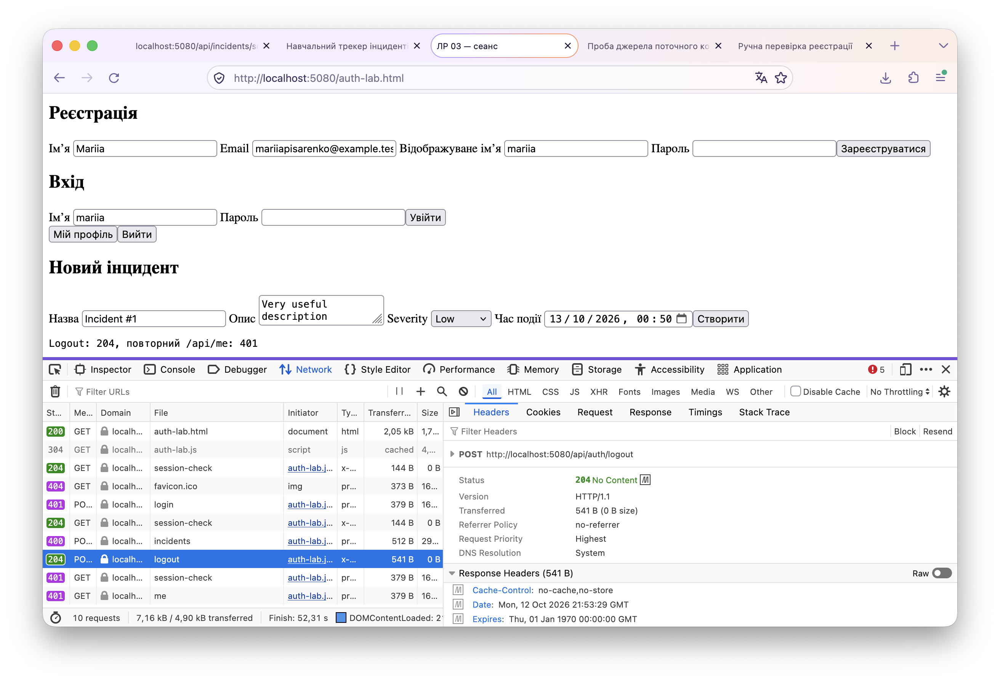, 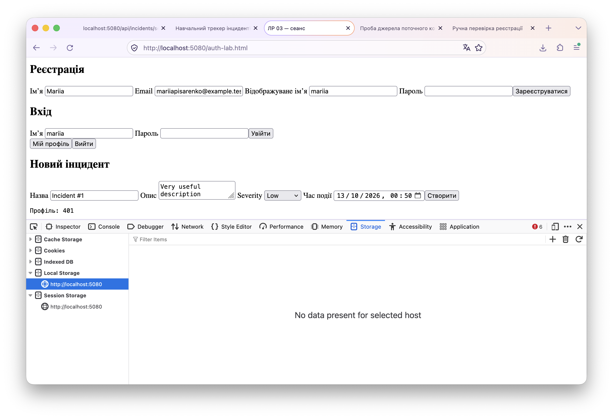, 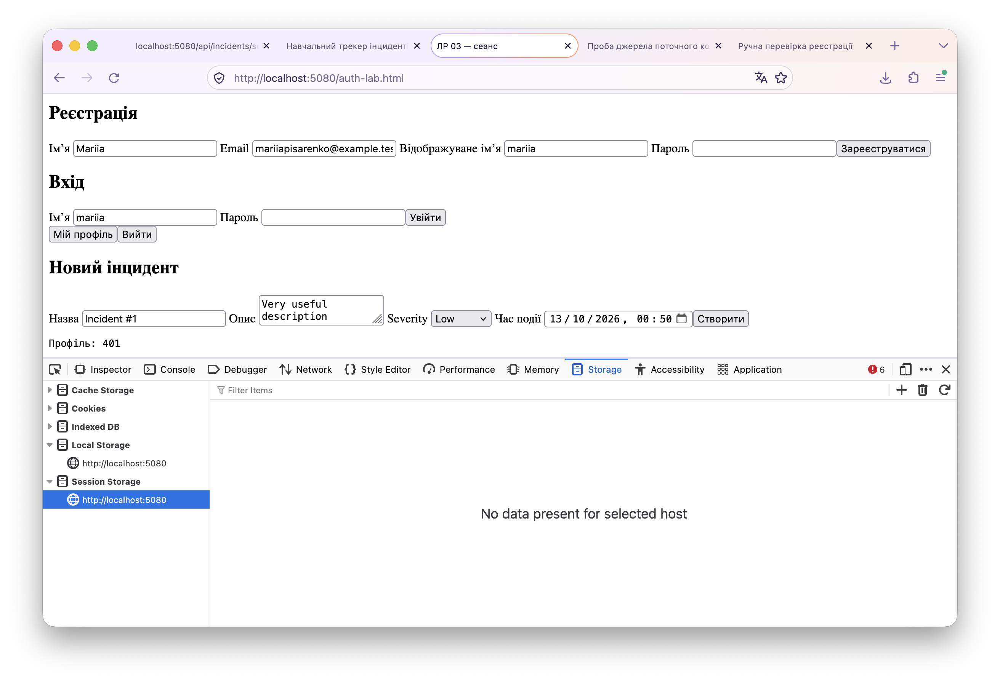 |
| Поглиблення 1 | відмінний | зміна security stamp, стара cookie      | 401 за інтервалу 0, межа 30 хвилин                     | 200 -> 401, з інтервалом 30 хв 200                                                    | `Lab03SessionRevocationTests`,                                                                                                                                                                                                                                                                                                                                                                                                                                                                                                                                                                                             |
| Поглиблення 2 | відмінний | threat analysis login flow              | активи, entry points, межі, загроза, контрзахід, ризик | розділ 9.2                                                                            | текст                                                                                                                                                                                                                                                                                                                                                                                                                                                                                                                                                                                                                                                                                                 |
| Поглиблення 3 | відмінний | `displayName` 121 символ у register     | 400 замість 500                                        | 500 -> 400                                                                            | , ,                                                                                                                                                                                                                                                                                                                                                                                                                          |

Тести `Lab03SecurityTests` після виправлення власника (7 з 7) і повний набір після рівня «Добре» (33 з 33, разом із тестами ЛР-1 і ЛР-2):

## 7. Обмеження входів і події автентифікації

Політика `login` у `Program.cs` (`AddRateLimiter`, `UseRateLimiter`, `.RequireRateLimiting("login")` на `POST /api/auth/login`): фіксоване вікно, ключ - IP-адреса клієнта, 5 спроб за 60 секунд, черги немає, відмова `429 Too Many Requests`. Значення читаються з конфігурації `LoginRateLimit:PermitLimit` і `LoginRateLimit:WindowSeconds`.

Обґрунтування ключа. Ключ за введеним ім'ям користувача дав би змогу будь-кому навмисно заблокувати вхід чужого облікового запису кількома запитами з його іменем. Ключ за IP цього не дозволяє, але об'єднує користувачів за спільним NAT і не зупиняє розподілений перебір з багатьох адрес. Для навчального застосунку з одним сервером це прийнятний компроміс. Пароль або пара email і пароль ключем не є. In-memory лічильник діє лише в межах одного процесу і не є захистом розподіленої системи.

`429` однаковий для існуючого і неіснуючого імені, тому обмеження не відкриває новий канал перебору облікових записів ([33-1-rate-limit-curl.png](evidence/lab-03/33-1-rate-limit-curl.png): п'ять `401`, потім `429`). Після завершення вікна вхід знову приймається.

У test host усі клієнти мають `RemoteIpAddress = null` і потрапляють в одну групу `unknown`. Тому `SecureLabApiFactory` для функціональних тестів піднімає ліміт до 1000, а сам ліміт перевіряє окремий host у `Lab03RateLimitTests` (3 спроби за 2 секунди): чотири швидкі спроби дають `401, 401, 401, 429`, неіснуюче ім'я теж отримує `429`, після вікна і запасу 500 мс відповідь знову `401`.

Події автентифікації пише категорія `SecureLab.AuthEvents`:

| Подія              | Рівень      | Поля                                                                       |
| ------------------ | ----------- | -------------------------------------------------------------------------- |
| успішний login     | Information | тип `login`, результат `success`, id користувача, traceId                  |
| невдалий login     | Warning     | тип `login`, результат `failure`, traceId                                  |
| перевищення ліміту | Warning     | тип `login`, результат `rate-limited`, traceId                             |
| logout             | Information | тип `logout`, результат `success`, id користувача або `anonymous`, traceId |

Час додає журнал. Навмисно виключено пароль, cookie, password hash, security stamp, token, raw заголовок `Authorization` і все тіло запиту. У невдалому вході не пишеться навіть введене ім'я: туди помилково вводять пароль, а запис імені підтверджував би в журналі, які облікові записи пробували. Тест `AuthEvents_AreLogged_WithoutCredentials` збирає всі повідомлення журналу test host і перевіряє, що події success, failure і rate-limited є, а навчального пароля, хибного пароля і введеного імені в них немає.

Cookie flags у HTTPS-сценарії. Тест `Login_OverHttps_SetsExpectedCookieFlags` надсилає login через `https://localhost` і читає лише атрибути `Set-Cookie`, значення відкидається. Є `httponly`, `secure`, `samesite=lax`, `path=/`, немає `expires` і `max-age`, отже cookie сеансова. Там само проходять тести duplicate (однаковий `409` для імені та email) і зайвих полів register (`role` Administrator і `id` ігноруються, роль `Reporter`):

Повний набір після цих змін - 33 з 33 ([31-tests-all-pass.png](evidence/lab-03/31-tests-all-pass.png)). Перед повним прогоном потрібен reset: ручні перевірки лишають записи в БД, а тест підсумку severity з ЛР-1 перевіряє саме seed-стан.

## 8. Браузерний сценарій

Наявну сторінку `Client/auth-lab.html` доповнено формою реєстрації, рядком стану сеансу, блоком профілю і формою інциденту, `auth-lab.js` переписано на ту саму модель запитів:

- усі запити йдуть через `apiFetch` лише на свій origin з `credentials: "same-origin"`, cookie додає браузер, JavaScript її не читає
- стан сеансу визначається відповіддю `GET /api/auth/session-check` (`204` - «Сеанс активний», `401` - «Не ввійшли», інше - «Невизначений»)
- профіль виводиться з `GET /api/me` лише через `textContent` і лише з дозволених полів `userId`, `userName`, `role`, відповідь `401` очищує профіль
- поле пароля очищується одразу після формування запиту, після реєстрації автоматичного входу немає
- JSON створення містить лише `title`, `description`, `severity` (текстове ім'я) та `occurredAtUtc` у форматі ISO 8601, полів owner, role, status, id немає, відмова `400` показує повідомлення валідації по полях
- після logout профіль очищується, а сторінка тим самим браузером повторює `GET /api/me`
- нічого не записується в `localStorage`, `sessionStorage` чи Console.

| №   | Спостереження                                                 | Результат                                                                                           | Доказ                                                                                                                                                                                                                                         |
| --- | ------------------------------------------------------------- | --------------------------------------------------------------------------------------------------- | --------------------------------------------------------------------------------------------------------------------------------------------------------------------------------------------------------------------------------------------- |
| 1   | до входу стан анонімний, профілю немає                        | «Не ввійшли», `session-check 401`                                                                   |                                                                                                                                                                                    |
| 2   | після login видно активний сеанс і дозволені поля             | реєстрація `201` без входу, після login «Сеанс активний», `Mariia`, `Reporter`                      | ,                                                                                                 |
| 3   | create JSON без власника дає `201`                            | `400` для часу в майбутньому з повідомленням поля, після виправлення `201`, у JSON лише чотири поля | , ,  |
| 4   | після logout профіль прибрано, повторний `/api/me` дає `401`  | `Logout: 204, повторний /api/me: 401`                                                               |                                                                                                                                                                                |
| 5   | credentials і principal не зберігаються у браузерному storage | Local Storage і Session Storage для `localhost:5080` порожні                                        | ,                                                                       |

## 9. Поглиблення

Обрано три пункти з п'яти: втрата чинності старого сеансу після серверної події, threat analysis login flow і додатковий auth defect.

### 9.1. Втрата чинності старого сеансу після зміни security stamp

Подія: `UserManager.UpdateSecurityStampAsync` для облікового запису. Саме так застосунок мав би реагувати на зміну пароля чи примусовий вихід з усіх пристроїв. Момент перевірки: `SecurityStampValidator` порівнює stamp, записаний у cookie, зі stamp у БД. За замовчуванням це відбувається не частіше ніж раз на 30 хвилин (`SecurityStampValidatorOptions.ValidationInterval`).

Критерій доказу: той самий клієнт із тією самою cookie до події отримує `200`, після події `401`, без logout і без нового login. Для перевірки використано окремий штучний акаунт з одноразовим паролем, який тест реєструє і після себе видаляє, seed-акаунти не змінюються.

`tests/SecureLab.Api.Tests/Lab03SessionRevocationTests.cs`:

| Тест                                                                 | Інтервал перевірки              | До події | Після події |
| -------------------------------------------------------------------- | ------------------------------- | -------- | ----------- |
| `StampChanged_WithZeroInterval_OldCookieReturns401`                  | 0 (перевірка на кожному запиті) | 200      | 401         |
| `StampChanged_WithDefaultInterval_OldCookieStillValidUntilNextCheck` | 30 хвилин (стандартний)         | -        | 200         |

Другий тест фіксує межу стандартного профілю: після зміни stamp раніше видана cookie діє до найближчої періодичної перевірки, тобто до 30 хвилин. Logout видаляє cookie лише в того клієнта, який його викликав, і не відкликає скопійований квиток. Зменшення інтервалу посилює відкликання ціною звернення до БД на кожному запиті, тому в робочому профілі інтервал не змінено, а зміну показано лише в test host.

### 9.2. Threat analysis login flow

- Активи: облікові записи Alice, Bob, Morgan, Admin і зареєстрованих користувачів, `PasswordHash` і `SecurityStamp` у таблиці `identity_users`, cookie `.AspNetCore.Identity.Application`, серверні ключі Data Protection, якими зашифровано cookie, інциденти та їхній власник `OwnerUserId`.
- Entry points: `POST /api/auth/register`, `POST /api/auth/login`, `POST /api/auth/logout`, `GET /api/me`, `POST /api/incidents`, сторінка `auth-lab.html`.
- Trust boundaries: браузер і сервер (усе з body, query, заголовків і форми - недовірені дані), сервер і БД (hash і stamp не виходять за межу сервера), cookie як квиток, який сервер сам видав і сам перевіряє (клієнт не може його прочитати чи підробити без серверних ключів).
- Загроза: онлайн-перебір пароля до `POST /api/auth/login` для відомого імені, наприклад `alice` (credential stuffing або словник).
- Контрзаходи: однаковий `401` для невідомого імені і хибного пароля (A-07), тож відповідь не підтверджує існування облікового запису. Обмеження 5 спроб за 60 секунд з одного IP, далі `429` однаковий для будь-якого імені. Повільний PBKDF2 (100 000 повторень) з окремою сіллю для кожного акаунта робить дорожчим і онлайн-, і офлайн-перебір після можливого витоку таблиці. Політика пароля від 10 символів з чотирма класами. Події `failure` і `rate-limited` у журналі для виявлення серії спроб, без пароля та імені.
- Залишковий ризик: розподілений перебір з багатьох IP обходить ліміт за IP. Lockout облікового запису Identity не ввімкнено (`lockoutOnFailure: false`), бо він дає змогу навмисно блокувати чужий вхід. In-memory лічильник не спільний між кількома екземплярами застосунку. Реєстрація відповідає `409` для зайнятого імені або email і лишається каналом перебору облікових записів. Стара cookie діє до 30 хвилин після зміни stamp (9.1). Немає HTTPS у локальному профілі, тому захист від перехоплення доведено лише конфігурацією і тестом через HTTPS. Для навчального застосунку з одним сервером це прийнятно, промисловий захист вимагав би ще CAPTCHA або поступової затримки, MFA та централізованого ліміту.

### 9.3. Додатковий auth defect: `displayName` понад 120 символів давав 500

Наданий register перевіряв лише наявність полів, а обмеження довжини `DisplayName` (120) було тільки в схемі БД. Значення зі 121 символу проходило `UserManager.CreateAsync` до `SaveChanges` і завершувалося `500 Internal Server Error`, тоді як 120 символів давали `201` ([14-1-register-displayname-121.png](evidence/lab-03/14-1-register-displayname-121.png), [14-2-register-displayname-120.png](evidence/lab-03/14-2-register-displayname-120.png)). Помилка 500 на вході реєстрації розкриває, що валідацію виконує лише БД, і перетворює звичайну помилку користувача на серверний збій.

Виправлення: перевірка довжини до `Trim()` для `userName`, `email` (256), `displayName` (120) і `password` (128) до звернення до Identity, відповідь `400 ValidationProblem` з ключем поля ([14-3-register-displayname-fixed.png](evidence/lab-03/14-3-register-displayname-fixed.png)). Commit `a03c8e3`.

## 10. Маршрут довіри і пояснення

Запит входу -> стандартна перевірка пароля Identity -> захищена cookie за фіксованими правилами -> автоматичне надсилання cookie браузером -> перевірка authentication handler -> claims у `HttpContext.User` -> власник ресурсу з principal.

- Перевірка пароля. `SignInManager.PasswordSignInAsync` знаходить користувача за іменем, повторює PBKDF2 з тією самою сіллю і параметрами, записаними в `PasswordHash`, і порівнює результат. Власного порівняння рядків чи хешування в коді немає. `PasswordHash` - чутливий артефакт: з нього можна запускати офлайн-перебір, тому він не входить у жоден response DTO (`RegistrationResponse`, `CurrentUserResponse`), не логується і на схемі показано лише назву стовпця.
- Cookie options встановлено в `AddLab03Identity` (`Lab03Identity.cs`, `ConfigureApplicationCookie`): `HttpOnly = true` (JavaScript сторінки не бачить cookie, [18-document-cookie.png](evidence/lab-03/18-document-cookie.png)), `SameSite = Lax` (браузер не надсилає cookie у cross-site POST, `fetch` і вбудованих запитах), `SecurePolicy = SameAsRequest` у Development і `Always` поза ним. Локальний запуск іде через `http://localhost:5080`, тому в DevTools атрибута `secure` немає ([16-login-set-cookie.png](evidence/lab-03/16-login-set-cookie.png), [17-cookie-attributes.png](evidence/lab-03/17-cookie-attributes.png)). Це не доводить і не спростовує Secure для production, тому атрибут перевірено тестом із `https://localhost` ([34-cookie-flags-test.png](evidence/lab-03/34-cookie-flags-test.png)). Строк дії не змінювався: cookie сеансова, а серверний квиток діє 14 днів із продовженням.
- Клієнтський UserId не входить до ланцюжка довіри, бо body, query, заголовок `X-Demo-UserId` чи hidden field клієнт пише довільно. Наданий `/api/me` довіряв `X-Demo-UserId` і повертав Bob без cookie ([12-2-me-header-defect.png](evidence/lab-03/12-2-me-header-defect.png)). Після змін і `/api/me`, і `POST /api/incidents` беруть id лише з `ClaimTypes.NameIdentifier` у principal, який handler сформував із зашифрованої cookie (A-03, A-05).
- CSRF-борг до ЛР 6. Cookie додається браузером автоматично, тому state-changing запити (`POST /api/incidents`, `/api/auth/logout`) потенційно можна ініціювати з чужого сайту. `SameSite=Lax` блокує надсилання cookie у cross-site POST, але не захищає від запитів із того самого site (піддомени, інший порт того самого хоста) і від GET, що змінює стан. Antiforgery token не використовується. `HttpOnly` і відсутність CORS цю проблему не закривають. Повна CSRF-модель - тема ЛР 6.
- Канали перебору облікових записів:

| Endpoint                  | Що може розкрити                             | Обраний компроміс                                                                                                                                                            |
| ------------------------- | -------------------------------------------- | ---------------------------------------------------------------------------------------------------------------------------------------------------------------------------- |
| `POST /api/auth/login`    | існування імені за різною відповіддю         | однаковий `401` і Problem Details для невідомого імені та хибного пароля (A-07), однаковий `429` після ліміту                                                                |
| `POST /api/auth/register` | `409` підтверджує, що ім'я або email зайняті | свідомо лишено заради зрозумілої відповіді користувачеві, відповідь однакова для імені та email і не уточнює поле, ліміт частоти для register не додано, це залишковий ризик |
| `GET /api/me`             | -                                            | вимагає автентифікації, повертає лише поточного користувача                                                                                                                  |
| події журналу             | -                                            | невдалий вхід не містить введеного імені                                                                                                                                     |

## 11. S-01, фінальна перевірка і висновок

S-01. Межа облікових даних перевірена з чотирьох боків:

- Git. Пошук значення навчального пароля зі змінної середовища без його виведення: `git grep -F -c` у робочому дереві збігів не знайшов (код 1), `git log -p --all | grep -F -c` по всій історії дав `0`.
- Відповіді API. `RegistrationResponse(Id, UserName, DisplayName)` і `CurrentUserResponse(UserId, UserName, Role)` не містять password, hash, security stamp, cookie чи token. Тести A-02 і `Register_Duplicate_Returns409_SameForNameAndEmail` розбирають JSON і перевіряють відсутність цих властивостей.
- Журнал. Події автентифікації не містять пароля, cookie, hash, тіла запиту і введеного імені у невдалому вході, це перевіряє `AuthEvents_AreLogged_WithoutCredentials`. Журнал SQL EF показує параметри як `'?'`.
- Звіт і кадри. Значення cookie закрито або приховано стовпцем, пароль вводився лише через `read -rs`, вкладки Request входу й заголовки з `Cookie` на кадрах не відкривались. Навчальні сторінки `register-check.*` і `probe-check.*` не додано до Git.

Фінальна перевірка на commit `b7f7da1` після `--reset-database`: 35 з 35 тестів (тести ЛР-1, ЛР-2, A-01…A-07, duplicate, зайві поля register, cookie flags, rate limit, події, відкликання сеансу):

Власний diff відносно встановленого scaffold `e049714` (11 файлів у `src` і `tests`) та історія commit-ів роботи:

Висновок. Тимчасовий навчальний контекст ЛР-2 замінено перевіреною автентифікацією на фіксованому профілі ASP.NET Core Identity, EF stores і cookie. Сервер сам визначає поточного користувача з principal, який authentication handler формує із зашифрованої cookie, тому `/api/me` і створення інциденту більше не залежать від `X-Demo-UserId` чи поля `ownerUserId` у JSON. Реєстрація має межу DTO і безпечні відповіді, login не розрізняє невідоме ім'я і хибний пароль, logout виконує серверний sign-out, спроби входу обмежено, події автентифікації не містять облікових даних.

## 12. Декларація використання ШІ

| Сервіс                  | Задачі                                                                                                                                                                                 | Авторська адаптація/інтерпретація                                                                                                                                                                                                                                                                                                    | Фактична перевірка                                                                                                                                                                                                                                                                                                                              |
| ----------------------- | -------------------------------------------------------------------------------------------------------------------------------------------------------------------------------------- | ------------------------------------------------------------------------------------------------------------------------------------------------------------------------------------------------------------------------------------------------------------------------------------------------------------------------------------ | ----------------------------------------------------------------------------------------------------------------------------------------------------------------------------------------------------------------------------------------------------------------------------------------------------------------------------------------------- |
| Claude Code (Anthropic) | покроковий план за методичкою, підказки для коду валідації реєстрації, `/api/me`, logout, захисту створення, обмеження входів, подій, браузерної сторінки й автотестів, чернетка звіту | код створено за підказками ШІ й перевірено власноруч, сценарії `.http`, `curl` і браузерні перевірки виконано самостійно, контракт duplicate (`409`), ключ і вікно ліміту, склад полів події та поглиблення обрано й обґрунтовано самостійно, дефект `displayName` (500 для 121 символу) підтверджено власним запитом до виправлення | кожен сценарій виконано вручну через `.http`, `curl` і DevTools з фотофіксацією відповіді, 35 автотестів пройдено після reset на останньому коді, тести A-04 і A-05 перевірено на здатність виявити дефект: на commit зі сталим власником Alice вони впали, після переходу на principal пройшли, пароль і значення cookie до ШІ не передавались |
