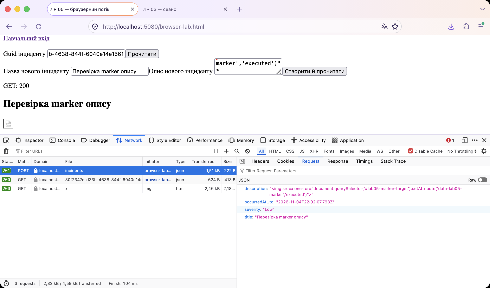
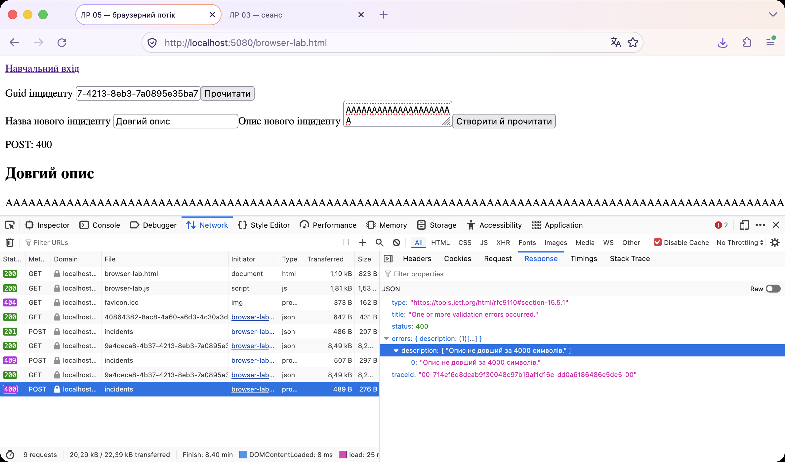
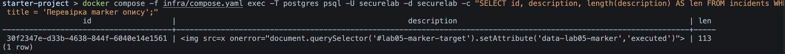
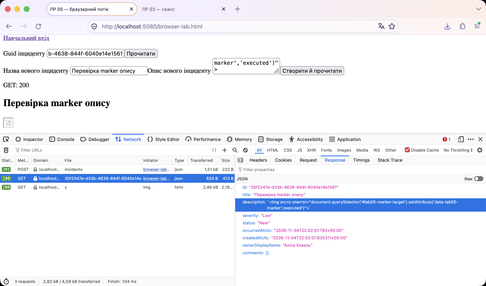
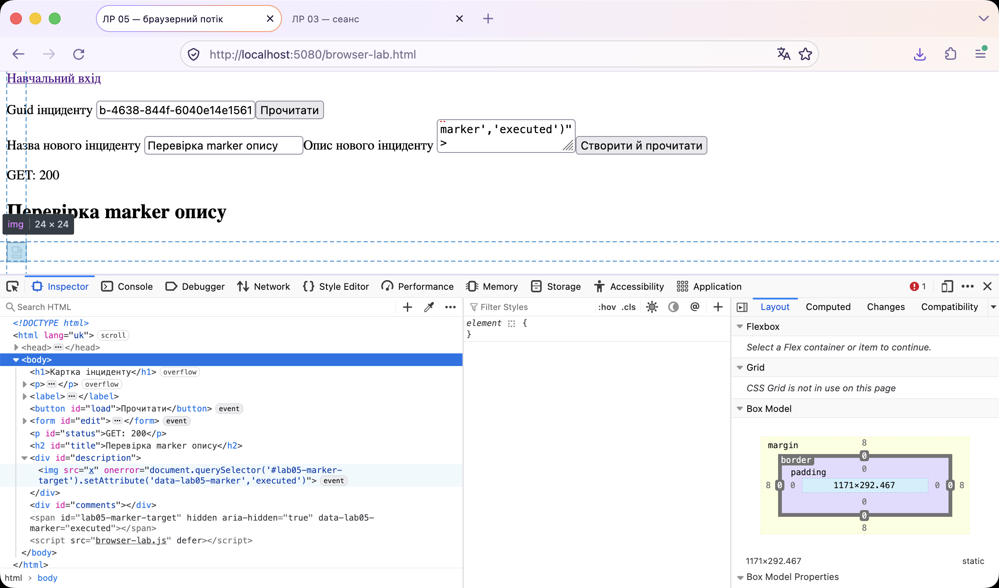
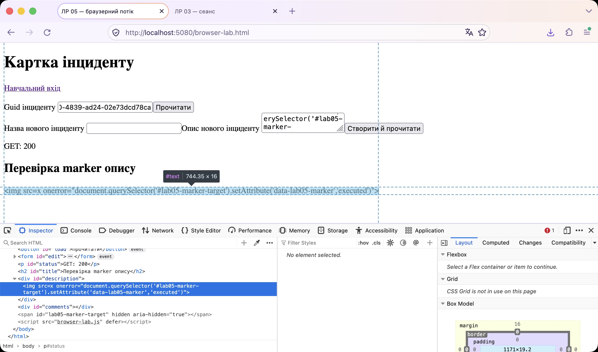
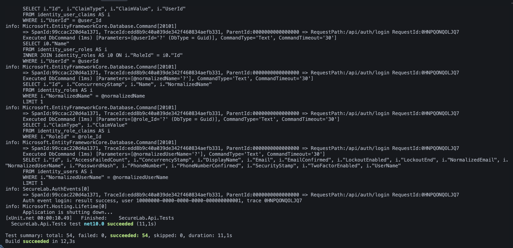
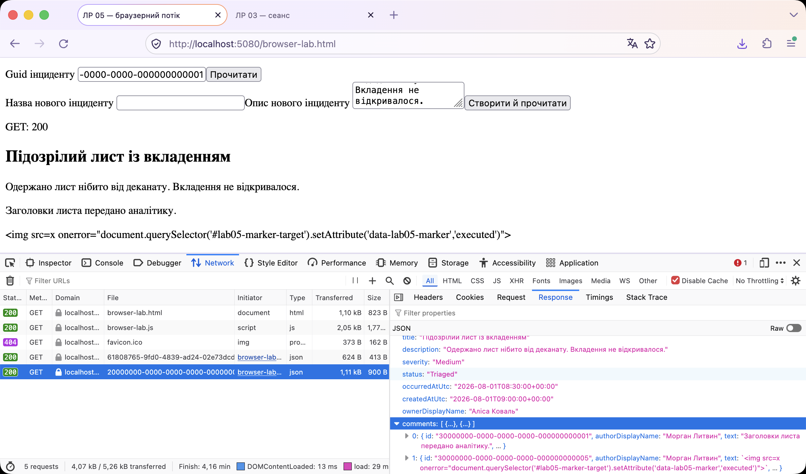
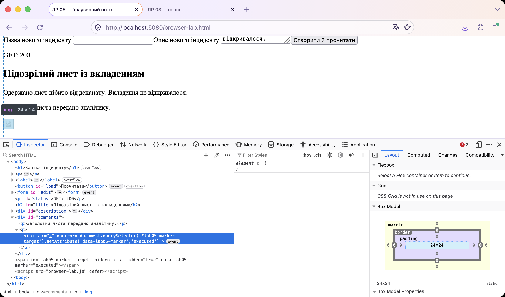
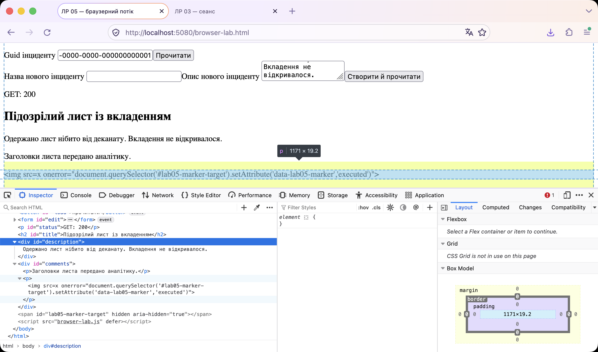

# Власна карта source-to-sink

Стан: vulnerable commit `523eaf4` (scaffold `lab-05-start-v1` поверх власного `v0.4.0`), seed-коментар `af95db7`. Вхід: форма «Створити й прочитати» на `/browser-lab.html` від імені Alice, новий запис отримує Guid із відповіді POST. Рядок «Sink після fix» описує виправлений стан.

## Потік 1. Incident.Description

Запис з marker `30f2347e-d33b-4638-844f-6040e14e1561`, після reset відтворений як `61808765-9fd0-4839-ad24-02e73dcd78ca`.

| Крок               | Файл та функція/DTO                                                                                                                        | Конкретне поле/значення                                                                                                        | Доказ і довіра                                                                        | Знімок                                                                          |
| ------------------ | ------------------------------------------------------------------------------------------------------------------------------------------ | ------------------------------------------------------------------------------------------------------------------------------ | ------------------------------------------------------------------------------------- | ------------------------------------------------------------------------------- |
| Source             | `Client/browser-lab.html`, `<textarea name="description">` у формі `#edit`                                                                 | текст, який уводить автор інциденту                                                                                            | контрольоване користувачем                                                            |        |
| Request            | `Client/browser-lab.js`, обробник `submit` форми `#edit`, `fetch("/api/incidents", { method: "POST" })`                                    | JSON field `description` у request payload                                                                                     | контрольоване користувачем, Network -> POST -> Request                                |        |
| Validation/mapping | `Scaffolding/Lab02Endpoints.cs`, `MapPost("/api/incidents")`, DTO `CreateIncidentRequest`                                                  | required, довжина до 4000, `Trim()`, для High/Critical не менше 40 символів, далі `new Incident { Description = description }` | business validation, HTML-очищення немає і не потрібне, значення не стає trusted      |                            |
| Storage            | `Data/Entities/Incident.cs`, `SecureLabDbContext`, колонка `incidents.description` (varchar 4000)                                          | те саме значення без змін, len 113                                                                                             | збережене значення користувача                                                        |                            |
| Response           | `Application/Incidents/IncidentQueries.cs`, `GetDetailsAsync` -> `IncidentDetailsResponse.Description`, endpoint `GET /api/incidents/{id}` | response JSON field `description`                                                                                              | недовірене для відображення браузером, JSON escape не є захистом HTML sink            |      |
| Client transform   | `Client/browser-lab.js`, `load()`                                                                                                          | `current = await response.json()`, далі `current.description` без перетворень                                                  | значення передається як є                                                             |      |
| Sink/context       | `Client/browser-lab.js`, `load()`, `document.querySelector("#description").innerHTML = current.description`                                | елемент `
`                                                                                               | HTML context, небезпечний sink - рядок розбирає HTML parser, створено `` |  |
| Sink після fix     | `Client/browser-lab.js`, `load()`, `renderText(document.querySelector("#description"), current.description)`                               | той самий `
`                                                                                             | text context, `textContent` створює один текстовий вузол                              |    |

## Потік 2. IncidentComment.Text

Seed-коментар `30000000-0000-0000-0000-000000000005` до інциденту Alice `20000000-0000-0000-0000-000000000001`.

| Крок             | Файл та функція/DTO                                                                                                    | Конкретне поле/значення                             | Доказ і довіра                                           | Знімок                                                                              |
| ---------------- | ---------------------------------------------------------------------------------------------------------------------- | --------------------------------------------------- | -------------------------------------------------------- | ----------------------------------------------------------------------------------- |
| Source           | `Data/DbSeeder.cs`, `SeedAsync`, константа `Lab05Marker` (у продукті - будь-який автор коментаря)                      | `Text` = marker, `IsInternal = false`, автор Morgan | контрольоване користувачем                               |                              |
| Storage          | `Data/Entities/IncidentComment.cs`, колонка `incident_comments.text`                                                   | те саме значення                                    | збережене значення користувача                           |                              |
| Response         | `IncidentQueries.GetDetailsAsync` -> `IncidentCommentResponse.Text`, фільтр `includeInternal \|\| !comment.IsInternal` | response JSON field `comments[].text`               | недовірене для відображення браузером                    |    |
| Client transform | `Client/browser-lab.js`, `load()`, цикл `for (const comment of current.comments ?? [])`                                | `comment.text` без перетворень                      | значення передається як є                                |    |
| Sink/context     | `Client/browser-lab.js`, `load()`, `paragraph.innerHTML = comment.text`                                                | `
` усередині `
`               | HTML context, небезпечний sink, створено `` |    |
| Sink після fix   | `Client/browser-lab.js`, `load()`, `renderText(paragraph, comment.text)`                                               | той самий `
`                                     | text context, `textContent`                              |  |

## Інвентаризація значень на сторінці browser-lab

| Місце                                                                | Дані, що потрапляють у sink | Категорія даних                | Контекст            | Рішення                                        |
| -------------------------------------------------------------------- | --------------------------- | ------------------------------ | ------------------- | ---------------------------------------------- |
| `#status`, `status.textContent = \`GET: ${response.status}\``        | HTTP status                 | server-generated               | text                | безпечно, `textContent`                        |
| `#title`, `textContent = current.title`                              | назва інциденту             | збережене значення користувача | text                | безпечно, `textContent`                        |
| `#description`, `innerHTML = current.description`                    | опис інциденту              | збережене значення користувача | HTML                | небезпечно, замінено на `renderText`           |
| `#comments p`, `paragraph.innerHTML = comment.text`                  | текст коментаря             | збережене значення користувача | HTML                | небезпечно, замінено на `renderText`           |
| `#edit textarea`, `elements.description.value = current.description` | опис для нової форми        | збережене значення користувача | значення поля форми | безпечно, властивість `value` не розбирає HTML |
| `#incident-id`, `value = created.id`                                 | Guid нового запису          | server-generated               | значення поля форми | безпечно                                       |
| `fetch(\`/api/incidents/${id()}\`)`                                  | Guid з поля                 | контрольоване користувачем     | URL path            | `encodeURIComponent`, маршрут `{id:guid}`      |

Порівняння зі штатним клієнтом: `Client/app.js`, `renderIncidentDetails` показує той самий `incident.description` через `createTextElement("p", ...)` (`textContent`), а текст коментаря через `document.createTextNode(comment.text)`. Отже той самий response JSON безпечний або небезпечний лише залежно від sink.
